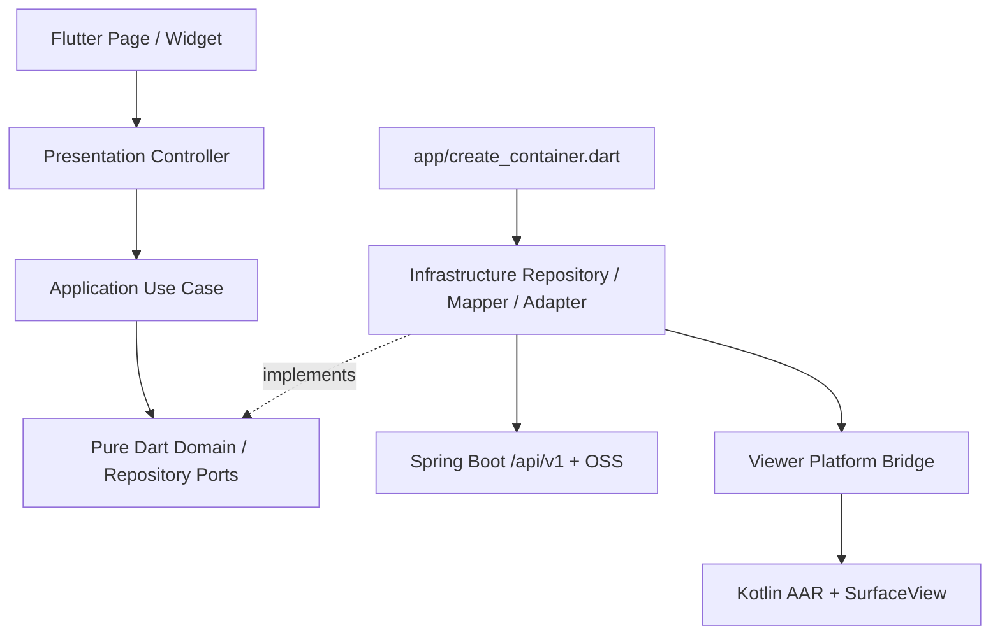

# 产品范围与 Flutter DDD 架构

2026-10-19。P0 Flutter 开发工程与本地原生插件已开始落地，证据见 [P0 验证记录](verification/p0.md)；下述五个业务 BC 与正式产品导航仍为后续设计，尚未实现。依据：根工程手册、web2 AGENTS/WEB2_FRONTEND、现有 Controller/DTO、发布 SDK 实物。

## 1. 复用什么

XJICloud 是 3DGS 数据上传、云端训练、模型资产管理和查看平台。Web2 的 Identity、Project、Dataset-training、Model-asset、Viewer 五个 BC 可迁移；Editor 不迁移。复用的是后端接口、领域语义、视觉语言与测试场景，不是跨语言直接 import Vue/TypeScript。

Worker 当前仍是 mock 训练。移动客户端不能把真实训练效果当作已实现；训练产物与工程 ModelAsset 也不是同一资源。

| 能力 | 首版处理 |
|---|---|
| 主页 | 最近工程、当前工程、真实加载的工程概览与快捷操作 |
| 工程管理 | 列表、创建、改名/描述、删除、当前工程、工程内模型与任务 |
| 上传 | 图片数据集训练；另一个类型为工程 PLY/SPZ 资产上传 |
| 训练 | 查看/订阅、取消、终态删除、产物下载/本地打开 |
| 模型查看 | 本机文件、当前工程模型、单模型只读原生查看 |
| 我的 | 会话账号、语言、缓存、帮助、退出 |
| 航线/高级编辑/搜索索引/双屏 | 不注册路由，不展示入口 |

## 2. 技术选择与替代方案

推荐 Flutter + Kotlin AAR + PlatformView/SurfaceView。它复用 SDK 的解码隔离 Service、请求事务和相机；SDK 不处理网络，模型由资产仓储鉴权下载到私有文件后提供本地 URI。

| 接入方式 | 收益 | 成本/决策 |
|---|---|---|
| AAR + Flutter PlatformView | 直接复用 Kotlin API 和 Surface 生命周期；UI 可内嵌 | 推荐，首先实测混合合成、Flutter 浮层与触控 |
| C ABI + Dart FFI + 自建渲染输出 | 更直接控制 native 接口 | 仍需 Surface/FD/Service 适配；无现成 Flutter Texture 输出，首版成本更高 |
| Flutter 跳转原生 Activity | Surface 宿主简单 | 分离路由/工具栏/返回与状态；仅作为内嵌验证失败后的评审选项 |

状态管理建议先用 Flutter SDK 的 `ChangeNotifier`/`Listenable` 薄 controller；Domain 不依赖它。路由选 `go_router`，HTTP 选 `dio`，安全会话用 `flutter_secure_storage`，非敏感偏好用 `shared_preferences`，缓存位置用 `path_provider`；系统文件选择在独立 port 后。首版不增加 Riverpod/BLoC/GetX 或代码生成流水线。所有第三方包在建工程时解析兼容版本并提交 lockfile；这里不虚构已验证版本。

## 3. 四层与组合根



外层依赖内层。页面用组合根注入的 controller，不 new 仓库。跨 BC 仅在 Application 编排，禁止导入其他 BC 的 Infrastructure。主页与“我的”是组合页面，不为页面名新增领域。

建议目录（创建工程时才落地）：

```text
apps/android/
  lib/
    main.dart
    app/{app.dart,create_container.dart,app_container.dart,router.dart,session_coordinator.dart}
    shared/{domain/{result.dart,domain_error.dart},infrastructure/,presentation/,l10n/}
    presentation/{shell/,theme/,widgets/,pages/my_page.dart}
    features/
      identity/{domain/,application/,infrastructure/,presentation/}
      project/{domain/,application/,infrastructure/,presentation/}
      dataset_training/{domain/,application/,infrastructure/,presentation/}
      model_asset/{domain/,application/,infrastructure/,presentation/}
      viewer/{domain/,application/,infrastructure/,presentation/}
  packages/native3dgs_flutter/       # 本地插件，无对网络/鉴权的知识
    lib/{native3dgs_view.dart,src/}
    android/src/main/kotlin/com/xjicloud/native3dgs/
  android/                         # Flutter Android 宿主，非另一个客户端
  ios/                             # 有 macOS/iOS 渲染条件后创建和验证
  test/{architecture/,features/,presentation/}
  integration_test/
```

Domain error 用稳定码，Infrastructure 将 HTTP/SDK 错误归一化；用户文案用中英文 l10n。sealed `Success<T>`/`Failure<T>` 保留“失败/无数据/空列表”区别，不能将鉴权错误映射为空工程列表。

## 4. BC 契约与不变量

| BC | 实体/VO | Port | 核心用例与规则 |
|---|---|---|---|
| Identity | UserSession、CaptchaChallenge | AuthRepository、SessionStore | 登录/注册/验证码；按 JWT exp 到期；401 统一清会话，不发明刷新 token |
| Project | Project、RecentProject、ProjectId | ProjectRepository、WorkspacePersistence | load/create/update/delete/open；账号隔离、最近最多 5；删当前工程清 workspace |
| Dataset-training | TrainingJob、DatasetManifest、SelectedImage | TrainingJobRepository、JobEventPort、ObjectStoragePort、UploadCheckpointPort | prepare/submit/resume/watch/cancel/delete；过滤格式、稳定排序、四位归档；服务端状态与本地暂停分开 |
| Model-asset | ModelAsset、ModelRevision、UploadSession、LocalModelRef | ModelAssetRepository、ModelCachePort、LocalFilePort | 模型列表/顺序分片上传/下载/删缓存；2GB 是协议上限，不是设备可渲染保证 |
| Viewer | ModelSource、ViewerCapabilities | ModelSourcePort、ViewerEnginePort | open/cancel/close/相机；一活动场景，候选失败保留旧模型，旧请求不能覆盖新请求 |

`ModelSource` 只描述资源身份，不持有 Android Uri/Dart File。URI、HTTP DTO、StateFlow、SurfaceGeneration 留在 adapter；Viewer Application 可持有宿主 sessionId/request token，原生值通过映射的状态提供诊断，不扩散 SDK 类。

Provider 返回的文件可能不可 seek、无真实路径、来自云盘。选取层必须通过流/FD 或受控临时副本读取；不将 content URI 当路径。数据集的图片先建立元数据与流句柄，不一次读全量内存。持久授权不支持/失效时让用户重选，不能承诺任意来源进程重启续传。

## 5. 生命周期与一致性

- 登录成功加载该账号 workspace；登出清安全 token、当前工程、传输和 SSE/Viewer 会话。最近工程可保留但按 userId 隔离。账号缓存目录隔离，登出后不能被下一个账号浏览。
- 401 或 exp 到期只触发一次 session coordinator；取消传输、关闭 SSE、失效旧回调、关闭 viewer，返回登录。API 故障/断网不直接当成 401。
- 上传固定绑定开始时的 userId/projectId，过程中切换当前工程不改变任务归属。删除含活动上传的工程先停止本地传输并确认；失败显示后端原意，不假成功。
- inactive 可能只是系统选择器/权限框遮挡；进入 paused/hidden 才暂停网络发送。返回 resumed 查询任务/分片会话，不能直接重建任务。首版不启前台服务/后台上传。
- SSE 是前台通知通道，无初始快照或重放保证。回前台 GET 当前状态并启动订阅；即使 SSE 健康仍每 15 秒 GET 校正，连接失败改为可取消的 5 秒轮询，后台停止。用会话代际和本地观察序号防止迟到 GET 覆盖已收到的更新；收到 COMPLETED/FAILED 后再 GET 完整 JobResponse（SSE 没有产物链接/详细错误）才停止观察。CANCELLED 关闭 SSE 但在页面仍有订阅者且前台时保留 15 秒快照校正，允许 Worker 后续回写 RUNNING/COMPLETED。任务页与主页共享按 jobId 去重的 watcher。
- 训练已入队后 App 退出不影响服务端。取消 RUNNING 不保证立刻中断 Worker，后端仍可能回写完成；UI 必须重新读取实际状态。
- 缓存按 userId/modelId/updatedAt/sizeBytes 建修订键；`.part` 成功后原子改名，落盘大小校验、取消清理、磁盘配额/LRU；正在被 viewer/上传使用的文件有 lease，不被清理。
- 云端 viewer-config 旧视角缺少坐标元数据，首版自动取景，不套未知姿态，不覆写服务端配置。

## 6. iOS 演进

保留同样的五个 BC、仓库、响应式布局与 Result；替换系统文件/安全存储/渲染实现。`ViewerCapabilities` 明确不支持的能力，不能用空方法冒充成功。没有 iOS 引擎时显示不支持说明，不提供假画布。Windows 可写共享 Dart 和文档，但 iOS 编译、签名、Metal/原生渲染和真机验收必须在 macOS/Xcode 完成。

## 7. 质量门槛

Domain 不变量单测 → 用例端口集成测试 → DTO fixture 契约测试 → Phone/Pad Widget 与布局测试 → Android 设备完整用户路径。架构测试扫描 Dart import，Domain 禁 framework/IO，Presentation 禁 infra/DTO/通道，禁止跨 BC infra 和第二组合根。原生 Surface/触控/内存/热态只能设备验证。
