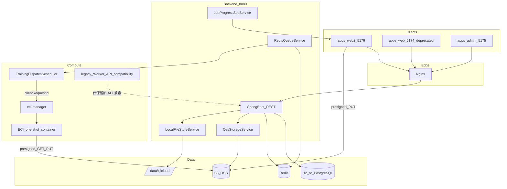

# XJICloud — Agent 上下文记忆文档

> 供 Cursor / 其他 AI Agent 快速理解本仓库的结构、已实现功能、扩展点与约束。  
> 用户面向文档见 [../README.md](../README.md)；部署见 [Deploy.md](Deploy.md)。

**最后更新：** 2026-09-02（**当前用户前端是 `apps/web2`**；`apps/web` 已弃用。见 [WEB2_FRONTEND.md](./WEB2_FRONTEND.md)）

**Agent 硬门槛（先读再改）：** [TEAM_ENGINEERING.md](./TEAM_ENGINEERING.md) — 编程规则、强制功能验证、强制 Code Review。根目录 [AGENTS.md](../AGENTS.md) 是入口。未验证、未审查的生成代码视为未完成。

---

## 1. 项目是什么

**XJICloud** 是一套 **3D Gaussian Splatting（3DGS）建模解决方案云平台**：

- 用户通过 Web 上传图片数据集 → 触发 GPU 算力容器训练（当前为 **mock 算法**）→ 下载产出模型（PLY）
- 用户上传 / 管理 **PLY/SPZ** 模型，用 **Spark 2.0** 查看标注，用 **SuperSplat** iframe 做高级编辑
- 管理员通过独立 **Vue Admin 面板** 配置 OSS、监控 Worker 与训练任务

技术栈：**Vue 3.5 + Vite + pnpm workspace**（当前用户端为 `apps/web2`，前端 DDD，无 Pinia 作为业务源）；**Spring Boot 3.3 + Java 17**（后端）、**Redis**（任务队列）、**S3 兼容 OSS**（MinIO / 阿里云 OSS）、**Python GPU Worker 容器**（Alibaba Cloud Linux 3）、**Rust/WASM**（浏览器端 Spark）。

**桌面端（Electron/Tauri）已移除**，仅保留 Web。

---

## 2. 仓库结构（Monorepo）

```
XJICloud/
├── apps/web2/                # 当前用户前端 @xjicloud/web2（:5176，DDD）
├── apps/web/                 # 已弃用：旧用户前端 @xjicloud/web（:5174）
├── apps/admin/               # 管理前端 @xjicloud/admin（:5175，base /admin/）
├── packages/spark/           # Spark 2.0 TS 渲染库 @xjicloud/spark
├── packages/shared/          # 共享 ApiResponse / ApiError
├── services/backend/         # Spring Boot（:8080）
├── services/gpu-worker/      # legacy Worker 源码留存；不由活动部署构建或启动
├── rust/                     # spark-rs、spark-worker-rs WASM
├── vendors/supersplat/       # SuperSplat 预编译静态资源
├── deploy/                   # Compose、Nginx、systemd、K8s
├── docs/                     # AGENT_CONTEXT、TEAM_ENGINEERING、Deploy、WEB2_FRONTEND
├── AGENTS.md                 # Agent 入口（强制验证与 Review）
├── scripts/                  # copy-supersplat-dist 等
├── package.json              # pnpm workspace 根编排
└── pnpm-workspace.yaml
```

---

## 3. 系统架构



### 3.1 双存储策略（重要）

| 数据类型 | 存储 | 服务类 |
|----------|------|--------|
| PLY/SPZ 模型、viewer.json | **本地磁盘** `{xjicloud.storage.root}` | `LocalFileStoreService` |
| 图片数据集、训练产出 model.ply | **OSS**（浏览器/ECI one-shot 容器直传） | `OssStorageService` |
| 元数据（用户、项目、任务、Worker） | **H2（dev）/ PostgreSQL（prod）** | JPA 实体 |

**不要**在未规划的情况下把 PLY/SPZ 模型迁移到 OSS，会破坏 Spark/SuperSplat 现有下载/Range 逻辑。

### 3.2 三套 JWT 身份

| 角色 | claim `type` | Filter | 用途 |
|------|--------------|--------|------|
| 用户 | `user` | `JwtAuthenticationFilter` | 普通云平台 API |
| 管理员 | `admin` | `AdminJwtAuthenticationFilter` | `/api/v1/admin/**` |
| Worker | `worker` | `WorkerJwtAuthenticationFilter` | `/api/v1/worker/**`（register 除外） |

Worker 注册额外需要请求头：`X-Worker-Secret`，与 `xjicloud.worker.shared-secret` 一致。

用户 JWT 有效期 **7 天**。过期后前端清会话并回到登录页。最近项目按账号存在浏览器本地，登出不清空。

---

## 4. 训练流水线（图片 → 模型）

用户侧「数据上传」主流程：上传**含有建模素材的图片文件夹**，浏览器端归档后直传 OSS，再入队由 GPU 算力容器处理。

**「归档打包」含义（重要）：**
- **不是** zip/tar 压缩包
- **是** 浏览器端逻辑归档：`datasetArchive.ts` 过滤 JPG/PNG/WebP → 按 `webkitRelativePath` 排序 → 4 位序列重命名（`0001.jpg`…）→ 生成 `manifest.json` → 逐文件 presigned PUT 到 OSS

前端归档器会筛选 JPG/PNG/WebP；目前真云训练路径仅有 JPG/JPEG 验证证据，不据此承诺 PNG/WebP 可用。其他格式仍是真云路径待确认项。

```
1. 用户选择文件夹（webkitdirectory，须先打开项目）
   → src/utils/datasetArchive.ts 过滤 jpg/png/webp，重命名为 0001.jpg…
   → 生成 manifest.json（version/imageCount/files[]：archivedName、originalName、contentType、sizeBytes）

2. POST /api/v1/projects/{id}/datasets
   → 后端创建 TrainingJob(status=UPLOADING)，返回 presigned PUT URL 列表

3. 浏览器直传 OSS（src/api/datasets.ts putToOss，XHR 进度）
   → datasets/{jobId}/images/{archivedName} + datasets/{jobId}/manifest.json

4. POST /api/v1/projects/{id}/datasets/{jobId}/complete
   → status=QUEUED，RPUSH 写入 Redis 待派发队列 xjicloud:jobs

5. 主 backend 的 TrainingDispatchScheduler 消费 Redis 并 POST eci-manager `/api/v1/eci/tasks`
   → 使用本 attempt 稳定的 `clientRequestId`、`storage.mode=keys` 和配置项 `XJICLOUD_ECI_MANAGER_TRAINING_IMAGE` 指向的已上传 3DGS 镜像
   → 请求使用 `/opt/3dgs/docker/entrypoint.sh` + `shell` + base64 bootstrap；资源为 16 CPU / 60 GiB / 1 GPU、`gn7i-c16g1.4xlarge`、`shm=8Gi`、`maxRuntime=21600` 秒
   → bootstrap 来源为 `eci-manager/scripts/3dgs-bootstrap.py`，backend classpath snapshot 位于 `services/backend/src/main/resources/3dgs-bootstrap.py`；源文件修改须同步 snapshot，并由测试验证字节一致
   → eci-manager 为输入/输出签发 URL，容器下载图片、运行训练、上传 `output.ply` 后退出；不回调 backend

6. backend 轮询已绑定的 ECI task，将 RUNNING 和终态投影到 TrainingJob/SSE
   → 用户 GET /api/v1/jobs/{id}/events 接收粗状态
   → COMPLETED 后 GET /api/v1/jobs/{id} 拿 presigned 下载 URL
```

ECI 派发失败或配置缺失时，backend 将 `dispatch_next_attempt_at` 持久化为 30 秒后的重试时间；恢复扫描和实际 claim 都受该时间约束。取消中的任务若 ECI task ID 尚未绑定，也会沿同一退避与恢复路径收敛。

调度责任留在主 backend：链路为用户上传 → Redis → 主 backend `TrainingDispatchScheduler` → eci-manager → ECI。真云 ECI OSS 预签名 URL 有效期须配置为至少 1440 分钟，以覆盖最长 21600 秒任务和余量。独立 3DGS 标准任务样例见 [`eci-manager/scripts/submit-3dgs-standard.sh`](../eci-manager/scripts/submit-3dgs-standard.sh)，不改变上述应用派发链路。

**与 PLY/SPZ 模型上传的区别：** 图片数据集走 OSS + 训练队列；PLY/SPZ 走 `/projects/{id}/models/upload` 存本地盘，供查看器加载，**不是**训练输入。

**Job 状态枚举：** `PENDING | UPLOADING | QUEUED | RUNNING | COMPLETED | FAILED | CANCELLED`

---

## 5. 后端包结构（`com.xjicloud.*`）

| 包 | 职责 |
|----|------|
| `auth/` | 用户注册登录、JWT |
| `project/` | 工程项目 CRUD |
| `model/` | PLY/SPZ 本地上传下载、viewer-config、export |
| `job/` | 训练任务、数据集 API、`TrainingJobService` |
| `worker/` | legacy Worker 注册/心跳；旧队列领取与进度/完成/失败回调已停用 |
| `admin/` | 管理员账户、Admin API |
| `oss/` | S3 兼容存储、presigned URL、DB 热更新配置 |
| `queue/` | Redis 列表队列 |
| `sse/` | `JobProgressSseService`（SseEmitter） |
| `config/` | Security、Redis、各 Properties |

**入口：** `services/backend/src/main/java/com/xjicloud/XjiCloudApplication.java`（`@EnableScheduling`）

**配置：** `services/backend/src/main/resources/application.yml`  
关键前缀：`xjicloud.jwt` / `storage` / `oss` / `worker` / `eci-manager` / `admin` / `cors`

**OSS 运行时配置：** 默认读 yml，管理员可通过 Admin API 写入 `system_config` 表并 `reloadClients()`。

---

## 6. REST API 速查

前缀 `/api/v1`。统一响应：`{ success, message, data }`。

### 6.1 用户（Bearer 用户 JWT）

| 方法 | 路径 | 说明 |
|------|------|------|
| POST | `/auth/register`, `/auth/login` | 公开 |
| GET/POST | `/projects` | 项目 |
| GET | `/projects/{id}/models` | 模型列表 |
| POST | `/projects/{id}/models/upload` | multipart PLY/SPZ → 本地盘（兼容旧客户端） |
| POST | `/projects/{id}/models/upload-sessions` | 创建分片上传会话 |
| GET | `/models/upload-sessions/{sessionId}` | 查询已收字节（续传） |
| PUT | `/models/upload-sessions/{sessionId}/chunks` | `Content-Range` 原始分片写入本地盘；已写入范围重放会读完请求体后直接返回，避免连接被重置 |
| POST | `/models/upload-sessions/{sessionId}/complete` | 收齐后入库为 ModelAsset；可重复调用（幂等） |
| DELETE | `/models/upload-sessions/{sessionId}` | 取消未完成上传 |
| DELETE | `/models/{id}` | 删除模型记录、viewer 配置与磁盘目录 |
| POST | `/models/{id}/download-token` | SuperSplat 短期下载 token |
| GET | `/models/{id}/download` | 下载（Bearer 或 `?access_token=`，支持 Range） |
| GET/PUT | `/models/{id}/viewer-config` | 查看器 JSON v2 |
| POST | `/models/{id}/export` | SuperSplat 覆盖当前模型：清空该模型旧 `exports/` 与 `model_versions`，把 live 拷到唯一历史 `exports/{versionId}.ply\|spz`，再流式覆盖 live，`ModelAsset.version + 1`。每模型只保留 **现有 + 1 条历史**。不要把整文件读进堆。另存为新模型走分片上传，不走本接口。 |
| GET | `/models/{id}/versions` | 现有（id=`current`）+ 至多 1 条历史（id 为 UUID）。整数 `version` 仅内部修订号，产品文案不用 v1/v2。 |
| GET | `/models/{id}/versions/{versionId}/file` | 下载该模型唯一历史快照（需用户 JWT；versionId 必须属于该模型） |
| POST | `/models/{id}/versions/restore` | body `{ versionId }`：把快照暂存后剪枝历史，将当前 live 归档为唯一历史，再把快照拷回 live 并 bump version |
| POST | `/projects/{id}/datasets` | 创建数据集任务 + presigned URLs |
| POST | `/projects/{id}/datasets/{jobId}/complete` | 确认上传完成并入队 |
| GET | `/projects/{id}/jobs` | 项目训练任务列表 |
| GET | `/jobs/{id}` | 任务详情 |
| GET | `/jobs/{id}/events` | **SSE** 进度（需 Authorization，前端用 fetch 流式读） |

prod 使用 `ddl-auto: validate` 时需先建表：

```sql
CREATE TABLE model_versions (
  id UUID PRIMARY KEY,
  model_id UUID NOT NULL,
  version INTEGER NOT NULL,
  file_name VARCHAR(512) NOT NULL,
  size_bytes BIGINT NOT NULL,
  storage_path VARCHAR(1024) NOT NULL,
  created_at TIMESTAMP NOT NULL,
  CONSTRAINT uk_model_versions_model_version UNIQUE (model_id, version)
);
```

### 6.2 Worker（Bearer worker JWT + 注册时 X-Worker-Secret）

| 方法 | 路径 |
|------|------|
| POST | `/worker/register` |
| POST | `/worker/heartbeat` |
| GET | `/worker/jobs/next` | legacy 路由已停用消费，返回空任务 |
| POST | `/worker/jobs/{id}/progress` | legacy 回调已停用，返回 410 |
| POST | `/worker/jobs/{id}/complete` | legacy 回调已停用，返回 410 |
| POST | `/worker/jobs/{id}/fail` | legacy 回调已停用，返回 410 |

### 6.3 Admin（Bearer admin JWT）

| 方法 | 路径 |
|------|------|
| POST | `/admin/auth/login` | 公开 |
| GET | `/admin/dashboard` |
| GET/PUT | `/admin/oss` |
| POST | `/admin/oss/test` |
| GET/POST | `/admin/cloud-access-keys`（GET 必传 `resource=ECI_OPENAPI|OSS`；POST 用 `resources` 绑定一个或多个资源） |
| GET/PUT/DELETE | `/admin/cloud-access-keys/{id}` |
| POST | `/admin/cloud-access-keys/{id}/select`（body 指定单个 `resource`）、`/admin/cloud-access-keys/{id}/test` |
| POST | `/admin/cloud-access-keys/test` |
| GET | `/admin/workers` |
| POST | `/admin/workers/{id}/offline` |
| GET | `/admin/jobs` |
| POST | `/admin/jobs/{id}/retry`, `/cancel` |
| GET | `/admin/stats` |

**默认管理员：** `admin` / `admin123`（`AdminDataInitializer` 首次启动创建，生产必改）

---

## 7. 当前用户前端（`apps/web2/`）

**这是唯一的用户产品面。** 完整架构知识库：[WEB2_FRONTEND.md](./WEB2_FRONTEND.md)。包说明：[apps/web2/README.md](../apps/web2/README.md)。Agent 硬规则：[apps/web2/AGENTS.md](../apps/web2/AGENTS.md)。

- 包名 `@xjicloud/web2`，端口 **5176**，`/api` 代理到 8080
- 在旧版 `apps/web` 的产品能力之上，用前端 DDD 重构：`features/{bc}/{domain,application,infrastructure,presentation}` + `app/create-container.ts` 组合根
- BC：identity、project、dataset-training、model-asset、viewer、editor
- **UI 主题：** 浅色产品壳（`--surface #f5f6f8`，强调色 `--accent #3d6b8a`，`system-ui`）+ 暗色 3D 画布。不是旧版 Twilight Amber 暗色壳。
- `/app/layer` 为原生 Spark 查看；`/app/supersplat` 允许无云端模型进入并打开本地文件；`/app/settings` 管理 OPFS 模型缓存
- `GET /models/{id}/download` 的字节由 web2 `model-asset` 仓储经 OPFS 按 modelId + 修订（`updatedAt`+`sizeBytes`）缓存，查看器与高级编辑共用；覆盖导出/恢复会使该模型缓存失效
- 测试：`pnpm test:web2`；构建：`pnpm build` / `pnpm build:web2`；开发：`pnpm dev`（指向 web2）

## 7.1 已弃用：旧用户前端（`apps/web/`）

包名 `@xjicloud/web`，端口 **5174**。Pinia + `src/api` 直连。仅作对照与历史构建：`pnpm dev:web-legacy` / `pnpm build:web-legacy`。

**不要**在此包开发新功能，除非任务明确要求改旧版。渲染库仍通过 `@xjicloud/spark`。

## 8. 管理面板（`apps/admin/`）

- `base: /admin/`，端口 5175，包名 `@xjicloud/admin`
- 共用 `@xjicloud/shared`；构建：`pnpm build:admin`

## 9. Legacy GPU Worker 源码（`services/gpu-worker/`）

该目录仅保留旧 Redis Worker 源码供兼容参考，不是 ECI 训练镜像的构建上下文。活动 Compose、Kustomize、构建/导入脚本和本地部署脚本均不构建或启动它；`deploy/k8s/gpu-worker/deployment.yaml` 是未被活动资源引用的历史清单。旧 Worker API 路由仍保留，行为见 §6.2。

## 10. 本地开发

```bash
pnpm install

cd services/backend && mvn spring-boot:run

pnpm dev
pnpm dev:admin
pnpm dev:web-legacy
```

部署见 [Deploy.md](Deploy.md)；本地 Compose 不启动训练 Worker。

## 11. 已知限制

1. SuperSplat：使用 `vendors/supersplat` 预编译资源；web2（及旧版 web）`predev`/`prebuild` 自动复制到各自 `public/supersplat`
2. OSS CORS / 用户 PC 网段防火墙（Deploy.md §5.1.5）
3. SSE 需 Nginx `proxy_buffering off`
4. 旧 Worker API 保留兼容语义；活动训练路径使用现有 ECI 3DGS 镜像
5. 真云训练格式目前仅有 JPG/JPEG 验证证据；PNG/WebP 尚待确认

## 12. Agent 约定

完整规则与检查清单：[TEAM_ENGINEERING.md](./TEAM_ENGINEERING.md)。摘要：

- 开场读 TEAM_ENGINEERING + 本文；只改任务点名的板块。结束必须实跑验证，并对本次 diff 做 Code Review（回复含 `## 验证` 与 `## Code Review`）
- 不改 `packages/spark/`、`rust/`（除非任务要求）
- **用户前端只改 `apps/web2`**（先读 `apps/web2/AGENTS.md`）。不要改已弃用的 `apps/web`，除非任务点名旧版。管理端改 `apps/admin`；后端改 `services/backend`
- 关键配置：`services/backend/src/main/resources/application.yml`、`pnpm-workspace.yaml`、`apps/*/vite.config.ts`

## 13. 实体与 Redis

JPA：`users`, `projects`, `model_assets`, `viewer_configs`, `training_jobs`, `dataset_assets`, `worker_nodes`, `admin_users`, `system_config`

Redis 列表：`xjicloud:jobs`

OSS：`datasets/{jobId}/images/`、`outputs/{jobId}/model.ply`

---

*重大架构变更后请同步更新本文与根 README。工程规则变更同步 [TEAM_ENGINEERING.md](./TEAM_ENGINEERING.md)。*
