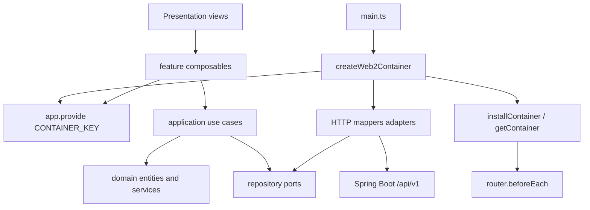

# web2 前端架构（DDD）

> 给开发者与 AI Agent 的 **当前用户前端知识库**。包级入门见 [apps/web2/README.md](../apps/web2/README.md)；改代码时的硬规则见 [apps/web2/AGENTS.md](../apps/web2/AGENTS.md)。  
> 全仓后端 / Worker / 部署仍以 [AGENT_CONTEXT.md](./AGENT_CONTEXT.md) 为准。工程规则、验证与 Code Review 以 [TEAM_ENGINEERING.md](./TEAM_ENGINEERING.md) 为准。  
> **最后更新：** 2026-10-09

本文记录的是 **已经落地的** 结构，不是愿景。**`apps/web2` 是当前用户产品面**；`apps/web` 已弃用。同一套 `/api/v1` 后端。UI 为浅色壳 + 暗画布，不是旧版暗色 Twilight Amber。

---

## 1. 一句话

web2 把「数据生产、用例编排、视图消费」拆开：Domain 不依赖框架；Infrastructure 把 `/api/v1` 与浏览器 API 翻译成实体；Presentation 只渲染用例结果。

前端 DDD **不是** 把后端微服务目录抄进 Vue。它解决的是 view 里同时出现 `fetch`、字段换算、权限判断、Pinia 杂物抽屉的问题。

---

## 2. 设计原则

1. **依赖向内**：Presentation → Application → Domain。Infrastructure 实现 Domain 的 port。Domain 不知道 HTTP、Vue、localStorage。
2. **限界上下文（BC）按业务能力切**，不按页面切。一个页面可以组合多个 BC 的 composable。
3. **防腐层（ACL）在 mapper**：后端 `snake_case`、`state` 魔法数、`records` 列表键只出现在 `infrastructure/mappers`。
4. **用例是剧本**：`loginUseCase`、`submitDatasetUseCase`、`openEditorUseCase` 这类扁平函数，便于单测。
5. **Result 不抛进 UI**：`Result<T> = readonly [error, data]`。错误码在 `DomainError`，文案在 i18n `errors.*`。
6. **组合根唯一**：`createWeb2Container()` 是唯一 `new` 仓库实现的地方。
7. **够用就停**：不要为登录页再拆 12 层。新规则先放领域服务；只有跨实体或跨端口时才加用例。

通用方法论见 `.agents/skills/frontend-ddd/SKILL.md`。冲突时以 **本仓库 web2 目录与测试** 为准。

---

## 3. 运行时与组合根



启动顺序（`src/main.ts`）：

1. `createWeb2Container()` 注入 `localStorage`、`fetch`、各 HTTP 仓库、JobWatchHub、EditorBridge。
2. `installContainer(container)` 给路由守卫。
3. `app.provide(CONTAINER_KEY, container)` 给 composable 的 `inject`。
4. 挂 i18n、router、样式。

401 时 HTTP 客户端调用 `unauthorized.notifyUnauthorized()`：清 session、清 workspace、清 job watch。不要在页面里再写一套登出副作用。

测试可传入假 `storage` / `fetchImpl` / `baseUrl` 构造容器，不必起 Vite。

---

## 4. 目录与层

```text
apps/web2/src/
├── main.ts
├── app/                 # 组合根、路由、i18n（不是 Domain）
├── shared/              # 跨 BC 内核：Result、DomainError、HTTP、架构测试
├── features/<bc>/
│   ├── domain/
│   │   ├── entities/
│   │   ├── services/          # 纯函数不变量
│   │   └── repositories/      # 接口 only，文件名 *.repository.ts 或 *.port.ts
│   ├── application/
│   │   └── use-cases/
│   ├── infrastructure/
│   │   ├── mappers/
│   │   ├── repositories/
│   │   └── adapters/
│   └── presentation/
│       ├── composables/
│       └── *.vue
└── presentation/        # 壳：CloudLayout、AppButton、styles、errors
```

`src/presentation` **不是** 第六个 BC。它只放跨页面的视觉与 `formatDomainError`。Help 页没有独立领域，可以放在这里。

Vite 别名 `@` → `src/`。**Vue 单文件里不要用** `../../domain`：从 `presentation/*.vue` 出发会指到 `features/` 而不是该 BC 的 domain。

Vitest 配置与 Vite 配置分离（`vitest.config.ts`），避免 plugin 类型冲突。

---

## 5. 共享内核（`src/shared`）

| 模块 | 作用 |
|------|------|
| `result.ts` | `ok` / `err` / `isOk` |
| `domain-error.ts` | `DomainErrorCode` 联合类型 + `DomainError` |
| `di.ts` | `CONTAINER_KEY` |
| `infrastructure/http-client.ts` | Bearer、JSON/blob、`downloadBytes` 进度、映射 `ApiError` |
| `unwrap.ts`（presentation） | 仅 UI 需要把 Result 摊开时用，不要在 domain 用 |
| `architecture.spec.ts` | 依赖方向门禁 |
| `parity.spec.ts` | 与旧站能力对应的用例文件必须存在 |

HTTP 客户端属于 **shared infrastructure**，不是某个 BC 的领域。各 BC 的 `http-*.repository.ts` 只依赖 `HttpClient` 接口，不直接 `fetch`。

当前错误码（改码时同步 `src/app/i18n/index.ts` 的 `errors.*`）：

`AUTH_*`、`DATASET_*`、`JOB_*`、`PROJECT_*`、`MODEL_*`、`VIEWER_CONFIG_INVALID`、`EDITOR_*`、`OSS_UPLOAD_FAILED`、`SSE_CONNECT_FAILED`、`NETWORK`、`UNKNOWN`。

---

## 6. 限界上下文

跨 BC 规则：A 的 presentation 可以调用 B 的 **composable**（同一页面组合）。A 的 domain **禁止** import B 的 infrastructure。需要 B 的能力时，在组合根把 B 的 port 注入，或在 Application 显式传入 deps。

### 6.1 Identity（身份）

| | |
|--|--|
| UL | UserSession、Captcha、登录/注册 |
| 实体 | `user-session.entity`、`captcha.entity` |
| 领域服务 | `captcha-policy.service`（登录是否强制验证码） |
| Ports | `AuthRepository`、`SessionStore` |
| 基础设施 | `http-auth.repository`、`local-storage-session.store` |
| 用例 | `loginUseCase`、`registerUseCase`、`resolveAuthNavigation` |
| UI | `LoginView`、`useAuthSession` |

会话在 localStorage。`isAuthenticated` 以 JWT `exp` 为准（用户 token 7 天）。过期或 API 401 清会话并回登录页；登出不清最近工程。路由用 `isAuthenticated(session)` + `resolveAuthNavigation`，不要在每个页面手写 if。

### 6.2 Project（工程）

| | |
|--|--|
| UL | Project、最近打开 |
| 实体 | `project.entity`（id/name/description/createdAt） |
| 领域服务 | `recent-projects.service`（上限 `MAX_RECENT_PROJECTS` = 5） |
| Ports | `ProjectRepository`、`WorkspacePersistence`（当前工程 id、按账号隔离的最近列表） |
| UI | `HomeView`、`ProjectListView`、`useProjectWorkspace` |

「当前工程」是 workspace 持久化，不是后端字段。查看器、上传、编辑器都读 `activeProjectId()`。

### 6.3 Dataset-training（数据集与训练）

| | |
|--|--|
| UL | TrainingJob、归档图片、manifest、SSE |
| 实体 | `training-job.entity` |
| 领域服务 | `dataset-archive.service`（过滤 jpg/png/webp、四位序号、manifest）、`job-policy.service`（能否取消/删除）、`sse-buffer.service` |
| Ports | `TrainingJobRepository`、`JobEventPort`、`ObjectStoragePort` |
| 应用 | `submit-dataset.usecase`、`job-watch-hub`（进程内订阅，401 时清空） |
| 适配器 | `xhr-object-storage`（OSS presigned PUT 进度）、`fetch-job-event`（SSE，不能走普通 JSON client） |
| UI | `UploadView`、`DatasetUploadPanel`、`TrainingJobPanel`、`useDatasetTraining` |

归档 **不是** zip。与全仓 AGENT_CONTEXT 第 4 节同一条流水线。PLY 上传不属于本 BC。

### 6.4 Model-asset（模型资产）

| | |
|--|--|
| UL | ModelAsset、PLY/SPZ、下载 token、export、分片上传会话、本机 OPFS 缓存 |
| 领域服务 | `model-format.service`（格式与 2GB 上限）、`chunk-range.service`、`model-list.service`、`model-cache.service`（修订命中） |
| Port | `ModelAssetRepository`、`CloudModelCachePort` |
| 用例 | `listModelsUseCase`、`uploadModelUseCase`（顺序分片续传）、`deleteModelUseCase`、`downloadModelToDiskUseCase`、`listCachedModelsUseCase` |
| UI | `useModelAssets`、`ModelUploadPanel`（查看/下载/删除）、`SettingsView`（`/app/settings` 删缓存） |

没有工程 id 时 `MODEL_PROJECT_REQUIRED`。非法扩展名 `MODEL_INVALID_FORMAT`。超过 2GB `MODEL_TOO_LARGE`。

### 6.5 Viewer（查看）

| | |
|--|--|
| UL | ViewerConfig v2、defaultView、模型摘要 |
| 实体 | `viewer-config.entity`（仍包含标注/立方体类型，供配置解析；**当前产品页不提供绘制 UI**） |
| 领域服务 | `parseViewerConfig` / 空配置 |
| Port | `ViewerStoragePort`（列表、字节、config、export） |
| UI | `LayerViewerView`、`Native3DGSViewer`、`useViewerStorage` |

画布由固定 `@native3dgs/web@0.2.2-preview.3` 与官方 `/vue` composable 提供 WebGPU；SDK 仅在 presentation 引擎边界出现。`ViewerSession` 只管宿主加载 identity、取消、错误映射、相机命令与截图。demo（`:5186`，`demo/native3dgs`）与云页使用同一组件，不复制调试查看器。

只读功能：本机 PLY/SPZ、选择工程模型、取消下载/解码、关闭、固定/自由浏览、适配/重置/Y翻转、缩放、本机 PNG 截图。不提供查看页上传/删除、标注/擦除/修改模型；资产管理和高级编辑仍由各自 BC 负责。云页保留 `?modelId=`，模型字节通过原有带 Bearer 的仓储与 OPFS 缓存取得 File；HTTP 下载新增可选 AbortSignal，旧调用保持兼容。候选失败/取消保留旧场景，新打开或卸载使旧事务失效。

SDK 已规范化为 RUB；不照搬旧 Spark 的根节点翻转，也不加 Canvas CSS 镜像。已有 viewer-config 只存 position/quaternion，无法确认坐标系与来源，新查看器自动取景并提示，不改 JSON 或把未知旧视角错误套上新场景。配置实体/解析仍保留供其他能力使用。

运行要求：Node 24.14+，浏览器 HTTPS/localhost、安全存储和可用 WebGPU。支持 binary little-endian PLY 与基础 SPZ，ASCII PLY 是明确错误态。构建前校验并完整复制 SDK 资产/许可证；mjs 与 Worker 必须为 JavaScript MIME，wasm 为 application/wasm，不能 SPA fallback。云壳不强制跨源隔离，decoder auto 可回退单线程；独立 demo 的隔离头仅用于 demo，不影响 SuperSplat/地图。详见包 README。

### 6.6 Editor（高级编辑）

| | |
|--|--|
| UL | EditorLaunch、空白会话、云端模型、本地文件、iframe dirty |
| 实体 | `EditorLaunchParams`（`signedUrl` / `fileName` / `modelId` 均可选） |
| 领域服务 | `createBlankEditorLaunch`、`createRemoteEditorLaunch`、`hasRemoteScene` |
| Port | `EditorBridgePort`（`buildSrc`、`isDirty`、`exportPly`） |
| 协议 | `supersplat-protocol.ts`（postMessage 常量、`buildSuperSplatSrc`） |
| 用例 | `openEditorUseCase`（下载 token）、`prepareLocalEditorLaunch`、`blankEditorLaunch`、`saveEditorExportUseCase`（PLY/SPZ + 覆盖）、`saveEditorAsNewModelUseCase`（必填名称 + 分片上传） |
| UI | `SuperSplatEditorView`、`useEditorSession` |

无云端模型、无当前工程都可以进入 `/app/supersplat`。空白 iframe：`/supersplat/index.html?embedded=1` 且 **没有** `load=`。本地打开：校验格式后 `blob:` URL 作为 `load`。云端保存仅当 iframe 带回的 `modelId` 与当前云端会话一致。

---

## 7. 数据流（强制方向）

```text
View 事件
  → composable
    → use case(deps from container)
      → domain 不变量
      → port
        → mapper ← DTO
        → HttpClient / XHR / SSE / postMessage
```

**反例（禁止）：**

- `.vue` 里 `fetch('/api/v1/...')`
- 模板里 `price * 0.9`、列表 `dto.records.map`
- domain 文件 `import { ref } from 'vue'`
- composable `import { mapJobFromDto }`
- 在 `LayerViewerView` 里解析 viewer-config JSON 字段

**正例（登录）：**

```text
LoginView
  → useAuthSession().login(input)
    → loginUseCase({ auth, session }, input)
      → assertCaptchaForMode
      → AuthRepository.login
      → SessionStore.persist
    → Result<UserSession>
  → formatDomainError
```

---

## 8. Presentation 约定

- Composable 只暴露：命令函数 + 给模板的只读状态。不要把 repository 漏出给模板。
- 跨 BC 页面（查看器同时要工程、模型、配置）分别 `useProjectWorkspace` / `useModelAssets` / `useViewerStorage`。
- 壳组件：`AppButton`（primary | ghost | destructive）、`AppSheet`、`WaitOverlay`（导出/传输等待层，z-index 70，高于 Sheet 60）、`AppToast`、`ToolIcon`。等待快照在 `presentation/wait-session.ts`，不含业务规则。
- 样式：`shell.css` 产品壳；`viewer-canvas.css` 画布 + 查看器浮动检查器。
- 动效：`presentation/motion.ts`（`bounce: 0` 默认，手势动量才用轻微 bounce）。尊重 `prefers-reduced-motion` / `prefers-reduced-transparency`。

---

## 9. 测试金字塔（web2）

| 层 | 现有重点 |
|----|----------|
| Domain | captcha、归档、job policy、模型格式、viewer-config、最近工程、editor launch |
| Application | auth、project、submit-dataset、editor open/export/local |
| Shared | HTTP 客户端、mapper 快照、architecture、parity |
| Presentation | 不强制 `@vue/test-utils`；回归靠 `build:web2` + 手工主路径 |
| E2E | 未内置 Playwright；需要登录的流依赖 :8080 |

加不变量时优先写 **domain spec**，不要先堆 E2E。

`architecture.spec.ts` 只扫 `.ts`。Vue 里的违规要靠 review / AGENTS 规则抓住。

---

## 10. 与已弃用的 apps/web、后端的关系

- **`apps/web` 已弃用。** 新功能只进 web2。旧包可作行为对照，不要双写。
- API 契约、JWT、SSE、OSS 直传、本地盘模型：与旧版相同，见 AGENT_CONTEXT §3–§6。
- SuperSplat 静态资源：`vendors/supersplat` → `apps/web2/public/supersplat`（旧版 web 仍可复制一份）。
- Spark 共享包保留供既有调用方使用；当前 web2 查看器改为 Native3DGS SDK，不改 `packages/spark` 或 Rust。
- 功能对齐靠 `parity.spec.ts` 的用例文件清单，不是靠复制 Vue。

---

## 11. 演进时怎么改

1. 点名 BC 与用例（谁、做什么、成功长什么样）。
2. 不变量放 domain service，并补 spec。
3. 新外部形状 → mapper，禁止 DTO 进入 presentation。
4. 在 `container.types.ts` + `create-container.ts` 接上实现。
5. composable 只多一层函数，不把 XHR 细节写进 Vue。
6. `pnpm test:web2` && `pnpm build:web2`。
7. 若新增用户能力，把用例路径加入 `parity.spec.ts`。
8. 架构级变更同步本文日期与根 README / AGENT_CONTEXT 中的 web2 段落。

**不要**为了「更 DDD」把 `Native3DGSViewer` 做成 Domain。WebGPU 是 Presentation + 引擎适配，下载与配置才走 Viewer port。

---

## 11.1 任务执行 / 本机 Sky Command

导入的 KML/KMZ 由网关 `sky-route-storage.mjs` 自动保存到 `%LOCALAPPDATA%/Sky Command/routes`，`SKY_COMMAND_ROUTES_DIR` 可覆盖绝对路径；启动时从原子索引恢复，经 SDK 重新校验。原始字节及 SHA-256 不变，SDK 航线库仍为会话内存；删除更新持久化索引。不恢复手机分配、上传或任务执行。损坏资料保留并显示恢复异常，禁止覆写未恢复资料；飞控和图传调用不等待航线磁盘队列。详见 `apps/web2/scripts/sky-route-storage.CONTRACT.md`。

2026-10-19 起测试证据独立长期归档到 `D:\XJI-Test-Records`（`XJI_TEST_RECORDS_ROOT` 可覆盖），不随 Temp 轮换。web2 test/build 默认经统一记录入口执行；开发网关启动时通过既有 `diagnosticSink` 接口、应用订阅、控制调用和播放诊断创建真机会话，手机诊断实际落盘后才确认，原诊断镜像保留。记录异步有界，失败不改变业务返回；缺口显式标注。SDK 回执、归一化状态和人工观察分别保存；未取得的 APK/固件保持未知。离线索引、标记、附件和对比说明见 `docs/TEST_RECORDS.md`，接口见 `scripts/test-records/CONTRACT.md`。旧网关可用只读旁路兼容采集，完整控制入口仍需新网关启动。

图传端到端延迟验收上限为 1.5 秒，网页积压读数不能代替相机到显示的实测。飞行与监控页关闭额外接收 stash，共用 0.3 秒缓冲目标、1 秒积压追帧线及 250ms 前台检查；回到前台先追最新缓冲再恢复播放。播放延迟修复不得改变手机推流、飞控、任务或地图，详细契约见 Sky-Command `operator-console/CONTRACT.md`。

图传排查沿用 Sky-Command 的 `operator-console/CONTRACT.md` 与 `electron-host/CONTRACT.md`：先更新契约再改实现。Web 桥保留最近 128 条脱敏播放诊断供只读检查；本机 `diagnostics-record` 对播放诊断真实异步记录，不能伪报成功。浏览器播放事件、HTTP-FLV 连接开闭、RTMP 视频包间隔以及发布开始/结束、观看者背压事件写入 `%TEMP%/sky-command-web/diagnostics/playback.ndjson`，避免只能看见观看连接中断而丢失上游终态；新增发布/背压事件只接受生产适配器的固定文案，不接收任意异常、URL 或路径。单写入器最多保留 512 条等待记录与一批 512 条正在写入的记录；文件达到 8 MiB 后轮换，只保留当前与 `.previous` 两份。日志仅观察播放器，不改变飞控、任务、航线、照片或降落提示；更新嵌入包必须保留本节所述地图优化。航线进入执行、暂停、启动或结束时，飞行页「现在」和监控栏用航线资料里的航点总数显示「第几个 / 一共几个」及细进度条；手机上报的航点序号从 0 计，界面加 1。没有总数或序号超出总数时只显示当前序号，不估算比例。更新嵌入包必须保留这段进度展示。

任务执行页只嵌入 `/sky-operator/index.html`。操作按钮在嵌入包 `public/sky-operator/console.js` 里判断，经 `desktop-operator-host.ts` 调用 `http://127.0.0.1:8767/invoke`。组合根的 `createSdkLocalBridge` 连同一网关，当前路由没有挂 Vue 任务控件。`createHttpLocalBridge` 仍默认 `http://127.0.0.1:17890`，不是这次组合根。开发来源为 `localhost:5176`。返航仍走网关的 `flight.request`，确认后再 `flight.confirm`，取消则 `flight.cancel`，不以网页布尔值替代 DJI 确认 ID。

当前本地开发由 Vite 自动启动 `apps/web2/scripts/sky-command-gateway.mjs`，使用 `package.json` 里的 vendored SDK 0.2.17（同一飞机的 HTTP-FLV 观看连接相互隔离，带开闭和 RTMP 包间隔诊断；确认降落仅在原始请求标志为 true 时下发；Node WebSocket 收包逐条让出事件循环，避免航线上传进度与成功回执在 TCP 合包时触发 16 条入站队列溢出断连，队列上限保持不变）：控制接口仅监听 `127.0.0.1:8767/invoke`，手机 Relay 为 `8080`，RTMP 为 `19500`，HTTP-FLV 为 `18080`。Relay 与控制接口就绪后，在物理 WLAN 上每秒向 UDP `39082` 广播自动发现公告，并监听该端口的 `SKY_COMMAND_RELAY_DISCOVER_V1` 请求，向同子网手机单播回复原公告；Windows 入站规则只需允许对应程序的 LocalSubnet UDP 39082。手机在未 ACTIVE 时每秒请求，ACTIVE 后停止，仍保留 3 秒唯一候选观察和多电脑冲突检查。网关退出时停止发现来源。`serverId` 保存在系统临时目录的 `sky-command-web/discovery-server-id`，同目录存在时重启复用，`instanceId` 每次启动更新。广播不可用时保留手动连接入口；电脑与手机发现/会话已实机验证，飞行器业务仍需独立验收。

手机还会记住上次 AUTO 合法连接的电脑 IPv4，在同 WLAN 子网内优先单播询问以减少校园网广播延迟；它只用于获取新公告，不直接重连旧 endpoint，仍保留 3 秒观察与多电脑冲突保护。首次配对、换子网或电脑 IP 改变时回退广播。

开发网关的网卡枚举在独立 Worker 中执行，每次完成后间隔 1 秒刷新；图传地址、连接提示与发现广播共享最新快照。命令和状态处理线程不调用同步 `networkInterfaces()`，避免 Windows 网卡枚举阻塞飞控命令。首次枚举成功后才启动网关，读取失败时清空旧快照并记录错误，退出时终止 Worker。

嵌入操作台的 `public/sky-operator/cesium` 与 `city-tiles` 静态资源随代码保存，保证 `index.html` 的相对地址在构建产物中可用；现有 prebuild 不会生成这两套资源。地图契约见 `apps/web2/public/sky-operator/MAP.CONTRACT.md`：白模不因交互或相机高度隐藏，活动更新上限 60 FPS，静止按需绘制并降低更新频率，后台暂停循环。地图性能优化来源现保存在 `scripts/embedded-route-map.mjs`；`scripts/build-sky-operator.mjs` 将该模块与 Sky-Command 操作台源码合并构建，必须执行 operator-map 回归。2026-10-26 飞机只读图层使用 SDK 0.2.19 的 navigation，位置过期/断连保留及平面高度规则见根 DESIGN.md。

监控页左栏显示各机的“不适合降落”提示。本地网关订阅应用快照，在 `state-snapshot` 的设备连接信息中附加只供展示的 `landingProtectionNoticeAtMs`，保留最近 20 秒内收到的 `NOT_SAFE_TO_LAND`，避免页面每秒轮询漏掉短暂状态；原始状态不变。状态退回时明确标为“刚才曾判定”，适合降落、等待确认、落地停桨、飞控失联、手机重连或移除时清除；该历史提示不参与任何指令或确认门禁。

监控栏位宽度不超过 440px 时，状态、航点进度、操作按钮分三行显示，按钮不再抢占状态列；按栏位自身宽度响应，桌面四栏和窄屏采用同一规则。各栏位继续按设备 ID 独立读取 DJI 状态与航点，不得借用第一栏数据，也不得从启动成功或飞行模式推算航点进度。

飞机状态快照独立刷新，不等待网络提示、图传刷新或航线预览。辅助读取各自最多保留一个在途请求，返回后再允许下一次读取，不能因超时反复堆积请求；操作前读取设备快照也不等待网络提示。四机共用操作和状态投影规则，任务、命令等待与航点按设备隔离；同设备的互斥和 DJI 原始门禁继续有效。

操作回执按操作类型和设备分别保留，切换设备后仍可查看该机结果；旧连接的迟到回执不得覆盖新连接结果，连接代次不匹配的历史回执不显示。

开发网关采用 Sky Command SDK 0.2.17：重复执行同名航线不再复用上一轮缓存里程碑，匹配任务的终态可在等待暂停、继续或停止回执时立即收敛。断线后的新航线不接收旧暂存回执；被抢占的启动超时不算成功；停止被拒绝时恢复已确认的暂停或继续。四个监控栏位共用终态按钮规则，结束/失败后返回航线选择；重选、上传和启动须由操作者发起。飞行页「上传至飞机」和监控页「航线选择」在 MSDK 就绪后，还要求该手机曾经确认遥控器已连接；连过一次后拔下仍可操作，记录保存在当前浏览器会话键 `sky-operator-remote-once`。准备航线、暂停、继续和停止不使用这条记录。飞行页「上传至飞机」要求当前飞控已连接，未连接时按钮不可点，提示「请先连接飞控」。监控页「一键执行」不因飞控禁用；传到手机后、上传飞机前再检查，未连接则停在上传步骤并提示同一句原因。航线选择、准备、暂停、继续、停止和飞行页执行航线不使用这条飞控门禁。「启动图传」和「回传照片」再次要求 AirLink 与主相机已连接；主相机未连接时拍照同样拒绝。手机在调用 DJI 前用同一图传源条件拒绝，源断开时取消尚未结束的图传。DJI `onSuccess` 后，启动和停止结果仍带 `SUCCEEDED`，按钮下方显示 `MSDK 回调：成功` 与 `原始类型：onSuccess`。这只说明接口回调，不代替源门禁。活动图传进入推流或停止后，源断开仍清理且不自动重启。回传进行中的「停止回传」由生产装配把 `stopFetch` 交给工作流，再下发 `camera.photo.fetch.stop`；手机调用大疆停止原图下载、停止拉列表并退出回放。停止后的进度阶段是 `stopped`，按钮回到「回传照片」。这是中继请求，不是 DJI `onSuccess`。嵌入包保留既有地图、航点进度修复，相关 TS 源码位于 Sky Command 操作台。

## 12. 已知产品事实（避免 Agent 回退）

- **默认开发入口是 `apps/web2` :5176**（根目录 `pnpm dev`）。
- 旧版 `apps/web` :5174 已弃用，仅 `pnpm dev:web-legacy`。
- web2 `strictPort: true`。
- 查看器已删除厚 `SparkViewport` 与 throwing storage adapter。
- 高级编辑不再用「无模型空状态」挡住 iframe。
- Phosphor 图标必须 `Ph*` 导出，否则生产构建失败。
- 验证码接口无后端即登录不可用，不要把代理失败当成前端回归。
