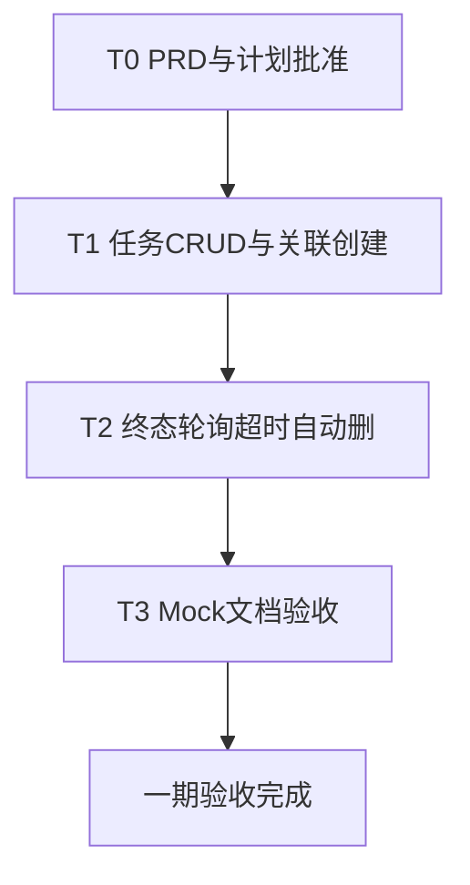

# ECI 任务驱动容器编排服务 Implementation Plan

> **For agentic workers:** REQUIRED SUB-SKILL: Use superpowers:subagent-driven-development (recommended) or superpowers:executing-plans to implement this plan task-by-task. Steps use checkbox (`- [ ]`) syntax for tracking.
>
> **How to resume in a new chat:** `@docs/superpowers/plans/2026-07-27-eci-task-orchestration.md` 并说明要从哪个未完成 Task 继续。  
> **PRD 源：** 仓库根目录 `ECI任务驱动容器编排服务产品需求文档(PRD).md` v2.0  
> **工程目录：** `eci-manager/`（禁止修改 `backend/`）

**Goal:** 在已完成的 D0–D3 实例管理基座上，交付任务提交、一任务一实例、云终态自动删除与 `maxRuntimeSec` 超时保护（T1–T3）。

**Architecture:** 在 `eci-manager` 内新增 `task` 域；任务异步驱动现有 `EciInstanceService` + `AsyncLifecycleWorker`；Running 后由独立任务轮询器根据云侧 `Succeeded`/`Failed`/`maxRuntimeSec` 触发删除并回写任务状态。Mock / 真实 Provider 共用同一状态机。不改主仓 `backend/`。

**Tech Stack:** Spring Boot 3.3.x、Java 17、Maven 3.9+、H2 文件库、现有 `EciProvider`（`MockEciProvider` / `AliyunEciProvider`，SDK：`aliyun-java-sdk-eci`）。

## Global Constraints

- 工程仅位于 `eci-manager/`；独立进程；端口 `8081`；API 前缀 `/api/v1/eci`
- 鉴权：`X-Api-Key`，配置 `eci.api-key`；`/actuator/health` 公开
- 一任务对应一个本地实例、一个 ECI 容器组、一个主容器
- 关闭 = 删除云资源（非 Stop 保留）；本地终态 `TERMINATED`
- 默认 `restartPolicy=Never`；`command`/`args` 可选（未传则用镜像 ENTRYPOINT/CMD）
- 一期不做：业务回调、镜像注册表、规格套餐、批量提交、常驻 Worker、前端、改 `backend/`
- 凭证与 api-key 不得进 Git；提供 `application-local.yml.example`
- 验收以 Linux + JDK 17 + Maven 为准；开发验证优先 `mock=true`
- PRD 流程：T0 评审与本计划批准前，不写 T1–T3 业务代码、不调云资源

### 现状基线（截至 2026-07-27）

| 已有 | 路径提示 |
|------|----------|
| 实例 CRUD、幂等删除、Api-Key | `instance/`、`auth/` |
| Mock / Aliyun Provider；`CreateSpec` 含 restartPolicy / command / args / gpu / instanceType | `provider/` |
| 创建轮询至 Running、删除确认、启动补偿 | `lifecycle/AsyncLifecycleWorker`、`StartupCompensationRunner` |
| 任务领域模型（尚无 `/tasks` API） | `task/`：`TaskStatus`、`EciTaskEntity`、`EciTaskRepository` |
| 任务运行时配置键 | `eci.default-restart-policy` / `default-max-runtime-sec` / `task-poll-interval-sec` |
| Mock 终态测试钩子 | `MockEciProvider.simulateStatus`（Succeeded/Failed） |
| H2、`ApiResponse`、统一异常 | `application.yml`、`common/` |

### 分期总览

| 阶段 | 内容 | 状态 |
|------|------|------|
| **T0** | PRD 评审定稿 + 本计划批准 | ✅ 已完成（2026-07-27） |
| **T1** | 任务持久化、提交/查询/取消、关联实例、`restartPolicy` | 进行中：Task 1–3 ✅；**待 Task 4**（手动 `/instances` 兼容确认） |
| **T2** | Running 轮询、Succeeded/Failed 自动删、`maxRuntimeSec`、任务恢复 | 待做 |
| **T3** | Mock 自动生命周期、文档、Linux/cloud 验收 | 部分提前：Mock `simulateStatus` ✅；其余待做 |
| **T4 / I1** | 镜像注册表等 / 主仓联调与生产选型 | 本期不做 |

### 进度日志（2026-07-27）

| 项 | 说明 |
|----|------|
| Task 0 | 评审批准已记录 |
| Task 1（T1.1） | 配置三键、`eci_task` 实体/仓库、实例扩展字段、`CreateSpec.restartPolicy`；本地提交 `62db50b` |
| Task 2（T1.2） | Aliyun/Mock 透传 `restartPolicy`；`EciProviderRestartPolicyTest`；代码完成，**待用户要求再 commit** |
| Task 3（T1.3） | `/tasks` 提交/查询/取消；实例 `taskId`；Running/失败回写；`EciTaskApiTest` PASS；**待用户要求再 commit** |
| **下一刀** | Task 4：手动 `/instances` 兼容确认 |



---

## File Structure（目标落点）

```
eci-manager/src/main/java/com/xjicloud/eci/
├── task/                              # 新建
│   ├── TaskStatus.java
│   ├── EciTaskEntity.java
│   ├── EciTaskRepository.java
│   ├── EciTaskService.java
│   ├── EciTaskController.java
│   └── dto/
│       ├── CreateTaskRequest.java
│       └── TaskResponse.java
├── instance/                          # 扩展：taskId、restartPolicy、规格字段、响应
├── provider/                          # CreateSpec + Mock/Aliyun 透传 restartPolicy
├── lifecycle/
│   ├── AsyncLifecycleWorker.java      # 已有：创建/删除
│   ├── TaskLifecycleWatcher.java      # 新建：终态/超时轮询
│   └── StartupCompensationRunner.java # 扩展：非终态任务恢复
└── config/EciProperties.java          # 新配置键
```

测试建议目录：`eci-manager/src/test/java/com/xjicloud/eci/task/`、既有 `lifecycle` / `instance` 测试旁扩展。

---

### Task 0: 评审闸门（T0）

**Files:** 无代码变更

**产出:** 决策锁定 + Go/No-Go

- [x] **Step 1: 确认 PRD 第 0 节 10 条建议决策**

锁定：独立编排服务、`X-Api-Key`、一任务一实例、关闭=删除、轮询终态、可配置重启策略（默认 Never）、任务直传镜像/规格、可选 command/args、手动 `/instances` 与 `/tasks` 并存、生产 ECI/CCI 选型待定不阻塞。

- [x] **Step 2: 确认 PRD 第 9 节**

生产最终用 ECI / CCI / 双 Provider **不阻塞** T1–T3。

- [x] **Step 3: 批准本实现计划**

评审人批注本文件或口头批准后，将本 Task 全部勾选，再开 T1。

- [x] **Step 4: 记录批准结果**

```
批准人：用户确认（对话「已完成定稿与评审批准」）
日期：2026-07-27
异议/修订：无
```

---

### Task 1: 配置与任务领域模型（T1.1）

**Files:**
- Modify: `eci-manager/src/main/java/com/xjicloud/eci/config/EciProperties.java`
- Modify: `eci-manager/src/main/resources/application.yml`
- Modify: `eci-manager/src/main/resources/application-dev.yml`
- Modify: `eci-manager/src/main/resources/application-cloud.yml`
- Create: `eci-manager/src/main/java/com/xjicloud/eci/task/TaskStatus.java`
- Create: `eci-manager/src/main/java/com/xjicloud/eci/task/EciTaskEntity.java`
- Create: `eci-manager/src/main/java/com/xjicloud/eci/task/EciTaskRepository.java`
- Modify: `eci-manager/src/main/java/com/xjicloud/eci/instance/EciInstanceEntity.java`
- Modify: `eci-manager/src/main/java/com/xjicloud/eci/provider/CreateSpec.java`
- Test: `eci-manager/src/test/java/com/xjicloud/eci/task/EciTaskEntityMappingTest.java`（或 Properties 绑定测试）

**Interfaces:**
- Produces: `TaskStatus` 枚举；`EciTaskEntity` 表 `eci_task`；`EciTaskRepository`；`CreateSpec` 增加 `String restartPolicy`；实例实体增加 `UUID taskId`、`String restartPolicy`、以及持久化 `instanceType`/`gpu`（若尚未有列）
- Config keys:
  - `eci.default-restart-policy` 默认 `Never`
  - `eci.default-max-runtime-sec` 默认 `14400`
  - `eci.task-poll-interval-sec` 默认 `10`（与现有 `poll-interval-ms` 并存；任务运行轮询用前者）

**任务实体必含字段:** `id`, `name`, `status`, `instanceId`, `image`, `commandJson`, `argsJson`, `cpu`, `memory`, `instanceType`, `gpu`, `restartPolicy`, `maxRuntimeSec`, `envJson`, `failureReason`, `startedAt`, `endedAt`, `createdAt`, `updatedAt`

**任务状态机:**

```
PENDING → STARTING → RUNNING → SUCCEEDED | FAILED
STARTING → SUCCEEDED | FAILED
PENDING / STARTING / RUNNING → CANCELLED
任意非终态 → FAILED（创建失败、超时、云异常）
```

- [x] **Step 1: 扩展 `EciProperties` 与 yml**

增加上述三键及 getter/setter；`application.yml` 写入默认值。

- [x] **Step 2: 新增 `TaskStatus` + `EciTaskEntity` + `Repository`**

JPA + H2；`ddl-auto: update` 下可自动建表。

- [x] **Step 3: 扩展实例实体与 `CreateSpec`**

`CreateSpec` 增加 `restartPolicy`；实例表可关联 `taskId`（可空，手动实例为空）。

- [x] **Step 4: 写/跑绑定或持久化冒烟测试**

Run: `cd eci-manager && mvn -q test`  
Expected: PASS（含 `EciTaskEntityMappingTest`）；H2 可落任务行。

- [x] **Step 5: Commit（仅当用户要求提交时）**

本地提交：`62db50b feat(eci-manager): 增加任务领域模型与运行时配置`（未 push）。

---

### Task 2: Provider 透传 `restartPolicy`（T1.2）

**Files:**
- Modify: `eci-manager/src/main/java/com/xjicloud/eci/provider/CreateSpec.java`（若 Task 1 未完成则此处补齐）
- Modify: `eci-manager/src/main/java/com/xjicloud/eci/provider/MockEciProvider.java`
- Modify: `eci-manager/src/main/java/com/xjicloud/eci/provider/AliyunEciProvider.java`
- Test: 扩展既有 Provider / 创建相关测试，或新增单元测试断言 Create 请求含 RestartPolicy

**Interfaces:**
- Consumes: `CreateSpec.restartPolicy()`（可为 null → 调用方/Service 已合并为默认 `Never`）
- Produces: 云侧/Mock 创建带上 RestartPolicy

- [x] **Step 1: `AliyunEciProvider.create` 写入 RestartPolicy**

使用 ECI OpenAPI 对应字段（与现有 CreateContainerGroup 请求组装方式一致）。

- [x] **Step 2: `MockEciProvider` 记录/接受 restartPolicy**

便于后续 Mock 终态行为按策略扩展。

- [x] **Step 3: 测试**

Run: `cd eci-manager && mvn -q test`  
Expected: PASS（含 `EciProviderRestartPolicyTest`）。

- [ ] **Step 4: Commit（用户要求时）**

```bash
git commit -m "$(cat <<'EOF'
feat(eci-manager): pass restartPolicy through ECI providers

EOF
)"
```

---

### Task 3: 任务 API — 提交 / 查询 / 取消（T1.3）

**Files:**
- Create: `eci-manager/src/main/java/com/xjicloud/eci/task/dto/CreateTaskRequest.java`
- Create: `eci-manager/src/main/java/com/xjicloud/eci/task/dto/TaskResponse.java`
- Create: `eci-manager/src/main/java/com/xjicloud/eci/task/EciTaskService.java`
- Create: `eci-manager/src/main/java/com/xjicloud/eci/task/EciTaskController.java`
- Modify: `eci-manager/src/main/java/com/xjicloud/eci/instance/EciInstanceService.java`（支持绑定 taskId、回写任务状态钩子或事件）
- Modify: `eci-manager/src/main/java/com/xjicloud/eci/instance/dto/CreateInstanceRequest.java` / `InstanceResponse.java`（响应带 `taskId`）
- Test: `eci-manager/src/test/java/com/xjicloud/eci/task/EciTaskApiTest.java`（Mock profile）

**Interfaces:**
- Consumes: Task 1 实体/仓库；现有异步创建路径；`EciProperties` 默认规格与 `default-max-runtime-sec` / `default-restart-policy`
- Produces:
  - `POST /api/v1/eci/tasks` → `{ success, data: TaskResponse }`，立即返回 `taskId` + `PENDING` 或 `STARTING`
  - `GET /api/v1/eci/tasks?status=`
  - `GET /api/v1/eci/tasks/{id}`
  - `POST /api/v1/eci/tasks/{id}/cancel`（幂等 → `CANCELLED` + 删关联实例）

**提交字段规则（PRD §4.2）:**
- `image` 必填
- `command`/`args`/`cpu`/`memory`/`instanceType`/`gpu`/`restartPolicy`/`maxRuntimeSec`/`env`/`name` 可选
- 未传规格/重启/超时 → 用配置默认值；**实际使用值必须写入任务行**（历史可追溯）

**T1 状态联动（最小）:**
- 落库任务 → 创建关联实例 → 任务 `STARTING`
- 实例 `RUNNING` → 任务 `RUNNING`
- 创建失败 → 任务 `FAILED` + `failureReason`
- **终态自动删除留给 Task 5（T2）**

- [x] **Step 1: 写失败测试（API 契约）**

覆盖：缺 image → 4xx；无 Api-Key → 401/403；成功提交返回 taskId；cancel 幂等。

- [x] **Step 2: 实现 DTO + Service + Controller**

先 `repository.save` 任务，再创建实例并 `save`，再触发 `@Async`（与现有实例创建事务顺序一致）。

- [x] **Step 3: 实例响应带 `taskId`；手动创建 `taskId` 为空**

- [x] **Step 4: Mock 下跑测试 + 手工 curl**

```bash
curl -s -X POST http://127.0.0.1:8081/api/v1/eci/tasks \
  -H "Content-Type: application/json" \
  -H "X-Api-Key: $ECI_API_KEY" \
  -d '{"image":"nginx:alpine","restartPolicy":"Never","maxRuntimeSec":60}'
```

Expected: `success=true`，可查到 `instanceId`；cancel 后任务 `CANCELLED`。

- [x] **Step 5: Commit（用户要求时）**

本地提交：`feat(eci-manager): add task submit, query, and cancel APIs`（未 push）。

---

### Task 4: 手动 `/instances` 兼容确认（T1.4）

**Files:**
- 以测试与文档核对为主；必要时小改 `EciInstanceController` / Service

**要求:**
- `POST /instances`：未传 `image` 仍用 `eci.default-image`
- 任务路径必须显式 `image`
- 手动实例不建任务记录；`taskId` 为空
- 原有列表/详情/refresh/删除行为不变

- [ ] **Step 1: 回归现有实例集成测试**

Run: `cd eci-manager && mvn -q test`  
Expected: 既有 `EciLifecycleIntegrationTest` 等 PASS。

- [ ] **Step 2: 补一条「手动实例 taskId 为空」断言（若尚无）**

- [ ] **Step 3: Commit（用户要求时）**

---

### Task 5: 任务终态轮询、自动删除、超时（T2）

**Files:**
- Create: `eci-manager/src/main/java/com/xjicloud/eci/lifecycle/TaskLifecycleWatcher.java`
- Modify: `eci-manager/src/main/java/com/xjicloud/eci/lifecycle/StartupCompensationRunner.java`
- Modify: `eci-manager/src/main/java/com/xjicloud/eci/task/EciTaskService.java`（供 watcher 回写）
- Modify: `eci-manager/src/main/java/com/xjicloud/eci/config/AsyncConfig.java`（若需调度线程池）
- Test: `eci-manager/src/test/java/com/xjicloud/eci/lifecycle/TaskLifecycleWatcherTest.java`

**Interfaces:**
- Consumes: 非终态任务 + 关联实例 `cloudInstanceId`；`EciProvider.describe/delete`；`task-poll-interval-sec`；`maxRuntimeSec`
- Produces: 任务进入 `SUCCEEDED` / `FAILED`（含 `TIMEOUT`）/ 保持运行；实例经 `STOPPING` → `TERMINATED`

**轮询逻辑:**

```
对每个 STARTING / RUNNING 任务:
  若运行时长 > maxRuntimeSec → 强制删实例 → 任务 FAILED, failureReason=TIMEOUT
  否则 Describe:
    Succeeded → 删实例 → 成功则任务 SUCCEEDED
    Failed    → 记云侧原因 → 删实例 → 任务 FAILED
    Running   → 推进任务 RUNNING（若仍 STARTING）
  删除失败 → 实例 FAILED + failureReason；不得把清理失败静默当成任务成功
```

**策略备注:**
- `OnFailure`：等成功终态或超时
- `Always`：通常仅超时 / cancel / 人工删结束
- 与人工 DELETE、cancel 并发必须幂等，禁止 500

**短任务:** 允许 `STARTING → SUCCEEDED|FAILED`（未见 Running）

- [ ] **Step 1: 写失败测试**

Mock：Succeeded 自动清、Failed 自动清、TIMEOUT、cancel 与自动删竞态。

- [ ] **Step 2: 实现 `TaskLifecycleWatcher`（定时或循环）**

按 `task-poll-interval-sec` 扫描；日志带 `taskId`、本地 `instanceId`、`cloudInstanceId`。

- [ ] **Step 3: 扩展启动补偿**

启动扫描任务 `PENDING|STARTING|RUNNING`，按关联实例与云状态续跑轮询或标记失败；策略写死并注释：有明确失败 → `FAILED`，否则续建/续轮询。

- [ ] **Step 4: 跑测试**

Run: `cd eci-manager && mvn -q test`  
Expected: PASS。

- [ ] **Step 5: Commit（用户要求时）**

```bash
git commit -m "$(cat <<'EOF'
feat(eci-manager): poll task terminal state, timeout, and auto-delete

EOF
)"
```

---

### Task 6: Mock 自动生命周期（T3.1）

**Files:**
- Modify: `eci-manager/src/main/java/com/xjicloud/eci/provider/MockEciProvider.java`
- Test: 扩展 Task 5 集成测试或 `EciTaskLifecycleMockIT`

**行为（PRD §3.10）:**
- `mock=true` 不调云；创建后进 Running；可模拟 Succeeded/Failed 后走自动删除
- `cloudInstanceId` 形如 `mock-eci-xxx`

- [x] **Step 1: Mock 支持任务完成后的云状态迁移**（可时间触发或测试钩子）

已提供测试钩子 `MockEciProvider.simulateStatus(cloudId, Succeeded|Failed|...)`（2026-07-27）。自动时间触发与端到端任务链路仍待 Task 5/6 其余步骤。

- [ ] **Step 2: 端到端 Mock：提交 → Running → 终态 → 实例 TERMINATED → 任务 SUCCEEDED/FAILED**

- [ ] **Step 3: Commit（用户要求时）**

```bash
git commit -m "$(cat <<'EOF'
feat(eci-manager): simulate task terminal lifecycle in mock provider

EOF
)"
```

---

### Task 7: 文档与验收（T3.2–T3.3）

**Files:**
- Modify: `eci-manager/README.md`
- Modify: `eci-manager/docs/设计与使用说明.md`（如需要与 PRD 对齐）
- Modify: `eci-manager/AGENT.md`（指向本计划与完成状态）
- Modify/Create: `eci-manager/src/main/resources/application-local.yml.example`
- Optional: `eci-manager/docs/examples/3dgs-task.md`（或 README 专节）

**文档清单（PRD §7）:**
1. Linux JDK/Maven、mock/cloud 启动、Api-Key、任务与实例 curl、控制台核对、**用完必删防账单**
2. `application-local.yml.example` 含新配置键
3. 3DGS 类一次性任务示例（镜像、参数、GPU、`Never`、超时）
4. 重启策略差异与 `Always`/`OnFailure` 成本风险
5. 与本 PRD v2.0 / 本计划文件的对应关系
6. 「后续如何被 XJICloud 调用」短节；生产选型仍待定

**验收清单（PRD §1.4）— 全部勾选才算一期完成:**

- [ ] 服务可在 Linux 用 `mvn spring-boot:run` 或 `java -jar` 启动
- [ ] 正确 Api-Key 可提交任务（镜像、command、args、CPU/内存/规格/GPU、重启、超时）
- [ ] 可查询任务与实例，本地 ID 可关联
- [ ] `restartPolicy=Never` 时终态后自动删除实例
- [ ] 超过 `maxRuntimeSec` → 强制删 + 任务 `FAILED`/`TIMEOUT`
- [ ] `/instances` 手动能力仍可用
- [ ] 错误/缺失 Api-Key → 401/403 且不建云资源
- [ ] `mock=true` 全流程不调云可演练

- [ ] **Step 1: 更新 README / example yml / 示例**

- [ ] **Step 2: 按验收清单在 mock 下走通；cloud 仅在有凭证与批准时联调**

- [ ] **Step 3: 更新 `AGENT.md` 将「规划中」改为「T1–T3 已交付」并链到本计划**

- [ ] **Step 4: Commit（用户要求时）**

```bash
git commit -m "$(cat <<'EOF'
docs(eci-manager): document task APIs, lifecycle, and acceptance

EOF
)"
```

---

## Out of Scope（刻意不做）

- T4：镜像注册表、批量提交、规格套餐
- I1：与 XJICloud 主仓联调/迁入；CCI 或双 Provider
- 业务完成回调、`TASK_ID`/`CALLBACK_URL` 强制注入
- 常驻 Worker 注册/心跳/领任务
- 修改 `backend/` 业务代码

---

## Self-Review

| PRD 要点 | 本计划落点 |
|----------|------------|
| §0 / §9 评审 | Task 0 |
| §3.1–3.2 任务模型与状态机 | Task 1, 3, 5 |
| §3.3 实例状态 + 任务驱动自动删 | Task 5 |
| §3.4–3.5 任务提交 / 手动实例 | Task 3, 4 |
| §3.6–3.7 终态删除 / 幂等删 | Task 5 |
| §3.8 查询 | Task 3 |
| §3.10–3.11 Mock / Api-Key | 基座已有 + Task 6 |
| §4 API | Task 3 |
| §5 配置 | Task 1 |
| §6 恢复 / 幂等 / 日志 | Task 5 |
| §7 文档 | Task 7 |
| §1.3 非目标 | Out of Scope |

**Placeholder scan:** 无 TBD；竞态与启动恢复策略已给出默认口径。  
**类型一致性:** 统一使用 `taskId` / `instanceId`（本地 UUID）、`cloudInstanceId`、`failureReason=TIMEOUT`、状态枚举名与 PRD 一致。

---

## 执行方式（新对话时选择）

1. **Subagent-Driven（推荐）** — 每 Task 新开子代理，任务间人工/主代理评审  
2. **Inline Execution** — 同会话按 Task 连续实现，设检查点  

**下次开聊示例：**

> 继续 `@docs/superpowers/plans/2026-07-27-eci-task-orchestration.md`，从 **Task 4**（手动 `/instances` 兼容确认）开始。

---

*记录日期：2026-07-27。对应 PRD v2.0 / v2.0.1。进度：T0 + Task1–3 已完成；下一刀 Task 4。*
