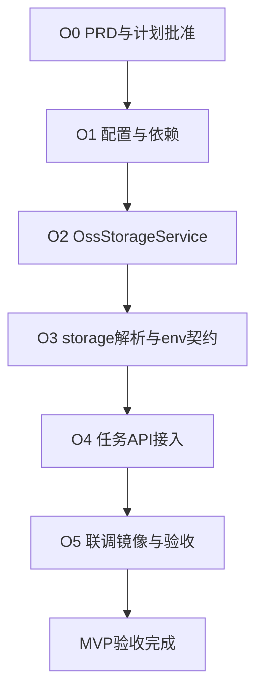

# ECI 任务 OSS 对象存储集成 Implementation Plan

> **For agentic workers:** REQUIRED SUB-SKILL: Use superpowers:subagent-driven-development (recommended) or superpowers:executing-plans to implement this plan task-by-task. Steps use checkbox (`- [ ]`) syntax for tracking.
>
> **How to resume in a new chat:** `@docs/superpowers/plans/2026-07-30-eci-oss-integration.md` 并说明要从哪个未完成 Task 继续；亦可先读 [`docs/superpowers/2026-07-31-eci-oss-handoff.md`](../2026-07-31-eci-oss-handoff.md) 了解 O1–O4 现状。  
> **PRD 源：** 仓库根目录 `ECI任务OSS对象存储集成产品需求文档(PRD).md` v1.0  
> **前置基线：** `docs/superpowers/plans/2026-07-27-eci-task-orchestration.md`（v2.0.3 已完成）  
> **工程目录：** 仅 `eci-manager/`（禁止修改 `backend/`）

**Goal:** 在 eci-manager v2.0.3 上增量交付 OSS presigned URL 签发与容器 env 注入，实现「提交任务 → 容器写文件到 OSS → 任务 SUCCEEDED」MVP 闭环。

**Architecture:** 新增 `eci.oss` 配置段与精简版 `OssStorageService`（从 backend 移植，去掉 `system_config` 热更新）；`POST /tasks` 可选 `storage` 块经 `TaskStorageResolver` 解析后 presign PUT/GET，合并进现有 `env` 再创建 ECI 实例。无 `storage` 时行为与 v2.0.3 完全一致。

**Tech Stack:** Spring Boot 3.3.5、Java 17、Maven 3.9+、AWS S3 SDK `software.amazon.awssdk:s3` 2.29.45、现有 ECI Provider（Mock / Aliyun）。

## Global Constraints

- 工程仅位于 `eci-manager/`；端口 `8081`；API 前缀 `/api/v1/eci`；鉴权 `X-Api-Key`
- JDK 17；验收以 Linux + Maven 为准
- Presigned URL 鉴权；**禁止**将 AK/SK 写入容器 env
- MVP 范围：`storage.mode=test` 与 `keys`；`dataset` 与 `storageResolved` 响应为二期
- 有 `storage` 且 OSS 未配置完整 → `400`，**不创建云资源**
- 向后兼容：无 `storage` 的请求与 v2.0.3 行为一致
- OSS 密钥、api-key 不得进 Git；通过 `.env` / `application-local.yml` 注入
- 不实现：Bucket 自动创建、backend 集成、Worker 轮询协议、浏览器直传/CORS


### 现状基线（截至 2026-07-31）


| 已有                       | 路径提示                                                             |
| ------------------------ | ---------------------------------------------------------------- |
| 任务 CRUD、生命周期、自动删实例       | `task/EciTaskService.java`、`lifecycle/TaskLifecycleWatcher.java` |
| `env` 透传到 ECI 容器         | `CreateTaskRequest.env` → `EciTaskService.create()`              |
| backend OSS 参考实现         | `backend/.../oss/OssStorageService.java`（含 endpoint 规范化）         |
| 容器 HTTP OSS 客户端参考        | `gpu-worker/oss_client.py`                                       |
| **O1–O4 已落地**            | `config/OssProperties`、`oss/OssStorageService`、`task/storage/*`、create 接入 |
| 续跑摘要                     | [`docs/superpowers/2026-07-31-eci-oss-handoff.md`](../2026-07-31-eci-oss-handoff.md) |


### 分期总览


| 阶段     | 内容                                    | 预估    |
| ------ | ------------------------------------- | ----- |
| **O0** | PRD 评审定稿 + 本计划批准                      | 0.5 天 |
| **O1** | 依赖 + `eci.oss` 配置 + `OssProperties`   | 0.5 天 |
| **O2** | `OssStorageService` 移植 + 单元测试         | 1 天   |
| **O3** | `storage` DTO + `TaskStorageResolver` | 0.5 天 |
| **O4** | `EciTaskService` 接入 + API 测试          | 0.5 天 |
| **O5** | 联调镜像 + 文档 + 云端验收                      | 1–2 天 |





---


## File Structure（目标落点）

```
eci-manager/
├── pom.xml                                          # 新增 s3 SDK 依赖
├── .env.example                                     # 新增 ECI_OSS_* 变量
├── src/main/java/com/xjicloud/eci/
│   ├── EciManagerApplication.java                   # @EnableConfigurationProperties 增加 OssProperties
│   ├── config/
│   │   ├── EciProperties.java                     # 不变
│   │   └── OssProperties.java                       # 新建：eci.oss.*
│   ├── oss/
│   │   └── OssStorageService.java                   # 新建：presign + key builders
│   └── task/
│       ├── EciTaskService.java                      # 修改：storage 解析 + env 合并
│       ├── storage/
│       │   ├── TaskStorageRequest.java              # 新建：storage 块 DTO
│       │   ├── TaskStorageResolver.java             # 新建：校验 + presign + env 构建
│       │   ├── ResolvedTaskStorage.java             # 新建：解析结果 record
│       │   └── WorkerImageItem.java                 # 新建：XJI_INPUT_FILES_JSON 项
│       └── dto/
│           └── CreateTaskRequest.java               # 修改：新增 storage 字段
├── src/main/resources/
│   └── application.yml                              # 新增 eci.oss 段
├── src/test/java/com/xjicloud/eci/
│   ├── oss/
│   │   ├── OssStorageServiceTest.java               # 新建：endpoint 规范化 + presign（可 mock S3）
│   │   └── OssStorageServiceIT.java                 # 可选：MinIO 集成测
│   └── task/
│       ├── TaskStorageResolverTest.java             # 新建：mode/keys 校验与 env
│       └── EciTaskStorageApiTest.java               # 新建：400 校验 + mock 向后兼容
└── test-images/oss-smoke/
    ├── Dockerfile
    ├── run.py
    └── requirements.txt
```

---


## Task 0：PRD 评审与计划批准（O0）

**交付：** 评审人确认 PRD §0 决策表无异议；本计划批准后开始 O1。

- [ ] 确认 OSS 配置归属：`eci.oss` 独立段，对接时只改配置值
- [ ] 确认 MVP 范围：仅 `test` / `keys`；输入 `inputKeys` 可选
- [ ] 确认运维 checklist：Bucket 地域、RAM 权限、安全组 443 出站
- [ ] 在本文件「进度日志」记录批准日期

---


## Task 1：Maven 依赖与 `eci.oss` 配置（O1）

**Files:**

- Modify: `eci-manager/pom.xml`
- Create: `eci-manager/src/main/java/com/xjicloud/eci/config/OssProperties.java`
- Modify: `eci-manager/src/main/java/com/xjicloud/eci/EciManagerApplication.java`
- Modify: `eci-manager/src/main/resources/application.yml`
- Modify: `eci-manager/.env.example`（若存在则补充；否则创建）

**Interfaces:**

- Produces: `OssProperties` — `enabled`, `endpoint`, `region`, `bucket`, `accessKey`, `secretKey`, `pathStyleAccess`, `presignExpirationMinutes`
- Produces: `OssProperties.isConfigured()` — endpoint/bucket/AK/SK 均非空时返回 true

- [x] **Step 1:** 在 `pom.xml` 添加 S3 SDK（版本与 backend 一致）

```xml
<dependency>
  <groupId>software.amazon.awssdk</groupId>
  <artifactId>s3</artifactId>
  <version>2.29.45</version>
</dependency>
```

- [x] **Step 2:** 创建 `OssProperties.java`

```java
@ConfigurationProperties(prefix = "eci.oss")
public class OssProperties {
    private boolean enabled = false;
    private String endpoint = "";
    private String region = "";
    private String bucket = "";
    private String accessKey = "";
    private String secretKey = "";
    private boolean pathStyleAccess = false;
    private int presignExpirationMinutes = 60;

    public boolean isConfigured() {
        return StringUtils.hasText(endpoint)
                && StringUtils.hasText(bucket)
                && StringUtils.hasText(accessKey)
                && StringUtils.hasText(secretKey);
    }
    // getters/setters
}
```

- [x] **Step 3:** `EciManagerApplication` 注册 `@EnableConfigurationProperties({EciProperties.class, OssProperties.class})`

- [x] **Step 4:** `application.yml` 追加（默认值 `enabled: false`，不影响现有行为）

```yaml
eci:
  oss:
    enabled: ${ECI_OSS_ENABLED:false}
    endpoint: ${ECI_OSS_ENDPOINT:}
    region: ${ECI_OSS_REGION:}
    bucket: ${ECI_OSS_BUCKET:}
    access-key: ${ECI_OSS_ACCESS_KEY:}
    secret-key: ${ECI_OSS_SECRET_KEY:}
    path-style-access: ${ECI_OSS_PATH_STYLE_ACCESS:false}
    presign-expiration-minutes: ${ECI_OSS_PRESIGN_EXPIRATION_MINUTES:60}
```

- [x] **Step 5:** `.env.example` 补充 `ECI_OSS_`* 说明

- [x] **Step 6:** 验证编译

```bash
cd eci-manager && mvn -q compile
```

Expected: BUILD SUCCESS

- [ ] **Step 7:** Commit（用户要求时）

---


## Task 2：`OssStorageService` 移植（O2）

**Files:**

- Create: `eci-manager/src/main/java/com/xjicloud/eci/oss/OssStorageService.java`
- Create: `eci-manager/src/test/java/com/xjicloud/eci/oss/OssStorageServiceTest.java`

**参考源:** `backend/src/main/java/com/xjicloud/oss/OssStorageService.java`

**Interfaces:**

- Consumes: `OssProperties`（构造注入，启动时 `@PostConstruct init()`）
- Produces:
  - `String presignPutUrl(String ossKey, String contentType)`
  - `String presignGetUrl(String ossKey)`
  - `String buildDatasetPrefix(UUID jobId)`
  - `String buildDatasetImageKey(UUID jobId, String archivedName)`
  - `String buildOutputKey(UUID jobId)`
  - `void testConnection()`（可选）
  - `static String normalizeEndpointForSdk(String endpoint)` 等 package-private/static 方法

**与 backend 差异（刻意删减）：**

- 删除 `SystemConfigRepository`、`updateConfig`、`getPublicConfig`
- 删除 `OssRuntimeConfig` 中间层；直接读 `OssProperties`
- `enabled=false` 或 `!isConfigured()` 时 `@PostConstruct` 跳过客户端初始化（服务仍可启动）

- [x] **Step 1:** 写失败测试 — endpoint 规范化

```java
@Test
void normalizeEndpointStripsS3PrefixForAliyun() {
    assertThat(OssStorageService.normalizeEndpointForSdk(
            "https://s3.oss-cn-hangzhou.aliyuncs.com"))
        .isEqualTo("https://oss-cn-hangzhou.aliyuncs.com");
}

@Test
void resolvePathStyleForSdkIsFalseOnAliyun() {
    assertThat(OssStorageService.resolvePathStyleForSdk(
            "https://oss-cn-hangzhou.aliyuncs.com", true))
        .isFalse();
}
```

- [x] **Step 2:** 运行测试确认 FAIL

```bash
cd eci-manager && mvn -q test -Dtest=OssStorageServiceTest
```

- [x] **Step 3:** 实现 `OssStorageService`（从 backend 复制 presign、key builder、normalize 逻辑；S3Client 配置 `chunkedEncodingEnabled(false)`）

- [x] **Step 4:** 补充 presign 测试（使用 `@MockBean` 或 Testcontainers MinIO；至少验证 URL 非空且含 bucket/key 查询参数）

- [x] **Step 5:** 全量测试

```bash
cd eci-manager && mvn test
```

Expected: 全部 PASS（含既有 75+ 项）

- [ ] **Step 6:** Commit（用户要求时）

---


## Task 3：`storage` DTO 与 `TaskStorageResolver`（O3）

**Files:**

- Create: `eci-manager/src/main/java/com/xjicloud/eci/task/storage/TaskStorageRequest.java`
- Create: `eci-manager/src/main/java/com/xjicloud/eci/task/storage/WorkerImageItem.java`
- Create: `eci-manager/src/main/java/com/xjicloud/eci/task/storage/ResolvedTaskStorage.java`
- Create: `eci-manager/src/main/java/com/xjicloud/eci/task/storage/TaskStorageResolver.java`
- Create: `eci-manager/src/test/java/com/xjicloud/eci/task/TaskStorageResolverTest.java`
- Modify: `eci-manager/src/main/java/com/xjicloud/eci/task/dto/CreateTaskRequest.java`

**Interfaces:**

```java
// TaskStorageRequest
public class TaskStorageRequest {
    private String mode;           // test | keys | dataset（一期拒绝 dataset）
    private String jobId;
    private String outputKey;
    private String outputFileName; // test 默认 output.txt
    private List<String> inputKeys;
}

// ResolvedTaskStorage (record)
public record ResolvedTaskStorage(
    String outputKey,
    String outputUploadUrl,
    List<WorkerImageItem> inputFiles
) {}

// TaskStorageResolver
public Map<String, String> resolveAndBuildEnv(
    UUID taskId,
    TaskStorageRequest storage,
    Map<String, String> callerEnv
);
// 抛出 BusinessException(400) 当：OSS 未启用/未配置、mode 非法、必填缺失
```

**env 契约（PRD §4.3）：**


| 变量                      | 来源                                           |
| ----------------------- | -------------------------------------------- |
| `XJI_OSS_ENDPOINT`      | `OssProperties.endpoint`                     |
| `XJI_OSS_BUCKET`        | `OssProperties.bucket`                       |
| `XJI_OSS_REGION`        | `OssProperties.region`                       |
| `XJI_TASK_ID`           | `taskId.toString()`                          |
| `XJI_OUTPUT_OSS_KEY`    | 解析后的 output key                              |
| `XJI_OUTPUT_UPLOAD_URL` | `presignPutUrl(outputKey, contentType)`      |
| `XJI_INPUT_FILES_JSON`  | `inputKeys` 非空时 JSON 序列化 `WorkerImageItem[]` |


**合并规则：** 先写 OSS env，再 `putAll(callerEnv)` — 调用方同名 key 优先。

**mode 行为：**


| mode      | outputKey                                        |
| --------- | ------------------------------------------------ |
| `test`    | `eci-test/{taskId}/{outputFileName||output.txt}` |
| `keys`    | `storage.outputKey`（必填）                          |
| `dataset` | 一期抛 400「dataset 模式尚未支持」                          |


- [x] **Step 1:** 写失败测试 — `enabled=false` 时抛 400

```java
@Test
void rejectsStorageWhenOssDisabled() {
    assertThatThrownBy(() -> resolver.resolveAndBuildEnv(taskId, testMode(), Map.of()))
        .isInstanceOf(BusinessException.class)
        .hasMessageContaining("OSS");
}
```

- [x] **Step 2:** 写测试 — `mode=test` 生成正确 key 与 env

```java
@Test
void testModeBuildsEciTestPrefix() {
    Map<String, String> env = resolver.resolveAndBuildEnv(taskId, testMode(), Map.of());
    assertThat(env.get("XJI_OUTPUT_OSS_KEY"))
        .isEqualTo("eci-test/" + taskId + "/output.txt");
    assertThat(env.get("XJI_OUTPUT_UPLOAD_URL")).isNotBlank();
}
```

- [x] **Step 3:** 写测试 — `mode=keys` + `inputKeys` 生成 `XJI_INPUT_FILES_JSON`

- [x] **Step 4:** 写测试 — 调用方 env 覆盖 OSS env

```java
@Test
void callerEnvOverridesOssEnv() {
    Map<String, String> env = resolver.resolveAndBuildEnv(
        taskId, testMode(), Map.of("XJI_TASK_ID", "override"));
    assertThat(env.get("XJI_TASK_ID")).isEqualTo("override");
}
```

- [x] **Step 5:** 实现 `TaskStorageResolver` + DTO；`CreateTaskRequest` 增加 `TaskStorageRequest storage`

- [x] **Step 6:** 运行 `TaskStorageResolverTest` PASS

- [ ] **Step 7:** Commit（用户要求时）

---


## Task 4：`EciTaskService` 接入（O4）

**Files:**

- Modify: `eci-manager/src/main/java/com/xjicloud/eci/task/EciTaskService.java`
- Create: `eci-manager/src/test/java/com/xjicloud/eci/task/EciTaskStorageApiTest.java`

**关键改动点（**`create()` **方法）：**

```java
// 在 UUID taskId = UUID.randomUUID() 之后、repository.save 之前：
if (request.getStorage() != null) {
    env = taskStorageResolver.resolveAndBuildEnv(taskId, request.getStorage(), env);
}
// 其余逻辑不变：entity.setEnvJson(toJson(env)); instanceRequest.setEnv(env);
```

**注意：** storage 校验与 presign 必须在 `repository.save` 和 `instanceService.createForTask` **之前**完成，确保 400 时不落库、不创建云资源。

- [x] **Step 1:** 写 API 测试 — 无 `storage` 行为不变

```java
@Test
void submitWithoutStorageUnchanged() throws Exception {
    mockMvc.perform(post("/api/v1/eci/tasks")
            .header("X-Api-Key", "test-api-key")
            .contentType(MediaType.APPLICATION_JSON)
            .content("{\"image\":\"nginx:alpine\"}"))
        .andExpect(status().isOk());
}
```

- [x] **Step 2:** 写 API 测试 — 有 `storage` 但 OSS 未配置 → 400

```java
@SpringBootTest(properties = {
    "eci.mock=true",
    "eci.api-key=test-api-key",
    "eci.oss.enabled=false",
    ...
})
@Test
void rejectsStorageWhenOssNotEnabled() throws Exception {
    mockMvc.perform(post("/api/v1/eci/tasks")
            ...
            .content("{\"image\":\"nginx:alpine\",\"storage\":{\"mode\":\"test\"}}"))
        .andExpect(status().isBadRequest());
}
```

- [x] **Step 3:** 写 API 测试 — `enabled=true` 但缺 bucket → 400，且 DB 无新任务（可查 `EciTaskRepository.count()`）

- [x] **Step 4:** 注入 `TaskStorageResolver` 到 `EciTaskService`，完成接入

- [x] **Step 5:** 全量 `mvn test` PASS

- [ ] **Step 6:** Commit（用户要求时）

---


## Task 5：联调镜像（O5.1）

**Files:**

- Create: `eci-manager/test-images/oss-smoke/Dockerfile`
- Create: `eci-manager/test-images/oss-smoke/run.py`
- Create: `eci-manager/test-images/oss-smoke/requirements.txt`

**脚本行为（PRD 附录 C）：** 读 `XJI_OUTPUT_UPLOAD_URL` → PUT 测试内容 → `exit 0`；可选读 `XJI_INPUT_FILES_JSON` 打印 input key。

- [ ] **Step 1:** 按 PRD 附录 C 创建 `run.py`

- [ ] **Step 2:** `Dockerfile` 基于 `python:3.12-alpine`，`pip install requests`，`CMD python3 /app/run.py`

- [ ] **Step 3:** 本地构建验证

```bash
cd eci-manager/test-images/oss-smoke
docker build -t eci-oss-test:local .
docker run --rm \
  -e XJI_OUTPUT_UPLOAD_URL='https://example.com' \
  -e XJI_OUTPUT_OSS_KEY='test/key' \
  eci-oss-test:local
# 预期：因 example.com 不可写而失败，但脚本能读到 env
```

- [ ] **Step 4:** 推送至 ACR（VPC 域名），记录镜像地址到文档

- [ ] **Step 5:** Commit（用户要求时）

---


## Task 6：文档同步（O5.2）

**Files:**

- Modify: `eci-manager/docs/API文档.md`
- Modify: `eci-manager/docs/设计与使用说明.md`
- Modify: `ECI任务驱动容器编排服务产品需求文档(PRD).md`（仅加关联链接）

- [ ] **Step 1:** API 文档补充 `storage` 字段、env 契约、400 错误说明
- [ ] **Step 2:** 设计说明补充 `eci.oss` 配置 §、联调 checklist
- [ ] **Step 3:** 前置 PRD 增加本 PRD 链接
- [ ] **Step 4:** Commit（用户要求时）

---


## Task 7：云端验收（O5.3）

**前置条件（运维 checklist）：**


| 项      | 要求                                    |
| ------ | ------------------------------------- |
| Bucket | 与 `eci.region-id` 同地域                 |
| RAM    | `oss:GetObject`、`oss:PutObject`       |
| 安全组    | 出站 HTTPS 443 到 `*.aliyuncs.com`       |
| 配置     | `application-local.yml` 填完整 `eci.oss` |


**验收脚本（PRD 附录 B）：**

- [ ] **Step 1:** 配置 `eci.oss.enabled=true` + 完整密钥，服务启动无报错

- [ ] **Step 2:** `POST /tasks` + `storage.mode=test` + 联调镜像 → 终态 `SUCCEEDED`

- [ ] **Step 3:** OSS 控制台确认 `eci-test/{taskId}/output.txt` 存在

- [ ] **Step 4:** 确认任务结束后 ECI 实例已删除

- [ ] **Step 5:** `mode=keys` + `inputKeys` 验证输入下载（需预置对象）

- [ ] **Step 6:** 无 `storage` 的旧 curl 用例行为不变

- [ ] **Step 7:** （可选）将 `eci.oss` 改为主项目 Bucket，验证 key 路径互通

- [ ] **Step 8:** 在本文件「进度日志」记录验收结果

---


## 进度日志


| 日期         | 项     | 说明         |
| ---------- | ----- | ---------- |
| 2026-07-30 | O0    | 本计划已创建，待批准 |
| 2026-07-30 | O1    | 依赖 + OssProperties + eci.oss 配置完成 |
| 2026-07-30 | O2    | OssStorageService 移植 + 单元测试；mvn test 79 PASS |
| 2026-07-30 | O3    | storage DTO + TaskStorageResolver；mvn test PASS |
| 2026-07-31 | O4    | EciTaskService 接入 storage；API 测试 PASS；全量 99 PASS |
| 2026-07-31 | 文档    | 核心类中文契约注释；续跑摘要 `docs/superpowers/2026-07-31-eci-oss-handoff.md` |
|            | O5–O7 | 未开始（下一跳 Task 5 联调镜像） |


---


## 二期 backlog（本计划不实施）


| 项                                      | PRD 引用 |
| -------------------------------------- | ------ |
| `storage.mode=dataset`                 | §4.2.2 |
| `GET /tasks/{id}` 返回 `storageResolved` | §4.5   |
| backend 调用 eci-manager 集成              | 附录 D   |
| 抽取 `xjicloud-oss-common` 共享模块          | §8 三期  |


---


## Spec Coverage 自检


| PRD 验收项                               | 对应 Task             |
| ------------------------------------- | ------------------- |
| 配置完整 `eci.oss` 后服务可启动                 | Task 1, 7           |
| `storage.mode=test` 终态 SUCCEEDED      | Task 4, 5, 7        |
| OSS 可见 `eci-test/{taskId}/output.txt` | Task 5, 7           |
| 任务结束实例自动删除                            | 已有 v2.0.3，Task 7 验证 |
| 无 `storage` 行为不变                      | Task 4              |
| 有 `storage` 但 OSS 未配置 → 400           | Task 3, 4           |
| `mvn test` 覆盖 presign 与 env 注入        | Task 2, 3, 4        |
| 主项目 Bucket 路径互通                       | Task 7 Step 7（可选）   |

