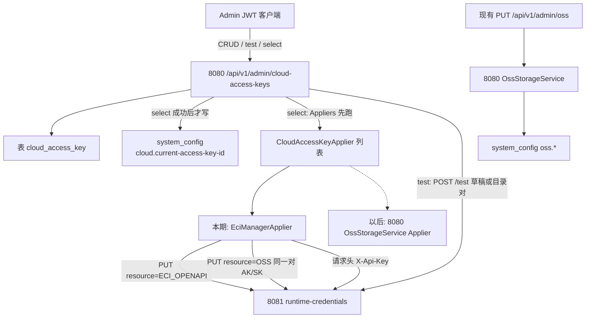

# 主后端云 AccessKey 目录 + 按资源选用推送到 eci-manager

> **状态：** 架构已锁定（2026-09-19）。本文件是实现契约，取代 [2026-09-08 设计 §5](./2026-09-08-eci-manager-credential-runtime-design.md) 中对 8080 的规划。  
> **日期：** 2026-09-19  
> **范围：** 仅 `services/backend`（端口 8080）Admin JWT API。不改 `apps/admin`、`apps/web2`、`eci-manager`。  
> **Git：** 云端 `upstream-xji/main` 已合入本地分支 `eci-oss`。`eci-manager/` 仅本地存在，8081 契约以本地代码与 `eci-manager/docs/API文档.md` §5 为准，本期冻结、零改动。

---

## 0. 2026-09-20 资源隔离修订

本节取代下文关于「全站一把当前钥」「select 同时下发 ECI_OPENAPI 与 OSS」的旧设计；其余脱敏、错误映射、Admin 鉴权和 8081 契约继续有效。

- `cloud_access_key` 仍是一份统一凭据目录；`cloud_access_key_resource` 保存一条凭据与 `ECI_OPENAPI` / `OSS` 的多对多绑定。
- 列表改为 `GET /api/v1/admin/cloud-access-keys?resource=<resource>`，只返回绑定该资源的条目。
- 创建与更新请求增加 `resources`；响应条目增加 `resources`、`selectedResources`，不再使用全局 `selected`。
- 当前选择分别保存在 `cloud.current-access-key-id.ECI_OPENAPI` 与 `cloud.current-access-key-id.OSS`。
- `POST /{id}/select` 请求体为 `{ "resource": "OSS" }`，只向 8081 下发该资源；响应使用单值 `appliedResource`。
- 旧目录条目首次启动时绑定两个资源；有效的旧 `cloud.current-access-key-id` 同时迁移到两个资源配置键。
- 已保存 Key 只能测通其已绑定的资源；正在使用的资源绑定不能移除，任一资源正在使用的 Key 不能删除。

生产环境使用 `ddl-auto=validate`，升级前增加关联表：

```sql
CREATE TABLE cloud_access_key_resource (
    cloud_access_key_id UUID NOT NULL REFERENCES cloud_access_key(id),
    resource VARCHAR(32) NOT NULL,
    PRIMARY KEY (cloud_access_key_id, resource)
);
```

---

## 1. 目的与本期边界

### 1.1 目的

在 **8080 主后端** 提供一份阿里云 AccessKey 目录（多把 AK/SK），管理员用 Admin JWT 增删改查，并 **选用其中一把**。选用成功时，8080 把同一对 AK/SK 推给 **8081 eci-manager 的当前钥执行器**（每种 resource 一把当前钥），让后续 ECI OpenAPI 与 eci-manager 任务预签名 OSS 使用这把钥。

8081 **不**维护第二份目录，也 **不**新增 API。HTTP Api-Key（`X-Api-Key`）**不**进入目录。

### 1.2 本期做

- 表 `cloud_access_key` + `system_config` 键 `cloud.current-access-key-id`。
- Admin API：`/api/v1/admin/cloud-access-keys` 的 list / create / get / update / delete / select / test。
- 选用时先跑已注册 Applier，**全部成功后再**写入当前 id。
- 本期只注册 `EciManagerApplier`：对 8081 `PUT /api/v1/eci/runtime-credentials` 调用两次（先 `ECI_OPENAPI`，再 `OSS`），同一对 AK/SK。
- 选用前可选测通：代理 8081 `POST /api/v1/eci/runtime-credentials/test`；不落 8080 当前 id，不 PUT 8081 当前钥。
- Spring `RestClient` 调 8081，请求头 `X-Api-Key`。
- GET/列表永不返回 SK，只返回 `accessKeyHint`。

### 1.3 本期不做（硬边界）

| 项 | 说明 |
|----|------|
| `apps/admin` UI | 不改管理页。本期只交付 HTTP。 |
| `apps/web2` / `apps/web` | 用户端不涉及。 |
| 改 `eci-manager` | 不改 8081 代码、API、配置键、脱敏算法。 |
| 把 8080 OSS 配进目录 | 现有 `PUT /api/v1/admin/oss` 仍是 **8080 `OssStorageService` 的权威**（endpoint / bucket / AK/SK）。目录 **不** 读写 `oss.endpoint`、`oss.access-key`、`oss.secret-key` 等键，也 **不** 调用 `OssStorageService.updateConfig` / `reloadClients`。 |
| 把 `oss.access-key` 迁入目录 | 不做数据迁移。以后 8080 OSS 作为另一个 Applier 再挂，**不改目录表结构**。 |
| 8081 HTTP Api-Key 轮换 / 热更新 | 权威仍是 8081 进程配置 `eci.api-key`（env `ECI_API_KEY`）。8080 侧对应 `xjicloud.eci-manager.api-key`。改钥必须改双方部署配置并重启各进程。 |
| 清空 8081 当前云钥 | 8081 本期无清空接口。选用只 PUT 成对非空 AK/SK。 |
| 8081 多钥目录 / 按 id 选钥 | 仍不做。 |
| 热改 8081 region / vswitch / sg / OSS endpoint | 选用只推 AK/SK。网络与 bucket 仍在 8081 自己的 `eci.*` / `eci.oss.*`。 |
| 新顶层 Java 包 | 业务代码放现有 `com.xjicloud.admin`（及已有 `com.xjicloud.config` 放 Properties）。禁止新建 `com.xjicloud.eci` / `com.xjicloud.cloud` 等平行顶层包。 |

---

## 2. 架构（已批准，不再重开）

一份目录活在 8080。选用时对已注册 Applier 逐个 `apply(ak, sk)`。本期只有推 8081 的 Applier；以后再挂 8080 OSS Applier，表结构不变。



选用顺序（必须遵守）：

1. 按 id 读目录行；成对 AK/SK 必须非空，否则 **400**，不调 8081。
2. 检查 `xjicloud.eci-manager.base-url` 与 `api-key` 均非空，否则 **503**，不写当前 id。
3. **按注册顺序**调用每个 `CloudAccessKeyApplier.apply(accessKeyId, accessKeySecret)`。本期列表里只有 `EciManagerApplier`。
4. `EciManagerApplier` **先** `PUT` `resource=ECI_OPENAPI`，**成功后再** `PUT` `resource=OSS`。两次 body 里的 `accessKeyId` / `accessKeySecret` 相同。
5. 所有 Applier 都成功后，才把该行 `id` 写入 `system_config` 的 `cloud.current-access-key-id`。
6. 任一步失败：**不**更新 `cloud.current-access-key-id`。避免「库里是 A、8081 仍是 B」中的 **id 不一致**（部分 PUT 导致的 8081 两 resource 不一致见 §5.4，不自动回滚）。

CRUD（create / update / delete / list / get）**不**调用 8081。更新当前选用行的 AK/SK **不会**自动再 PUT；操作员必须再调一次 select，才能把新明文推到 8081。这样「保存目录」和「热切 8081」不会混在一次可能打错字的 PUT 里。

HTTP Api-Key 只用于 8080→8081 内网调用，不进目录，不进浏览器响应。

---

## 3. 数据模型

### 3.1 表 `cloud_access_key`

JPA 实体：**`com.xjicloud.admin.CloudAccessKey`**（风格对齐 `AdminUser` / `TrainingJob`，不用 `*Entity` 后缀）。  
仓库：**`com.xjicloud.admin.CloudAccessKeyRepository`** extends `JpaRepository<CloudAccessKey, UUID>`。

| Java 字段 | 列名 | 类型 | 约束 |
|-----------|------|------|------|
| `id` | `id` | `UUID` | PK，`@GeneratedValue(strategy = GenerationType.UUID)` |
| `name` | `name` | `VARCHAR(128)` | `NOT NULL`，`UNIQUE`，trim 后 1–128 字符 |
| `accessKeyId` | `access_key_id` | `VARCHAR(128)` | `NOT NULL`，trim 后 1–128 字符 |
| `secret` | `secret` | `VARCHAR(512)` | `NOT NULL`，trim 后 1–512 字符。Java 属性名 `secret`，列名按锁定为 `secret` |
| `createdAt` | `created_at` | `Instant` | `NOT NULL`，`updatable = false`，创建时 `Instant.now()` |
| `updatedAt` | `updated_at` | `Instant` | `NOT NULL`，每次成功写入刷新 |

`name` 大小写敏感唯一。冲突 → HTTP **409**，文案见 §4.8。

`access_key_id` **不**做唯一约束（允许两行指向同一把阿里云钥）。

dev profile 现有 `spring.jpa.hibernate.ddl-auto: update`，本地 H2 会建表。prod 现为 `validate`，上线前必须先执行：

```sql
CREATE TABLE cloud_access_key (
    id UUID PRIMARY KEY,
    name VARCHAR(128) NOT NULL,
    access_key_id VARCHAR(128) NOT NULL,
    secret VARCHAR(512) NOT NULL,
    created_at TIMESTAMP WITH TIME ZONE NOT NULL,
    updated_at TIMESTAMP WITH TIME ZONE NOT NULL,
    CONSTRAINT uk_cloud_access_key_name UNIQUE (name)
);
```

本期不引入 Flyway。不把真实 AK/SK 写入本 spec、测试源码常量以外的可提交样例；测试用明显假值（例如 `LTAItestkey0001` / `test-secret-value-not-real`）。

### 3.2 当前选用：`system_config`

沿用现有实体 **`com.xjicloud.config.SystemConfig`** 与 **`SystemConfigRepository`**。不新建绑定表（这取代 2026-09-08 §5 的「资源绑定表」）。

| 项 | 值 |
|----|----|
| `config_key` | **`cloud.current-access-key-id`**（精确字符串，无空格） |
| `config_value` | 目录行 `id` 的 `UUID.toString()`（带连字符的标准形式，36 字符） |
| 行不存在 | 表示尚未选用；列表 `currentId` 为 `null` |
| 写入时机 | **仅** select 在全部 Applier 成功之后 |
| 删除该行 | 本期 API 不提供「取消选用」。删除目录行若其 id 等于当前值 → **409**，因此正常 API 路径下不会留下悬空 currentId |

`SystemConfig.configValue` 现长 2048，足够存 UUID。写入时同时刷新 `updatedAt`。`updatedBy` 列不存在，不新增。

若运维手工把 currentId 改成库中不存在的 UUID：列表仍返回该 `currentId`，所有 `items[].selected` 为 `false`；再次 select 合法 id 会覆盖。API 不自动清除悬空值。

### 3.3 与 8080 OSS `system_config` 隔离

`OssStorageService` 继续独占：

- `oss.endpoint` / `oss.region` / `oss.bucket` / `oss.access-key` / `oss.secret-key` / `oss.path-style-access`

目录代码 **禁止** `saveConfig` 这些键，**禁止** 读它们来填充目录。两边可以是同一把阿里云钥，但存储与热更新路径独立。

---

## 4. HTTP API

前缀：**`/api/v1/admin/cloud-access-keys`**。  
鉴权：与现有管理接口相同。`SecurityConfig` 已有 `.requestMatchers("/api/v1/admin/**").hasRole("ADMIN")`；`/api/v1/admin/auth/**` 除外。本期 **不改** Filter 与 SecurityConfig。

统一响应：现有 `com.xjicloud.common.ApiResponse`：`{ "success", "message", "data" }`。业务失败抛 `BusinessException(message, HttpStatus)`，由现有 `GlobalExceptionHandler` 转成对应 HTTP 状态 + `success=false`、`data=null`。

Controller：**`com.xjicloud.admin.CloudAccessKeyController`**（新建类，不要把 7 个动作塞进现有 `AdminController`）。  
Service：**`com.xjicloud.admin.CloudAccessKeyService`**。

JSON 字段一律 camelCase。时间字段为 ISO-8601 UTC（Spring Boot 默认 `Instant` 序列化，例如 `2026-09-19T12:00:00Z`）。

### 4.1 脱敏 `accessKeyHint`

GET / 列表 / 创建 / 更新 / 选用 的响应 **永不**包含 `accessKeySecret`、`secret`。也不返回完整 `accessKeyId`。

算法与现有 **8080 `OssStorageService.mask`** 逐字一致（本期不改 `OssStorageService`、不抽公共类）：

```
若 value == null 或 value.length() <= 4 → "****"
否则 value 前 2 字符 + "****" + 后 2 字符
```

不先 trim 再 mask（与 `OssStorageService.mask` 一致）；入库前已经 trim。  
例：`LTAItestkey0001` → `LT****01`。

**不**使用 8081 `CredentialHint`（前 4 + `****` + 后 4，且长度 &lt; 12 时整段 `****`）。测通响应里的 `accessKeyHint` 也由 8080 按上述算法计算，不回传 8081 的 hint，避免同一把钥在目录列表和测通结果里长得不一样。

另返回 `secretConfigured: true/false`（`secret` 非 blank 即为 true）。创建/更新成功后该字段恒为 true。

判断「客户端把 hint 又提交回来」与 OSS 相同：字符串包含 `****` 则视为脱敏值，**不**覆盖库里的 id 或 secret。

### 4.2 条目 JSON（`CloudAccessKeyResponse`）

```json
{
  "id": "550e8400-e29b-41d4-a716-446655440000",
  "name": "hangzhou-ram",
  "accessKeyHint": "LT****01",
  "secretConfigured": true,
  "selected": false,
  "createdAt": "2026-09-19T12:00:00Z",
  "updatedAt": "2026-09-19T12:00:00Z"
}
```

`selected`：该 `id` 与 `cloud.current-access-key-id` 相等则为 `true`。

### 4.3 列表

`GET /api/v1/admin/cloud-access-keys`

成功 **200**：

```json
{
  "success": true,
  "message": null,
  "data": {
    "currentId": "550e8400-e29b-41d4-a716-446655440000",
    "items": []
  }
}
```

- `items` 按 `createdAt` **降序**（新的在前）。无分页。
- 尚未选用时 `currentId` 为 `null`。
- 每个 item 不得出现 SK 字段；响应 JSON 字符串不得包含库中 secret 明文。

### 4.4 创建

`POST /api/v1/admin/cloud-access-keys`

请求（`CreateCloudAccessKeyRequest`）：

```json
{
  "name": "hangzhou-ram",
  "accessKeyId": "<AccessKeyId>",
  "accessKeySecret": "<AccessKeySecret>"
}
```

校验（trim 后）：

| 条件 | HTTP | `message` |
|------|------|-----------|
| `name` 空 | 400 | `名称不能为空` |
| `name` 长度 &gt; 128 | 400 | `名称长度不能超过 128` |
| `accessKeyId` 空 | 400 | `accessKeyId 不能为空` |
| `accessKeyId` 含 `****` | 400 | `请提供完整的 AccessKeyId，不要提交脱敏值` |
| `accessKeyId` 长度 &gt; 128 | 400 | `accessKeyId 长度不能超过 128` |
| `accessKeySecret` 空 | 400 | `accessKeySecret 不能为空` |
| `accessKeySecret` 含 `****` | 400 | `请提供完整的 AccessKeySecret，不要提交脱敏值` |
| `accessKeySecret` 长度 &gt; 512 | 400 | `accessKeySecret 长度不能超过 512` |
| `name` 已存在 | 409 | `云访问密钥名称已存在` |

成功 **200**，`data` 为 §4.2 条目（`selected` 此时为 `false`，创建不改变当前选用）。不调 8081。

### 4.5 单条查询

`GET /api/v1/admin/cloud-access-keys/{id}`

- `id` 不是合法 UUID → **400**，`message`：`id 格式无效`（Controller 用 `String` 再解析，避免 Spring 转换失败走通用 500）。
- 不存在 → **404**，`message`：`云访问密钥不存在`。
- 成功 **200**，`data` 为 §4.2。无 SK。

### 4.6 更新（省略 secret = 保留，对齐 OSS 表单）

`PUT /api/v1/admin/cloud-access-keys/{id}`

请求（`UpdateCloudAccessKeyRequest`，字段均可省略）：

```json
{
  "name": "hangzhou-ram-v2",
  "accessKeyId": "<可选，省略或空或脱敏则保留>",
  "accessKeySecret": "<可选，省略或空或脱敏则保留>"
}
```

规则（与 `OssStorageService.shouldPersistCredential` 同语义）：

- `name`：省略或 `null` → 不改名；非 null 则 trim，空串 → **400** `名称不能为空`；超长 / 与其它行冲突同创建。
- `accessKeyId`：`null`、省略、空白、或含 `****` → **保留**库中值；否则 trim 后覆盖（长度规则同创建）。
- `accessKeySecret`：`null`、省略、空白、或含 `****` → **保留**库中 secret；否则 trim 后覆盖。
- 允许只改 name、只改 id、只改 secret。
- 不存在 → **404** `云访问密钥不存在`。
- 成功后刷新 `updatedAt`。**不**调 8081，**不**改 `cloud.current-access-key-id`。
- 成功 **200**，`data` 为更新后的 §4.2。

若更新的是当前选用行：8081 仍是旧钥，直到再次 select。响应里 `selected` 仍为 `true`。

### 4.7 删除

`DELETE /api/v1/admin/cloud-access-keys/{id}`

| 条件 | HTTP | `message` |
|------|------|-----------|
| id 非法 | 400 | `id 格式无效` |
| 不存在 | 404 | `云访问密钥不存在` |
| 该 id 等于当前 `cloud.current-access-key-id` | **409** | **`不能删除当前选用的云访问密钥`** |
| 否则 | **200** | `message` 为 `null`，`data` 为 `null`（对齐 `AdminController` 其它无 body 成功） |

删除不调 8081，不修改 8081 当前钥。

### 4.8 选用（切换当前钥并推送 8081）

`POST /api/v1/admin/cloud-access-keys/{id}/select`

无请求体。

成功 **200**：

```json
{
  "success": true,
  "message": null,
  "data": {
    "id": "550e8400-e29b-41d4-a716-446655440000",
    "name": "hangzhou-ram",
    "accessKeyHint": "LT****01",
    "secretConfigured": true,
    "selected": true,
    "createdAt": "2026-09-19T12:00:00Z",
    "updatedAt": "2026-09-19T12:00:00Z",
    "appliedResources": ["ECI_OPENAPI", "OSS"]
  }
}
```

`appliedResources` 固定为先 `ECI_OPENAPI` 后 `OSS`，表示这两个 PUT 都已 2xx。

失败（均 **不**写 `cloud.current-access-key-id`）：

| 条件 | HTTP | `message` |
|------|------|-----------|
| id 非法 | 400 | `id 格式无效` |
| 不存在 | 404 | `云访问密钥不存在` |
| 库中 id 或 secret 空白 | 400 | `该云访问密钥不完整，请先更新 AccessKeySecret` |
| `base-url` 或 `api-key` 空白 | **503** | **`未配置 eci-manager 的 base-url 或 api-key，无法选用`** |
| 第一次 PUT（`ECI_OPENAPI`）失败 | 见 §5.3 | 见 §5.3；**不**发第二次 PUT |
| 第一次成功、第二次 PUT（`OSS`）失败 | **502** | **`eci-manager 应用失败: resource=OSS`**；若有 8081 `message` 则追加 `, message=` + 消毒后的原文。**不**对 8081 做补偿 PUT |
| 8081 不可达 / 超时 | **502** | **`eci-manager 不可达`** |

同一 id 重复 select：仍两次 PUT（用于修复「第一次成功、第二次失败」的半状态），成功后再写同一 currentId。这是有意的幂等修复，不是 no-op。

select 对 Service 方法加 `synchronized`（单机），避免两个管理员并发 select 把两次 PUT 交错成「ECI=A、OSS=B」。不做分布式锁。

写 currentId **不要**包住 8081 HTTP 的长事务：HTTP 在事务外；仅最后 `system_config` 保存走短事务。若 PUT 已成功但写库失败：返回 **500**，`message` 为 `云访问密钥已推送到 eci-manager，但保存当前选用失败，请重试选用`。操作员重试同一 select 即可（8081 PUT 幂等覆盖）。

### 4.9 选用前测通（不 persist、不 PUT 当前钥）

测通 **只**代理 8081 `POST /api/v1/eci/runtime-credentials/test`。8081 契约：成对非空 id/secret 用**草稿**测，不落盘、不 reload。8080 **禁止**把「两者都省略」转发给 8081，因为那会测 **8081 已保存的当前钥**，不是目录行。

#### 4.9.1 测草稿

`POST /api/v1/admin/cloud-access-keys/test`

```json
{
  "resource": "OSS",
  "accessKeyId": "<AccessKeyId>",
  "accessKeySecret": "<AccessKeySecret>"
}
```

`resource` 只允许 `ECI_OPENAPI` 或 `OSS`（精确大小写）。

| 条件 | HTTP | `message` |
|------|------|-----------|
| `resource` 空 | 400 | `resource 必填` |
| 其它字符串 | 400 | `未知 resource: ` + trim 后原文（不调 8081） |
| id/secret 不是成对非空 | 400 | `accessKeyId 与 accessKeySecret 必须成对非空` |
| 含 `****` | 400 | `请提供完整的 AccessKeyId 与 AccessKeySecret，不要提交脱敏值` |
| 未配置 base-url 或 api-key | 503 | `未配置 eci-manager 的 base-url 或 api-key，无法测通` |

#### 4.9.2 测目录已保存对

`POST /api/v1/admin/cloud-access-keys/{id}/test`

```json
{
  "resource": "ECI_OPENAPI"
}
```

8080 从库取出明文 AK/SK，作为草稿发给 8081（body 带 `resource` + `accessKeyId` + `accessKeySecret`）。不存在 404；不完整 400 `该云访问密钥不完整，请先更新 AccessKeySecret`；`resource` 规则同上。

请求体不得再带一对草稿钥（避免和路径 id 歧义）。若 JSON 出现非空 `accessKeyId` 或 `accessKeySecret` → **400** `测已保存密钥时不要提交 accessKeyId 或 accessKeySecret`。

#### 4.9.3 测通成功响应

8081 对「已真正发起探测」返回 **200**，`data.ok` 可为 true/false（云 403 是测通结果，不是 API 用错）。8080 同样 **200**：

```json
{
  "success": true,
  "message": null,
  "data": {
    "resource": "OSS",
    "ok": true,
    "accessKeyHint": "LT****01",
    "detail": "",
    "persistedCurrent": false,
    "appliedToEciManager": false
  }
}
```

- `ok` / `detail` 来自 8081 `data`（`detail` 做 §7 消毒：若包含本次 secret 则替换为 `***`）。
- `accessKeyHint` 用 8080 mask 计算本次实际送出的 AccessKeyId。
- `persistedCurrent` 与 `appliedToEciManager` **恒为 false**。
- 不写 `cloud.current-access-key-id`，不发 PUT `/runtime-credentials`。

8081 在 `eci.mock=true` 时测 `ECI_OPENAPI` 返回 **400**、文案 `mock 模式下不能测 ECI_OPENAPI`（本地 8081 现行行为）。8080 **原样映射为 400** 并转发该 `message`，不把它改成 200。测 `OSS` 在 8081 未配 endpoint/bucket 时为 400 `OSS endpoint 与 bucket 未配置，不能测通`，同样转发。

测通遇 8081 不可达 → **502** `eci-manager 不可达`。目录 CRUD 仍可用。

---

## 5. EciManager 客户端

### 5.1 类型与 RestClient

| 类型 | 包 | 职责 |
|------|-----|------|
| `EciManagerProperties` | `com.xjicloud.config` | 绑定 `xjicloud.eci-manager`（对齐现有 `OssProperties`） |
| `EciManagerClient` | `com.xjicloud.admin` | 封装 RestClient，发 PUT/POST，映射状态码 |
| `CloudAccessKeyApplier` | `com.xjicloud.admin` | 接口 `void apply(String accessKeyId, String accessKeySecret)` |
| `EciManagerApplier` | `com.xjicloud.admin` | 实现接口；注入 `EciManagerClient`；本期唯一的 `@Component` Applier |

在 `XjiCloudApplication` 的 `@EnableConfigurationProperties` 中 **追加** `EciManagerProperties.class`，不要新建平行启动类。

`RestClient`：Spring Framework 6 / Boot 3.3 自带，**不**引入 WebClient、OpenFeign、OkHttp 新依赖。Bean 在 `com.xjicloud.admin` 的 `@Configuration`（例如 `EciManagerClientConfig`）里创建：

- `baseUrl`：配置值 trim 掉末尾 `/`。默认假设 8081 **无** `server.servlet.context-path`（与当前 eci-manager `application.yml` 一致）。
- 每次请求 header：`X-Api-Key` = 配置的 api-key；`Content-Type: application/json`。
- 路径：
  - PUT `{baseUrl}/api/v1/eci/runtime-credentials`
  - POST `{baseUrl}/api/v1/eci/runtime-credentials/test`
- 超时：连接 **3 秒**，读取 **20 秒**（PUT 会在 8081 侧重建设客户端）。通过 `JdkClientHttpRequestFactory` 或 `SimpleClientHttpRequestFactory` 设置；配置项见 §6。超时抛出的异常走「不可达」**502**。
- 默认 **不**把 4xx/5xx 当成功；用 `RestClient` `onStatus` 或捕获 `RestClientResponseException` 后按 §5.3 映射。

PUT 请求体（与 8081 `PutRuntimeCredentialRequest` 字段名一致）：

```json
{
  "resource": "ECI_OPENAPI",
  "accessKeyId": "<AccessKeyId>",
  "accessKeySecret": "<AccessKeySecret>"
}
```

第二次仅 `resource` 改为 `OSS`。

8081 成功时 HTTP 200 且 `success=true`，`data` 为全量 snapshot（含 `mock` 与两个 resource）。8080 **不**把该 snapshot 作为 select 的 `data` 返回给管理员（避免把 8081 `mode`/`mock` 泄漏进目录 API）。select 只要求 HTTP 2xx 且 `success` 不为 `false`。

`EciManagerClient` 本期 **不**调用 GET `/runtime-credentials`（GET 也不返回 SK，对 select 无帮助）。

### 5.2 Applier 注册

`CloudAccessKeyService` 构造注入 `List<CloudAccessKeyApplier>`（Spring 会收集所有实现）。顺序：仅一个 Bean 时就是 `EciManagerApplier`。以后增加 8080 OSS Applier 时用 `@Order` 明确顺序，**不必改表**。

本期测试用真实 `EciManagerApplier` + mock `EciManagerClient`，或直接 mock `List<CloudAccessKeyApplier>` 断言调用顺序与失败短路。

### 5.3 8081 HTTP 状态 → 8080 `BusinessException`

管理员 JWT 仍然有效时，**禁止**把 8081 的 401 原样变成 8080 的 401（管理前端若按 401 清 Admin 登录会误下线）。

| 8081 / 传输 | 发生在 | 8080 HTTP | 8080 `message` |
|-------------|--------|-----------|----------------|
| 连接拒绝、DNS、读/连超时、无响应 | select 或 test | 502 | `eci-manager 不可达` |
| HTTP 401 | select 或 test | 502 | `eci-manager 拒绝 X-Api-Key` |
| HTTP 400 | select 的 PUT | 400 | 优先用 8081 JSON `message`（消毒后）；空则 `eci-manager 拒绝请求: resource=` + 当前 resource |
| HTTP 400 | test | 400 | 同上，转发 8081 `message`（例如 `mock 模式下不能测 ECI_OPENAPI`） |
| HTTP 404（路径不对） | select 或 test | 502 | `eci-manager 接口不可用` |
| HTTP 5xx | select 或 test | 502 | `eci-manager 应用失败: resource=` + 当前 resource + `, status=` + 状态码；若有消毒后的 8081 `message` 再追加 |
| HTTP 2xx 但 body `success=false` | select 或 test | 502 | `eci-manager 应用失败: resource=` + 当前 resource |
| 本地未配 base-url 或 api-key | select | 503 | `未配置 eci-manager 的 base-url 或 api-key，无法选用` |
| 同上 | test | 503 | `未配置 eci-manager 的 base-url 或 api-key，无法测通` |

解析 8081 失败体：与主仓相同的 `{success,message,data}`。读不到 JSON 时不要把原始 body（可能误含密钥）写入 8080 `message` 或日志。

`resource` 在异常 message 里只出现枚举名 `ECI_OPENAPI` 或 `OSS`。

### 5.4 部分失败（第一次 PUT 成功、第二次失败）

锁定行为：

1. **不**写入 `cloud.current-access-key-id`。
2. **不**对 8081 做补偿 PUT（8080 没有「8081 上一把钥」的 SK，GET 也不返回 SK，无法安全回滚）。
3. 返回 **502**，`message` 以 `eci-manager 应用失败: resource=OSS` 开头（失败发生在第二次）。
4. 此时 8081 上 `ECI_OPENAPI` 可能已是新钥、`OSS` 仍是旧钥。操作员 **再次对同一 id 调用 select** 即可把两次 PUT 都打完。文档与 `message` 不需要自动修复。

第一次 PUT 失败：不发第二次，currentId 不变。

8081 不可达：CRUD 与列表照常；只有 select/test 失败。

---

## 6. 配置键与环境变量

写在 `services/backend/src/main/resources/application.yml` 的 `xjicloud:` 下（与现有 `jwt` / `storage` / `cors` 并列）。**示例值不是真实密钥。**

```yaml
xjicloud:
  eci-manager:
    base-url: ${XJICLOUD_ECI_MANAGER_BASE_URL:http://127.0.0.1:8081}
    api-key: ${XJICLOUD_ECI_MANAGER_API_KEY:}
    connect-timeout: 3s
    read-timeout: 20s
```

| YAML | 环境变量 | 默认 | 含义 |
|------|----------|------|------|
| `xjicloud.eci-manager.base-url` | `XJICLOUD_ECI_MANAGER_BASE_URL` | `http://127.0.0.1:8081` | 8081 根 URL，无路径后缀 |
| `xjicloud.eci-manager.api-key` | `XJICLOUD_ECI_MANAGER_API_KEY` | **空** | 8080→8081 的 `X-Api-Key` |
| `xjicloud.eci-manager.connect-timeout` | `XJICLOUD_ECI_MANAGER_CONNECT_TIMEOUT` | `3s` | TCP 连接超时 |
| `xjicloud.eci-manager.read-timeout` | `XJICLOUD_ECI_MANAGER_READ_TIMEOUT` | `20s` | 等待 8081 响应 |

`api-key` 的 **值** 必须与 8081 进程配置 `eci.api-key` 一致。8081 注入变量名是 **`ECI_API_KEY`**，与 8080 的 `XJICLOUD_ECI_MANAGER_API_KEY` **不是**同一个名字；部署时拷贝同一秘密值到两个变量。8080 **不要**去读 `ECI_API_KEY`（避免和本机同时跑 8081 时误绑生命周期）。

空 `api-key` 是有意默认：未配置时 select/test 明确 503，而不会拿空头去撞 8081 的 401。

本期不改 `deploy/env.example` / Compose（非本 API 范围）。实现时把上述键加入 yml 即可。

`EciManagerProperties` 使用 record（对齐 `OssProperties` / `JwtProperties`）：

```java
@ConfigurationProperties(prefix = "xjicloud.eci-manager")
public record EciManagerProperties(
        String baseUrl,
        String apiKey,
        Duration connectTimeout,
        Duration readTimeout
) {
    public EciManagerProperties {
        if (baseUrl == null || baseUrl.isBlank()) {
            baseUrl = "http://127.0.0.1:8081";
        }
        if (apiKey == null) {
            apiKey = "";
        }
        if (connectTimeout == null) {
            connectTimeout = Duration.ofSeconds(3);
        }
        if (readTimeout == null) {
            readTimeout = Duration.ofSeconds(20);
        }
    }

    public boolean hasApiKey() {
        return !apiKey.isBlank();
    }
}
```

`apiKey` trim 后为空视为未配置。`hasApiKey()` 为 false 或 `baseUrl` 无有效主机时，select/test 走 §5.3 的 503，不发 HTTP。

---

## 7. 安全

1. **SK 不出 GET/列表/日志。** `CloudAccessKeyResponse` 无 secret 字段。日志只打 `id`、`name`、`accessKeyHint`、`resource`、HTTP 状态。禁止 `log.info(requestBody)`、禁止打印 `X-Api-Key`、禁止把 `EciManagerProperties.apiKey` 打进日志。
2. **8081 返回的 `detail` / `message`：** 若包含本次使用的 `accessKeySecret` 或配置的 `api-key`，替换为 `***` 再进入 8080 响应或日志。
3. **测通与选用的 RestClient 异常消息**同样消毒后再放入 `BusinessException`。
4. **`X-Api-Key` 仅 8080→8081 内网。** 不出现在 8080 对浏览器的 API 响应中。Admin JWT 继续走 `Authorization: Bearer`。
5. **HTTP Api-Key 不进 `cloud_access_key`，不进 `system_config`。** 与 [2026-09-17 HTTP Api-Key 配置权威](./2026-09-17-eci-http-api-key-config-authority.md) 一致：改钥靠部署配置 + 重启，无热切。
6. 鉴权：无有效 Admin JWT → 与现有 `/api/v1/admin/oss` 相同，Spring Security **401**（默认空 body，不是 `ApiResponse`）。用户 JWT 的 Filter 对 `/api/v1/admin/**` 直接 skip，因此用户 token 在管理路径上等于未登录 → **401**。`@WithMockUser(roles = "USER")` 这类已认证非 ADMIN → **403**。本期不改该行为。
7. 不把真实密钥写入 Git、spec 示例、测试输出断言字符串以外的「打印全 secret」。测试断言用 `doesNotContain(secret)`。
8. 更新接口忽略含 `****` 的提交，防止把 hint 写回库（OSS 曾出现过「脱敏值覆盖真 AK」）。

---

## 8. 测试

目录：`services/backend/src/test/java/com/xjicloud/admin/`。  
不连真 8081、不连真阿里云、不要求 Redis。现有 backend 测试以 Mockito 为主；8081 HTTP 用 **Spring `MockRestServiceServer` 绑定 RestClient**（`spring-boot-starter-test` 已有，**不**为 WireMock 新增依赖）。Service 层也可直接 mock `EciManagerClient`。

实现后必须能被 `cd services/backend && mvn -B test` 跑到。

### 8.1 `CloudAccessKeyServiceTest`（mock 仓库 + mock `EciManagerClient` 或 Applier）

| 用例 | 期望 |
|------|------|
| 创建后列表 | 含 hint，JSON/返回对象无 `secret` 字段；完整 secret 不出现在 response 里 |
| 创建缺 secret | 400 `accessKeySecret 不能为空` |
| 更新省略 `accessKeySecret` | 库中 secret 不变 |
| 更新提交含 `****` 的 id | 库中 `access_key_id` 不变 |
| select 成功 | `EciManagerClient`（或 Applier）先 ECI_OPENAPI 再 OSS；然后 `system_config` 键 `cloud.current-access-key-id` 等于该 UUID 字符串 |
| select 时 8081 第一次 PUT 抛 502 | **不**写 currentId；第二次 PUT **零次**调用 |
| select 时第一次成功、第二次失败 | **不**写 currentId；无补偿 PUT |
| 删除已选用 id | 409 `不能删除当前选用的云访问密钥` |
| 删除未选用 | 行消失；currentId 不变 |
| `apiKey` 空时 select | 503 `未配置 eci-manager 的 base-url 或 api-key，无法选用`；零次 HTTP |
| `apiKey` 空时 create/list | 成功（CRUD 不依赖 8081） |
| test 草稿 | 调用 test HTTP，不调用 PUT，不写 currentId |
| test 已保存 | 把库中明文对发给 test，不 PUT |

### 8.2 `EciManagerClientTest`（`MockRestServiceServer`）

| 用例 | 期望 |
|------|------|
| 两次 PUT 成功 | 请求 URL 为 `/api/v1/eci/runtime-credentials`；header `X-Api-Key` 等于测试配置的占位符（例如 `test-eci-api-key`）；body `resource` 分别为 `ECI_OPENAPI`、`OSS` |
| 8081 401 | 抛出 `BusinessException`，status **502**，message `eci-manager 拒绝 X-Api-Key` |
| 8081 400 + `{"success":false,"message":"accessKeyId 与 accessKeySecret 必须成对非空"}` | 400，message 含该中文 |
| 8081 500 | 502，message 含 `resource=` 与 `status=500` |
| 服务器未绑定（不可达） | 502 `eci-manager 不可达` |
| POST test 200 `{data:{ok:false,detail:"..."}}` | 调用方能读到 `ok=false`，不抛业务失败（由 Service 转 200） |

断言请求/响应序列化后的字符串 **不含** secret 以外的意外泄漏；对 Mock 服务器的期望 body 可含测试假 secret。

### 8.3 鉴权 `CloudAccessKeyControllerAuthTest`

本期不改 `SecurityConfig`：`/api/v1/admin/cloud-access-keys/**` 已落在现有 `/api/v1/admin/**` + `hasRole("ADMIN")` 下。切片测试不加载三个 JWT Filter（避免 `JwtService` / 仓库）。使用 `@WebMvcTest(CloudAccessKeyController.class)` + 测试用 `@EnableWebSecurity` 配置，其中 **唯一** 授权规则为 `.requestMatchers("/api/v1/admin/**").hasRole("ADMIN")`（与生产 matcher 字符串相同）：

| 请求 | 期望 |
|------|------|
| 无 `Authorization` 访问 GET `/api/v1/admin/cloud-access-keys` | **401** |
| `@WithMockUser(roles = "USER")` | **403** |
| `@WithMockUser(roles = "ADMIN")` | 进入 Controller（再 mock Service 返回空列表 → **200**） |

与现有 `/api/v1/admin/oss` 同一套规则，不新增公开白名单。

### 8.4 脱敏单测

对 Service 的 hint：长度 ≤4 → `****`；`LTAItestkey0001` → `LT****01`。响应对象 `toString`/Jackson 不含 `accessKeySecret`。

---

## 9. 实现落点（最小 diff）

只改 `services/backend`（外加本文档已存在）。实现文件：

```
com.xjicloud.admin.CloudAccessKey
com.xjicloud.admin.CloudAccessKeyRepository
com.xjicloud.admin.CloudAccessKeyService
com.xjicloud.admin.CloudAccessKeyController
com.xjicloud.admin.CloudAccessKeyApplier            // 同文件包含 EciManagerApplier
com.xjicloud.admin.EciManagerClient                 // 同文件包含 EciManagerClientConfig
com.xjicloud.admin.dto.CloudAccessKeyDtos            // 包含本功能全部请求/响应 record
com.xjicloud.config.EciManagerProperties
```

以及 `XjiCloudApplication` 增加 Properties 注册、`application.yml` 增加 §6 键。  
实现完成后按 TEAM_ENGINEERING：更新 `docs/AGENT_CONTEXT.md` §6.3 管理 API 表，补上本资源路径。本文档任务不改 AGENT_CONTEXT。

禁止改：`OssStorageService`、`AdminController` 的 OSS 方法、`eci-manager/**`、`apps/**`。

---

## 10. 与冻结的 8081 契约（调用方视角）

8081 接口 **本期零改动**。8080 必须按下列现行行为编码（摘自本地 `RuntimeCredentialController` / `RuntimeCredentialService` / `RuntimeCredentialTester` / `ApiKeyAuthFilter` 与 `eci-manager/docs/API文档.md` §5）：

| 8081 | 行为 |
|------|------|
| 鉴权 | `/api/v1/eci/**` 需要 header `X-Api-Key`，与 `eci.api-key` 精确匹配；失败 **401**，文案 `无效或缺失的 Api-Key` 或 `服务器未配置 eci.api-key` |
| PUT | `resource` 必填且为 `ECI_OPENAPI` 或 `OSS`；未知 → 400 `未知 resource: …`；id+secret 必须成对非空 → 否则 400 `accessKeyId 与 accessKeySecret 必须成对非空` |
| PUT 成功 | 覆盖该 resource 当前钥、落盘、重建该客户端；返回与 GET 相同的全量 snapshot |
| GET | 永不返回 SK；hint 用 **8081** `CredentialHint` |
| POST `/test` | 草稿不改当前；两者都省略则测 8081 已保存当前钥（故 8080 测目录时必须带对） |
| mock + test `ECI_OPENAPI` | 400 `mock 模式下不能测 ECI_OPENAPI` |
| 无清空当前钥 | 换钥只能 PUT 新的一对 |

8080 **不**发送 region、vswitch、OSS endpoint。这些留在 8081 配置。

---

## 11. 明确非目标（再列一次）

- 管理端 UI、用户前端。
- 将 `oss.access-key` / `oss.secret-key` 迁入 `cloud_access_key` 或 select 时热更新 8080 `OssStorageService`。
- 8081 HTTP Api-Key 运行时轮换、吊销、写入 H2。
- 清空 8081 当前云钥或切回 IMDS/默认链。
- 修改 eci-manager 源码、API、脱敏、超时或鉴权。
- 在 8081 做多钥目录。
- STS / KMS / 加密列 / 按 resource 绑定不同目录 id（本期同一把钥推两个 resource；以后若要「ECI 一把、8081 OSS 另一把」再扩展，**不是**本期表结构）。
- 改 `packages/spark`、`rust/`、弃用 `apps/web`。

---

## 12. 规格自检（锁定项对照）

| 锁定决策 | 落点 |
|----------|------|
| 本期仅 8080 Admin JWT API；无 admin UI；无 8081 API 变更 | §1.2、§1.3、§4 开头、§11 |
| 8080 无旧多 AK 目录；`PUT /admin/oss` 仍是 8080 OSS 权威；目录不改写 8080 OSS | §1.3、§3.3 |
| 表 `cloud_access_key`：id, name, access_key_id, secret, timestamps | §3.1 |
| 当前选用 `system_config` 键 `cloud.current-access-key-id` | §3.2 |
| 先 Applier 成功再 persist current id | §2 步骤、§4.8 |
| 本期仅 `EciManagerApplier`；两次 PUT 同一对；顺序 ECI_OPENAPI → OSS；region/endpoint 留 8081 | §2、§4.8、§5.1、§10 |
| 以后 8080 OSS 另挂 Applier，不改目录表 | §1.3、§2、§5.2 |
| HTTP Api-Key 不进目录；配置 `xjicloud.eci-manager.base-url` + `api-key`；header `X-Api-Key`；对齐 8081 `eci.api-key`；无 HTTP 钥热切 | §6、§7 |
| 包在 `com.xjicloud.admin`；RestClient | §5.1、§9 |
| GET 只返回 hint；算法对齐 8080 `OssStorageService.mask` | §4.1 |
| 8081 GET/PUT/test 契约冻结 | §10 |
| 删除当前选用 → 409 | §4.7 |
| 更新省略 secret = 保留 | §4.6 |
| 部分失败不 persist、不自动回滚 8081、502 标明失败 resource | §5.4 |
| 缺 X-Api-Key 配置 → select 503；CRUD 仍可用 | §4.8、§5.3、§8.1 |
| 测试：mock 8081、无 SK、select 成功双 PUT、失败不 persist、删除 409、缺配置 503、JWT 401/403 | §8 |
| 非目标：UI、迁移 OSS AK、HTTP 钥轮换、清空 8081、改 eci-manager | §1.3、§11 |

无 TBD / TODO / 占位实现。示例中的 `<AccessKeyId>` / `<AccessKeySecret>` 仅标记请求字段，不是可提交的真实密钥。
