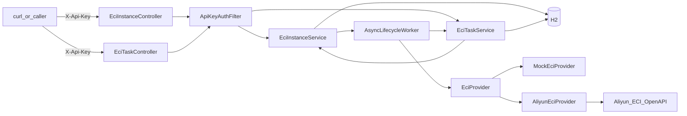

# eci-manager — Agent 上下文（AGENT.md）

> 供 Cursor / 其他 AI Agent 快速理解 **eci-manager** 子工程：结构、架构、已锁定决策、联调结论与约束。  
> 人类可读详细文档：[docs/设计与使用说明.md](docs/设计与使用说明.md)；**逐步测试（Mock/真云每条命令）：** [docs/测试说明.md](docs/测试说明.md)；快速上手：[README.md](README.md)。  
> 主仓全局上下文见仓库根目录 [AGENT_CONTEXT.md](../AGENT_CONTEXT.md)（若未收录本子工程，以本文为准）。

**最后更新：** 2026-09-06（3DGS 使用说明收敛为单篇；POST 15k 已跑通）

**3DGS：** 操作见 [`docs/3dgs-ECI使用说明.md`](docs/3dgs-ECI使用说明.md)（`submit-3dgs-standard.sh`）。**失败取证已实现：** `fetchContainerLog` → 落库 `containerLogTail` → grace → delete；成功不存全量日志。仍待联合 3dgs：traceback 刷 stderr、`PYTHONUNBUFFERED=1`。

---

## 1. 本子工程是什么

独立 **Spring Boot 3.3.5 / Java 17** 服务，目录在主仓 Monorepo 的 `eci-manager/`：

- **已交付（Demo 基座 D0–D3）：** REST + 阿里云 **ECI** OpenAPI 做容器实例 **创建 / 查询 / 删除**（关闭 = 删除，非 Stop）
- **已交付（PRD v2.0.3 T1–T3）：**
  - ✅ Task 1–4：任务模型、Provider、`/tasks` API、手动实例兼容
  - ✅ Task 5：`TaskLifecycleWatcher`、云终态自动删、`maxRuntimeSec`→TIMEOUT
  - ✅ Task 6：Mock `mock-auto-complete-sec` 时间触发终态 + 端到端 IT
  - ✅ Task 7：README / API / 设计说明 / example yml / 验收清单
  - ✅ 测试补强：`TaskLifecycleWatcherUnitTest`、`EciTaskLifecycleMockIT`、`ManualInstanceNoAutoDeleteIT`、`StartupCompensationRunnerTest`；Mock 可注入时钟
- **已交付（OSS 集成 O1–O5.2，2026-07-31）：**
  - ✅ `eci.oss` + `OssStorageService` + `POST /tasks` 可选 `storage`
  - ✅ 联调镜像源码 `test-images/oss-smoke/`；文档 API §3.1 / 设计说明 §4.4
  - ✅ 真云：`python_mirror` + `storage.mode=test` + **内网** OSS endpoint → `SUCCEEDED` 且对象写入 Bucket
  - 📋 Task 7 完整验收清单（keys/无 storage 回归等）可按 PRD 附录 B 继续
- **已交付（失败日志可观测性，2026-09-02～09-05）：**
  - ✅ 删实例前 `DescribeContainerLog` → 任务字段 `containerLogTail`（方案 A）
  - ✅ 可选宽限 `eci.failure-log-grace-sec` 默认 90（方案 C；`0` 关闭）
  - ✅ TIMEOUT 与 Failed 同序（先抓日志再删）；成功任务不存全量日志
  - ✅ Mock/单测锁定 fetch→persist→delete；详节见下方 **§5.1**
- **独立进程**、独立 `pom.xml`，端口 **8081**，**禁止改动**主仓 `backend/` 业务代码
- 对应 PRD：仓库根目录 [`ECI任务驱动容器编排服务产品需求文档(PRD).md`](../ECI任务驱动容器编排服务产品需求文档(PRD).md) **v2.0.3**
- **OSS 增量 PRD：** [`ECI任务OSS对象存储集成产品需求文档(PRD).md`](../ECI任务OSS对象存储集成产品需求文档(PRD).md) **v1.0**
- **实现计划：** [`docs/superpowers/plans/2026-07-27-eci-task-orchestration.md`](../docs/superpowers/plans/2026-07-27-eci-task-orchestration.md)
- **OSS 计划 / 续跑：** [`docs/superpowers/plans/2026-07-30-eci-oss-integration.md`](../docs/superpowers/plans/2026-07-30-eci-oss-integration.md)、[`docs/superpowers/2026-07-31-eci-oss-handoff.md`](../docs/superpowers/2026-07-31-eci-oss-handoff.md)

**当前非目标（一期）：** 训练队列、Worker 注册/心跳、自动扩缩、前端、业务回调、镜像注册表、批量提交；`storage.mode=dataset` / 响应 `storageResolved` / backend 对接（二期）；实时流式日志 UI；OSS 存全量容器日志（方案 B）。

---

## 2. 目录结构

```
eci-manager/
├── pom.xml
├── README.md
├── AGENT.md                         # 本文件
├── .env.example                     # 含 ECI_OSS_*、ECI_FAILURE_LOG_*（.env gitignore）
├── scripts/
│   ├── load-env.sh / start.sh
│   ├── run-hello-python.sh          # 真云：普通 Python 任务（无 storage）
│   ├── debug-oss-smoke.sh           # 真云：exit0 + storage.mode=test 冒烟
│   ├── submit-3dgs-standard.sh      # POST 标准档 3DGS 任务
│   ├── 3dgs-bootstrap.py            # 容器内 bootstrap（含 ply fallback）
│   ├── oss-presign-3dgs.py          # 本机预签名
│   └── run-eci-oss.sh               # conda eci-oss 包装
├── test-images/oss-smoke/           # eci-oss-test 联调镜像（Dockerfile/run.py）
├── docs/
│   ├── 设计与使用说明.md            # §4.4 eci.oss
│   ├── API文档.md                   # §3.1 storage；TaskResponse.containerLogTail
│   ├── 测试说明.md
│   └── 3dgs-ECI使用说明.md          # 3DGS 真云一键提交与注意事项
└── src/main/java/com/xjicloud/eci/
    ├── config/          # EciProperties（含 failure-log-*）、OssProperties、…
    ├── oss/             # OssStorageService
    ├── task/storage/    # TaskStorageResolver、DTO
    ├── instance/ … task/ … provider/ … lifecycle/
```

配置：

| 文件 | 作用 |
|------|------|
| `.env` / `.env.example` | **推荐**：Api-Key、网络、`ALIBABA_CLOUD_*`、`ECI_OSS_*`、可选 `ECI_FAILURE_LOG_*`（`.env` gitignore） |
| `scripts/load-env.sh` / `start.sh` | 加载 `.env` 并启动 |
| `application.yml` | 端口 8081、默认 mock、H2、任务轮询/超时、`failure-log-tail-lines` / `failure-log-grace-sec` |
| `application-dev.yml` | `mock=true` |
| `application-cloud.yml` | `mock=false` + 推荐阿里云镜像 |
| `application-local.yml.example` | 旧模板（推荐改用 `.env`） |
| `src/test/resources/application.properties` | 测试默认 `eci.failure-log-grace-sec=0`（避免 IT 卡 90s） |

仓库便携 JDK/Maven：根目录 `.tools/`（gitignore）+ `.tools/env.sh`（在 `eci-manager/` 下：`source ../.tools/env.sh`）。

---

## 3. 系统架构



### 职责边界

| 层 | 职责 |
|----|------|
| Instance Controller | 手动实例 HTTP |
| Task Controller | 任务提交/查询/取消 |
| EciTaskService | 任务落库、驱动 `createForTask`、cancel、`onInstanceRunning`/`onInstanceFailed`(可带 `containerLogTail`)/`markSucceeded` |
| EciInstanceService | **本地实例状态权威**；`createForTask` 写 `taskId`；`deleteForTaskCancel`（允许 CREATING）；refresh 钩子通知任务 |
| EciProvider | 云侧 Create / Describe / **fetchContainerLog** / Delete |
| AsyncLifecycleWorker | 创建/删除轮询；Succeeded 视为创建成功路径 markRunning；cancel 竞态 abort→删；回调任务状态 |
| TaskLifecycleWatcher | 按 `task-poll-interval-sec` 扫 STARTING/RUNNING；Failed/TIMEOUT：**抓日志→落库→宽限→删**；SUCCEEDED 门闩 |
| StartupCompensationRunner | 启动扫实例 CREATING/STOPPING/RUNNING + 非终态任务对齐 |
| ApiKeyAuthFilter | `/api/v1/eci/**`；`/actuator/health` 公开 |

### 实例状态机（本地权威）

```
CREATING → RUNNING | FAILED
RUNNING  → STOPPING → TERMINATED | FAILED
CREATING|RUNNING|STOPPING|FAILED + 云侧已删/NotFound → TERMINATED（refresh）
```

短任务云侧可能 Pending→Succeeded（未见 Running）：`pollUntilRunning` 将 Succeeded 对齐为本地 `RUNNING`，再由 `TaskLifecycleWatcher` 删实例并 `SUCCEEDED`。

### 任务状态机（T1–T2）

```
PENDING → STARTING → RUNNING → SUCCEEDED | FAILED
STARTING → SUCCEEDED | FAILED（短任务可跳过 Running）
PENDING|STARTING|RUNNING → CANCELLED（cancel）
任意非终态 → FAILED（创建失败、云 Failed、TIMEOUT、资源已清）
```

`SUCCEEDED` 仅在云侧 Succeeded **且** 本地实例已 `TERMINATED` 后落库。人工 `DELETE` 关联实例不会猜成功（任务 → `FAILED`「进程中断或资源已清理」）。

### 创建语义（已锁定：**异步**）

- `POST` **立即**返回；后台调云  
- **先 `repository.save` 再 `@Async`**  
- 任务路径：先存任务 → `createForTask` → 任务 `STARTING` + `instanceId`

删除：

- 手动 `DELETE /instances`：`CREATING` → **409**  
- 任务 `cancel`：走 `deleteForTaskCancel`（无 cloudId 的 CREATING → 本地 TERMINATED；有 cloudId → STOPPING+删）

### 鉴权 vs 云凭证（两种身份，勿混）

| 名称 | 用途 | 来源 |
|------|------|------|
| `eci.api-key` / `X-Api-Key` | 保护本服务 HTTP | **自建** |
| 阿里云调用身份 | 调 ECI OpenAPI | ECS RAM 角色 **或** `ALIBABA_CLOUD_*` 环境变量 |

**重要：** `application-local.yml` 里的 `access-key-id/secret` **不会**用于建客户端（字段废弃兼容）。本机 WSL 必须：

```bash
export ALIBABA_CLOUD_ACCESS_KEY_ID=...
export ALIBABA_CLOUD_ACCESS_KEY_SECRET=...
# STS 时再加 ALIBABA_CLOUD_SECURITY_TOKEN
```

否则 SDK 探 `100.100.100.200`（IMDS）超时属预期。local yml 仍要填：`api-key`、`region-id`、`vswitch-id`、`security-group-id` 等网络项。

启动时 `ProviderConfig` 还会校验 `poll-interval-ms`、`task-poll-interval-sec`、超时等为正数。

---

## 4. HTTP API 摘要

前缀：`/api/v1/eci`；响应：`{ success, message, data }`。

### 实例

| 方法 | 路径 | 行为 |
|------|------|------|
| POST | `/instances` | 异步创建；`image` **可选**→默认配置；`taskId=null` |
| DELETE | `/instances/{id}` | 删云；TERMINATED 幂等；CREATING→409 |
| GET | `/instances?status=` | 列表 |
| GET | `/instances/{id}` | 详情（含 `taskId`） |
| POST | `/instances/{id}/refresh` | Describe 回写；可推进任务 Running/Failed |

创建可选：`name`、`image`、`cpu`、`memory`、`env`、`instanceType`、`gpu`、`imageSnapshotId`、`restartPolicy`、`command`、`args`。

### 任务

| 方法 | 路径 | 行为 |
|------|------|------|
| POST | `/tasks` | **`image` 必填**；可选 `storage`；立即返回 taskId + STARTING + instanceId |
| GET | `/tasks?status=` | 列表 |
| GET | `/tasks/{id}` | 详情（失败时含 `failureReason` + `containerLogTail`） |
| POST | `/tasks/{id}/cancel` | 幂等 CANCELLED + 删关联实例 |

未传规格/重启/超时 → 用配置默认值，**实际值写入任务行**。

有 `storage`：须 `eci.oss.enabled` 且配置完整，否则 **400 不落库**；注入 `XJI_OUTPUT_UPLOAD_URL` 等（禁止 AK/SK 进容器）。契约见 [docs/API文档.md](docs/API文档.md) §3.1。

失败取证字段：`failureReason` 仍为短文案（≤1000）；容器日志尾部落独立字段 **`containerLogTail`**（`@Lob`），实例删除后仍可从 `GET /tasks/{id}` 读取。

### 其它

| GET | `/actuator/health` | 无 Api-Key |

---

## 5. 本次对话上下文与已确认决策

| 议题 | 结论 |
|------|------|
| 仓库位置 | 主仓子目录 `eci-manager/`，独立 Maven |
| 创建 HTTP | **异步受理**，非阻塞至 Running |
| 关闭 | **删除**实例 |
| 联调镜像 | 真实模式用**阿里云仓库**镜像（Docker Hub 易 Pending）；个人 ACR：`…/ylif4/python_mirror:3.12`（**VPC 域名**） |
| OSS endpoint（ECI 任务） | 须 **`https://oss-cn-{region}-internal.aliyuncs.com`**；公网 endpoint 在无 NAT 的 ECI 上 PUT 会超时 → exit 1 / Failed |
| OSS 联调 | `storage.mode=test` + 容器 PUT `XJI_OUTPUT_UPLOAD_URL`；本机探针失败（内网）属预期，以 ECI 终态为准 |
| Failed 诊断 | 短 `failureReason`（exitCode/events）+ 任务字段 `containerLogTail`（删前日志尾） |
| 失败日志顺序 | **硬约束** `fetchContainerLog` → 落库 FAILED(+logTail) →（可选 grace）→ `ensureDelete`；拉日志失败不阻断删除 |
| `failure-log-tail-lines` | 默认 **1000**（`ECI_FAILURE_LOG_TAIL_LINES`） |
| `failure-log-grace-sec` | 默认 **90**（`ECI_FAILURE_LOG_GRACE_SEC`）；测试 / 可配 `0` |
| 成功任务日志 | **不存** `containerLogTail`（防磁盘膨胀） |
| 生产选型 ECI/CCI | 待定，不阻塞 |
| 云凭证 | ECS RAM / `ALIBABA_CLOUD_*`；**yml AK 不建客户端** |
| T1 范围 | Task 1–7 完成；一期 mock 验收 closure |
| `notifyTaskOnStatusChange` 不通知 TERMINATED | **有意为之**；SUCCEEDED 由 `TaskLifecycleWatcher` 在 Describe=Succeeded 且实例 TERMINATED 后写入 |
| 手动实例 | 云终态不触发本地自动删（无 task watcher）；见 `ManualInstanceNoAutoDeleteIT` |
| Always/OnFailure | 忽略云 Failed/Succeeded 时**不**误调 `onInstanceRunning`（Watcher 2026-07-28 修正） |
| 测试文档 | `docs/测试说明.md` §0.3 自动化覆盖表 |

### 真云联调脚本（2026-07-31）

**启动（终端 A）：**

```bash
cd ~/XJI/XJICloud/eci-manager
source ../.tools/env.sh
./scripts/start.sh
```

**普通 Python 任务（无 storage，终端 B）：**

```bash
cd ~/XJI/XJICloud/eci-manager
./scripts/run-hello-python.sh
# 或换镜像：
# export CLOUD_IMAGE='alibaba-cloud-linux-3-registry-vpc.cn-hangzhou.cr.aliyuncs.com/alinux3/python:3.11.1'
# ./scripts/run-hello-python.sh
```

通过：`status=SUCCEEDED`，`failureReason=null`，实例多为 `TERMINATED`。失败可：

```bash
export TASK_ID=…   # 脚本会打印
curl -s -X POST "$BASE/api/v1/eci/tasks/$TASK_ID/cancel" -H "X-Api-Key: $ECI_API_KEY"
```

**OSS 冒烟（须 `.env`：`ECI_OSS_ENABLED=true` + 内网 endpoint）：**

```bash
./scripts/debug-oss-smoke.sh
```

手工 curl 步骤与变量约定见脚本头注释；**Api-Key 只从 `.env` / `source scripts/load-env.sh` 读取，勿写入文档或脚本。**

### 本地提交（对话中，未要求则勿 push）

| Commit | 说明 |
|--------|------|
| `7b172e6` | `feat(eci-manager): add task submit, query, and cancel APIs` |
| `2572dca` | `fix(eci-manager): harden sanitizeName and validate poll intervals` |
| `83fc612` | `test(eci-manager): assert manual instances expose null taskId` |
| `e9e891e` | `chore(eci-manager): snapshot first 3dgs POST/Shell test baseline`（改代码前基线：3dgs docs/scripts） |

（失败日志可观测性实现曾在工作区未单独 commit；以本 AGENT 与源码为准。）

### 测试执行结论

| 项 | 结果 | 日期 |
|----|------|------|
| `mvn test` | PASS（约 99 项，含 storage API） | 2026-07-31 |
| Watcher 单测 / Failed Mock IT / Watcher IT | PASS（含 fetch-before-delete、`containerLogTail`） | 2026-09-02 |
| Mock 手工 curl | 见 `docs/测试说明.md` §11 | |
| 真云 hello-python | `run-hello-python.sh` / 历史 SUCCEEDED | 2026-07-31 |
| 真云 OSS `mode=test` | 内网 endpoint → SUCCEEDED + `eci-test/{id}/output.txt` | 2026-07-31 |
| 真云 3DGS 失败取证冒烟 | 待：`submit-3dgs-standard.sh` 或故意失败镜像 | |

### 实现分期

- **D0–D3** Demo 基座  
- **T0–T3** 任务编排一期（mock 验收完成，2026-07-28）  
- **T3+** 生命周期测试补强（2026-07-30）  
- **O1–O5.2** OSS 配置/解析/API/联调镜像/文档（2026-07-31）  
- **L1** 失败日志可观测性（删前 Tail + 宽限，2026-09-02）  
- **下一刀** 联合 3dgs（traceback / `PYTHONUNBUFFERED`）；可选真云失败取证冒烟；O5.3 云端验收清单收尾  

### §5.1 变更记录：失败日志可观测性（2026-09-02）

**问题：** POST 任务云侧 Failed 时 watcher 秒删实例 → 无法 `DescribeContainerLog` → `failureReason` 仅「云侧状态: Failed」，根因永久丢失。

**eci-manager 侧改动（不改 3dgs 镜像）：**

| 层 | 改动 |
|----|------|
| `EciProvider` | 新增 `fetchContainerLog(cloudId, tailLines)` |
| `AliyunEciProvider` | `DescribeContainerLog`；`describe` 填 exitCode/reason/events → `statusDetail` |
| `MockEciProvider` | 假日志 + `lifecycleCallOrder`（fetch/delete）供断言 |
| `EciTaskEntity` / `TaskResponse` | 新字段 `containerLogTail`（`@Lob`） |
| `EciTaskRepository.markFailedIfActive` | 同时写 `failureReason` + `containerLogTail` |
| `TaskLifecycleWatcher` | Failed + TIMEOUT：`failPersistThenDelete`；TIMEOUT 不再先删后标失败 |
| `EciProperties` / yml / `.env.example` | `failure-log-tail-lines=1000`，`failure-log-grace-sec=90` |
| 测试 | `TaskLifecycleWatcherUnitTest` InOrder；`EciTaskLifecycleMockFailedIT` 删后仍可读 Tail |
| 文档 | `docs/API文档.md`、本文件、`docs/3dgs-ECI使用说明.md` |

**范围外（留给联合 3dgs）：** bootstrap 异常 traceback→stderr+flush；POST env `PYTHONUNBUFFERED=1`；方案 B（OSS 全量日志）。

### 代码修复备忘（历史 + 本轮）

1. `sanitizeName`：同一 create 共用一次规范化名；折叠非法字符/连字符，空串回退 `eci-demo`  
2. `refresh`：NotFound 时 CREATING/FAILED→TERMINATED；**Succeeded** 时 CREATING→RUNNING  
3. `pollUntilRunning`：Succeeded 与 Running 同等视为创建成功路径  
4. Describe：空 group / null status → NotFound 视图；**Failed 时拼 exitCode/events 到 statusDetail**  
5. 启动校验：轮询/超时间隔必须为正  
6. OSS：ECI 任务用内网 endpoint；`storage` 门控 400 不落库  
7. 失败取证：`fetchContainerLog` 异常返回可读串/空，**不阻断**后续 delete；测试勿用 yml `eci:` 整树覆盖（会抹掉 `task-poll-interval-sec`），用 `application.properties` 扁平键  

### 真实联调结论（基座 + OSS）

| 尝试 | 规格 / 镜像 | 结果 |
|------|-------------|------|
| 1 | `nginx:alpine`（Docker Hub） | 长期 Pending → 超时 FAILED |
| 2 | `eci_open/nginx:1.14.2` 1c2g | RUNNING → DELETE OK |
| 3 | GPU 规格 + nginx | `OperationDenied.NoStock` |
| 4 | `ALIBABA_CLOUD_*` + 小规格 | RUNNING → DELETE OK |
| 5 | `python_mirror` + `print` | SUCCEEDED |
| 6 | `storage=test` + 公网 OSS | Running≈120s → exit 1 Failed（无 NAT） |
| 7 | `storage=test` + **内网** OSS | SUCCEEDED + 对象落 Bucket |

### 运维注意

- 真实模式**计费**：测完必须 DELETE/cancel，并到控制台确认无残留  
- **不要**把长期 AK / Api-Key 写入 Git 或 AGENT.md 明文  
- 路径参数用真实 UUID，勿写字面量 `{id}`  
- `ECI_API_KEY` 须与配置 `api-key` 一致；新终端先 `source scripts/load-env.sh`  
- ECI 拉个人 ACR：用 **-vpc** 域名；本机 push 用公网 ACR 域名  
- 逐步命令：脚本优先；详解见 [docs/测试说明.md](docs/测试说明.md)、[docs/设计与使用说明.md](docs/设计与使用说明.md) §4.4  

### 启动速查

```bash
cd eci-manager
source ../.tools/env.sh

# Mock:
export ECI_API_KEY=dev-eci-api-key-change-me
mvn spring-boot:run

# 真实（推荐 .env）:
#   cp .env.example .env  # 填 ECI_*、ALIBABA_CLOUD_*、ECI_OSS_*（内网 endpoint）
./scripts/start.sh
# 日志：ECI provider mode: ALIYUN …；OSS enabled 时勿见 skipped（除非故意关闭）
```

自动化：`mvn test`（Mock，不调云）。

---

## 6. 与主仓关系

```
【当前】开发者 ──HTTP+X-Api-Key──► eci-manager:8081 ──OpenAPI──► 阿里云 ECI

【后续可选，本工程未实现】
XJICloud backend:8080 ──HTTP──► eci-manager
  或代码迁入 / 换 CCI Client
```

`env` 预留：`XJICLOUD_BACKEND_URL`、`WORKER_SECRET`、`WORKER_NAME`（本阶段不联调训练流水线）。

---

## 7. Agent 工作约束（本子工程）

- **不要**修改 `backend/`，除非用户明确要求  
- **不要**把 `application-local.yml`、长期 AccessKey、Api-Key 写入 Git 或文档明文  
- 云身份用 **ECS RAM / `ALIBABA_CLOUD_*`**，勿假设 yml AK 生效  
- 保持：本地状态权威、异步创建、删除=删云、一任务一实例  
- 实现进度与下一刀以计划文件勾选为准；逐步测试命令看 `docs/测试说明.md`  
- 用户未明确要求时：**不要**自动 `git commit` / `git push`  

---

## 8. 相关文件索引

| 路径 | 说明 |
|------|------|
| `../ECI任务驱动容器编排服务产品需求文档(PRD).md` | 需求 v2.0.3 |
| `../ECI任务OSS对象存储集成产品需求文档(PRD).md` | OSS 增量 PRD v1.0 |
| `../docs/superpowers/plans/2026-07-27-eci-task-orchestration.md` | 编排实现计划 |
| `../docs/superpowers/plans/2026-07-30-eci-oss-integration.md` | OSS 实现计划 |
| `../docs/superpowers/2026-07-31-eci-oss-handoff.md` | OSS 续跑摘要 |
| `scripts/run-hello-python.sh` | 真云普通 Python 任务 |
| `scripts/debug-oss-smoke.sh` | 真云 OSS storage 冒烟 |
| `scripts/submit-3dgs-standard.sh` | POST 标准档 3DGS |
| `scripts/3dgs-bootstrap.py` | 容器内 3DGS bootstrap |
| `docs/测试说明.md` | Mock/真云逐步测试 |
| `docs/设计与使用说明.md` | 结构 / 配置 / §4.4 OSS |
| `docs/API文档.md` | HTTP 契约 / storage / `containerLogTail` |
| `docs/3dgs-ECI使用说明.md` | 3DGS 真云提交、验收、踩坑与失败取证 |
| `src/.../task/EciTaskService.java` | 任务业务（含 `onInstanceFailed(..., logTail)`） |
| `src/.../task/storage/TaskStorageResolver.java` | storage → env |
| `src/.../oss/OssStorageService.java` | presign |
| `src/.../provider/EciProvider.java` | Create/Describe/**fetchContainerLog**/Delete |
| `src/.../provider/AliyunEciProvider.java` | 真实云 SDK + DescribeContainerLog + Failed 诊断串 |
| `src/.../lifecycle/TaskLifecycleWatcher.java` | 终态轮询；失败删前抓日志 |
| `src/.../lifecycle/AsyncLifecycleWorker.java` | 异步轮询 / 任务回调 |
| `src/.../config/EciProperties.java` | 含 `failureLogTailLines` / `failureLogGraceSec` |
| `src/.../config/ProviderConfig.java` | Mock/Aliyun 装配 |
