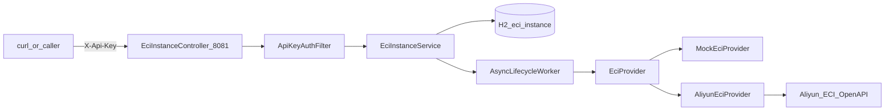

# eci-manager — Agent 上下文（AGENT.md）

> 供 Cursor / 其他 AI Agent 快速理解 **eci-manager** 子工程：结构、架构、已锁定决策、联调结论与约束。  
> 人类可读详细文档：[docs/设计与使用说明.md](docs/设计与使用说明.md)；快速上手：[README.md](README.md)。  
> 主仓全局上下文见仓库根目录 [AGENT_CONTEXT.md](../AGENT_CONTEXT.md)（2026-06 版尚未收录本子工程时，以本文为准）。

**最后更新：** 2026-07-23（启动补偿、方式 A 云凭证、GPU instanceType/gpu、文档配置说明）

---

## 1. 本子工程是什么

独立 **Spring Boot 3.3.5 / Java 17** Demo，目录在主仓 Monorepo 的 `eci-manager/`：

- 通过 REST + 阿里云 **ECI** OpenAPI 做容器实例 **创建 / 查询 / 删除**（关闭 = 删除，非 Stop）
- **独立进程**、独立 `pom.xml`，端口 **8081**，**禁止改动**主仓 `backend/` 业务代码
- 对应 PRD：仓库根目录 `ECI容器管理后端Demo产品需求文档(PRD).md` **v1.1**
- 与「训练队列驱动的 CCI GPU Worker 自动启停 PRD」**并行、不互相替代**；生产最终用 ECI 还是 CCI **仍待定**

**非目标：** 训练队列、Worker 注册/心跳、自动扩缩、前端、CCI 实现。

---

## 2. 目录结构

```
eci-manager/
├── pom.xml                          # 独立 Maven；aliyun-java-sdk-core 4.7.3 + aliyun-java-sdk-eci 1.3.3
├── README.md
├── AGENT.md                         # 本文件
├── docs/设计与使用说明.md
├── .gitignore                       # 含 application-local.yml、target/、data/
└── src/main/java/com/xjicloud/eci/
    ├── EciManagerApplication.java
    ├── common/          # ApiResponse、BusinessException、GlobalExceptionHandler
    ├── auth/            # ApiKeyAuthFilter（X-Api-Key）
    ├── config/          # EciProperties、Security、Async、ProviderConfig
    ├── instance/        # Controller、Service、Entity、Repository、DTO、InstanceStatus
    ├── provider/        # EciProvider、MockEciProvider、AliyunEciProvider、CreateSpec、CloudInstanceView
    └── lifecycle/       # AsyncLifecycleWorker、StartupCompensationRunner
```

配置：

| 文件 | 作用 |
|------|------|
| `application.yml` | 端口 8081、默认 mock、H2 `./data/eci-manager` |
| `application-dev.yml` | `mock=true` |
| `application-cloud.yml` | `mock=false` + 推荐阿里云镜像 |
| `application-local.yml.example` | 真实模式模板；复制为 `application-local.yml`（**gitignore，勿提交**） |

仓库便携 JDK/Maven：根目录 `.tools/`（gitignore）+ `.tools/env.sh`（`source ../.tools/env.sh`）。

---

## 3. 系统架构



### 职责边界

| 层 | 职责 |
|----|------|
| Controller | HTTP 契约；统一 `ApiResponse` |
| Service | **本地状态权威**、幂等删除、触发异步 |
| EciProvider | 仅云侧 Create / Describe / Delete |
| AsyncLifecycleWorker | 创建后轮询 Running；删除后确认消失；超时 → FAILED；提供 resume 供启动补偿 |
| StartupCompensationRunner | 启动扫 CREATING/STOPPING/RUNNING：refresh 或续跑；无 cloudId 的 CREATING → FAILED |
| ApiKeyAuthFilter | 仅 `/api/v1/eci/**`；`/actuator/health` 公开 |

### 状态机（本地权威）

```
CREATING → RUNNING | FAILED
RUNNING  → STOPPING → TERMINATED | FAILED
CREATING|RUNNING|STOPPING|FAILED + 云侧已删/NotFound → TERMINATED（refresh 可回写）
```

### 创建语义（已锁定：**异步**）

- `POST` **立即**返回 `CREATING` + 本地 UUID  
- 后台：`create` → 写 `cloudInstanceId` → 轮询至 Running / 失败 / 超时  
- **先 `repository.save` 再 `@Async`**，避免事务未提交时异步读不到行  

删除：先置 `STOPPING`；`TERMINATED` 再 DELETE **幂等成功**；`CREATING` 中删除 → 409。

### 启动补偿

进程崩溃可能留下 `CREATING`/`STOPPING`。`StartupCompensationRunner` 启动时扫描未终态（含 `RUNNING`）：

- `CREATING` 无 `cloudInstanceId` → 本地 `FAILED`（进程中断，创建未提交到云）
- 有 `cloudInstanceId`：先 `refresh`；仍 `CREATING`/`STOPPING` 则 `resumeCreatePoll` / `resumeDelete`（**不再**重复 Create）
- `RUNNING`：仅 refresh；云已删 → `TERMINATED`
- 按条独立事务提交；失败不阻断启动

Demo **单实例**；多节点 HA 并发补偿需分布式锁（如 ShedLock），本阶段不做。

### 鉴权 vs 云凭证（两种身份，勿混）

| 名称 | 用途 | 来源 |
|------|------|------|
| `eci.api-key` / `X-Api-Key` | 保护本服务 HTTP | **自建**，非阿里云颁发 |
| 阿里云调用身份 | 调 ECI OpenAPI | **方式 A：ECS RAM 角色**（推荐）；本机可用临时环境变量。**不使用** yml 长期 AK |

#### 云凭证（方式 A）

- 生产：ECS 绑 RAM 角色；可选 `eci.ecs-ram-role-name` 或 `ALIBABA_CLOUD_ECS_METADATA`。  
- SDK：`InstanceProfileCredentialsProvider`（有角色名）或 `DefaultCredentialsProvider`（默认链）。  
- 本机无 IMDS：export `ALIBABA_CLOUD_ACCESS_KEY_ID/SECRET`（及 STS `SECURITY_TOKEN`）；无凭证时探 `100.100.100.200` 超时属预期。  
- `access-key-id/secret` 配置项已废弃，不建客户端。  
- 最小权限示例见 [docs/设计与使用说明.md](docs/设计与使用说明.md)。  

## 4. HTTP API 摘要

前缀：`/api/v1/eci`；响应：`{ success, message, data }`。

| 方法 | 路径 | 行为 |
|------|------|------|
| POST | `/instances` | 异步创建 → CREATING；可选 `instanceType`/`gpu`（GPU 规格） |
| DELETE | `/instances/{id}` | 删除云资源 |
| GET | `/instances?status=` | 列表 |
| GET | `/instances/{id}` | 详情 |
| POST | `/instances/{id}/refresh` | Describe 回写 |
| GET | `/actuator/health` | 无 Api-Key |

创建 body 可选字段：`name`、`image`、`cpu`、`memory`、`env`、`instanceType`（如 `ecs.gn7i-c32g1.8xlarge`）、`gpu`（容器 GPU 个数，GPU 规格时通常传 `1`）。配置步骤见 [docs/设计与使用说明.md](docs/设计与使用说明.md) §4 / §6。

---

## 5. 本次对话上下文与已确认决策

| 议题 | 结论 |
|------|------|
| 仓库位置 | 主仓子目录 `eci-manager/`，独立 Maven |
| 创建 HTTP | **异步受理**（选项 2），非阻塞至 Running |
| 关闭 | **删除**实例 |
| 联调镜像 | 小镜像验证；真实模式应用**阿里云仓库**镜像 |
| 生产选型 ECI/CCI | 待定，不阻塞 Demo |
| D4 完整 CCI Provider | 未做；仅薄接口 `EciProvider` |
| 启动补偿 | Hybrid：扫 CREATING/STOPPING/RUNNING；无 cloudId 的 CREATING→FAILED；有 cloudId 先 refresh 再 resume；单实例 |
| 云凭证 | **方式 A**：ECS RAM 角色 / `DefaultCredentialsProvider`；yml AK **废弃不建客户端**；本机用 `ALIBABA_CLOUD_*` |
| GPU 创建 | POST 支持 `instanceType` + `gpu`；库存不足时云返回 `OperationDenied.NoStock` |

### 实现分期（已完成）

- **D1** Mock API + Api-Key + H2 + 异步状态机  
- **D2** `AliyunEciProvider` + cloud 配置校验  
- **D3** 超时/`failureReason`、env 透传、README、example yml  
- **文档** `docs/设计与使用说明.md` + 主代码**中文**类/方法注释  
- **启动补偿** `StartupCompensationRunner` + Worker resume  
- **方式 A 凭证** 实例角色 / 环境变量链；去掉 AK 启动必填  
- **GPU 字段** `instanceType` / `gpu` 透传 CreateContainerGroup  

### 代码修复（对话中）

1. `sanitizeName`：同一 `create` 内容器组名与容器名**共用一次**规范化名，避免双随机后缀  
2. `refresh`：云侧 NotFound 时 **CREATING**（及 FAILED）也须 → TERMINATED（勿卡死）  

### 真实联调结论（2026-07-23）

| 尝试 | 规格 / 镜像 | 结果 |
|------|-------------|------|
| 1 | `nginx:alpine`（Docker Hub） | 云创建成功，长期 Pending → 本地超时 FAILED；已 DELETE |
| 2 | `eci_open/nginx:1.14.2` 1c2g | **RUNNING** → DELETE → TERMINATED |
| 3 | `ecs.gn7i-c32g1.8xlarge` + gpu=1 + nginx | 鉴权成功；云侧 **`OperationDenied.NoStock`**（交换机可用区无库存）→ 本地 FAILED → 已清理 |
| 4 | 长期 AK 经 `ALIBABA_CLOUD_*` + 小规格 nginx | **RUNNING** → DELETE → TERMINATED（证明环境变量凭证可用） |

因此：默认真实镜像用阿里云 `eci_open/nginx`。GPU 规格依赖可用区库存；无自有 ECS 时角色无法绑定，本机用环境变量 AK/STS。

### 运维注意

- 真实模式**计费**（尤其 GPU）：测完必须 DELETE，并到控制台确认无残留  
- **不要**在 yml/Git 写长期 AccessKey；生产用实例角色；曾泄露的 AK 在 RAM **轮换/禁用**  
- 路径参数必须用真实 UUID，**不要**写字面量 `{id}`  
- `ECI_API_KEY` 须与配置 `api-key` 一致，否则 401  
- 配置操作步骤以 [docs/设计与使用说明.md](docs/设计与使用说明.md) **§4 配置与云凭证**、**§6 使用方法** 为准  

### 启动速查

```bash
cd eci-manager
source ../.tools/env.sh
# Mock:
mvn spring-boot:run
# 真实（ECS 已绑角色，或本机已 export ALIBABA_CLOUD_*）:
export SPRING_PROFILES_ACTIVE=cloud,local
export ECI_API_KEY='<与 application-local.yml 中 api-key 一致>'
mvn spring-boot:run
# 日志期望：ECI provider mode: ALIYUN … credential=INSTANCE_PROFILE|DEFAULT_CHAIN
```

测试：`mvn test`（仅 Mock，不调云）。

---

## 6. 与主仓关系

```
【当前】开发者 ──HTTP+X-Api-Key──► eci-manager:8081 ──OpenAPI──► 阿里云 ECI

【后续可选，本工程未实现】
XJICloud backend:8080 ──HTTP──► eci-manager
  或代码迁入 / 换 CCI Client
gpu-worker 启动后仍 register 到主后端 :8080
```

`env` 预留：`XJICLOUD_BACKEND_URL`、`WORKER_SECRET`、`WORKER_NAME`（本阶段不联调训练流水线）。

---

## 7. Agent 工作约束（本子工程）

- **不要**修改 `backend/` 来「集成」本 Demo，除非用户明确要求新需求  
- **不要**把 `application-local.yml`、长期 AccessKey、Api-Key 写入 Git 或文档示例明文  
- 真实模式云身份用 **ECS RAM 角色**（或本机临时环境变量），勿再依赖 yml AK  
- 改 Provider / 状态机时保持：**本地状态权威**、异步创建语义、删除=删云  
- 详细接口与配置以 [docs/设计与使用说明.md](docs/设计与使用说明.md) 为准；本文偏决策与对话记忆  

---

## 8. 相关文件索引

| 路径 | 说明 |
|------|------|
| `../ECI容器管理后端Demo产品需求文档(PRD).md` | 需求 v1.1 |
| `../训练队列驱动的CCI-GPU-Worker自动启停产品需求文档(PRD).md` | 另一条产品线 |
| `src/.../provider/AliyunEciProvider.java` | 真实云 SDK |
| `src/.../lifecycle/AsyncLifecycleWorker.java` | 异步轮询 / resume |
| `src/.../lifecycle/StartupCompensationRunner.java` | 启动补偿 |
| `src/.../instance/EciInstanceService.java` | 状态机、refresh、compensateOne |
