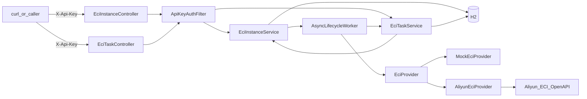

# eci-manager — Agent 上下文（AGENT.md）

> 供 Cursor / 其他 AI Agent 快速理解 **eci-manager** 子工程：结构、架构、已锁定决策、联调结论与约束。  
> 人类可读详细文档：[docs/设计与使用说明.md](docs/设计与使用说明.md)；**逐步测试（Mock/真云每条命令）：** [docs/测试说明.md](docs/测试说明.md)；快速上手：[README.md](README.md)。  
> 主仓全局上下文见仓库根目录 [AGENT_CONTEXT.md](../AGENT_CONTEXT.md)（若未收录本子工程，以本文为准）。

**最后更新：** 2026-07-27（PRD v2.0；**T1 / Task 1–4 已交付**；下一刀 Task 5 终态轮询/自动删/超时；测试说明已落盘）

---

## 1. 本子工程是什么

独立 **Spring Boot 3.3.5 / Java 17** 服务，目录在主仓 Monorepo 的 `eci-manager/`：

- **已交付（Demo 基座 D0–D3）：** REST + 阿里云 **ECI** OpenAPI 做容器实例 **创建 / 查询 / 删除**（关闭 = 删除，非 Stop）
- **已交付（PRD v2.0 T1）：**
  - ✅ Task 1：任务实体/仓库、运行时配置、实例 `taskId` / 规格字段、`CreateSpec.restartPolicy`
  - ✅ Task 2：Provider 透传 `restartPolicy`；`command`/`args` 全链路；Mock `simulateStatus`
  - ✅ Task 3：`/api/v1/eci/tasks` 提交 / 查询 / 取消；实例绑定；Running/创建失败回写任务
  - ✅ Task 4：手动 `/instances` 兼容（默认 image、`taskId=null`）
- **未做（T2 / Task 5+）：** `TaskLifecycleWatcher`、云侧 Succeeded/Failed 自动删、`maxRuntimeSec`→TIMEOUT、任务 SUCCEEDED 闭环、文档验收 Task 7
- **独立进程**、独立 `pom.xml`，端口 **8081**，**禁止改动**主仓 `backend/` 业务代码
- 对应 PRD：仓库根目录 [`ECI任务驱动容器编排服务产品需求文档(PRD).md`](../ECI任务驱动容器编排服务产品需求文档(PRD).md) **v2.0**
- **实现计划：** [`docs/superpowers/plans/2026-07-27-eci-task-orchestration.md`](../docs/superpowers/plans/2026-07-27-eci-task-orchestration.md)
- 生产最终用 ECI 还是 CCI **仍待定**（不阻塞本期）

**当前非目标（一期）：** 训练队列、Worker 注册/心跳、自动扩缩、前端、业务回调、镜像注册表、批量提交。

---

## 2. 目录结构

```
eci-manager/
├── pom.xml
├── README.md
├── AGENT.md                         # 本文件
├── docs/
│   ├── 设计与使用说明.md
│   └── 测试说明.md                  # Mock/真云逐步命令（2026-07-27 新增）
├── .gitignore                       # 含 application-local.yml、target/、data/
└── src/main/java/com/xjicloud/eci/
    ├── EciManagerApplication.java
    ├── common/          # ApiResponse、BusinessException、GlobalExceptionHandler
    ├── auth/            # ApiKeyAuthFilter（X-Api-Key）
    ├── config/          # EciProperties、Security、Async、ProviderConfig（含轮询间隔正数校验）
    ├── instance/        # Controller、Service、Entity、DTO；含 createForTask / deleteForTaskCancel
    ├── task/            # TaskStatus、Entity、Repository、EciTaskService、EciTaskController、dto/
    ├── provider/        # EciProvider、Mock、Aliyun、CreateSpec、CloudInstanceView
    └── lifecycle/       # AsyncLifecycleWorker、StartupCompensationRunner
                         # （TaskLifecycleWatcher 尚未创建）
```

配置：

| 文件 | 作用 |
|------|------|
| `application.yml` | 端口 8081、默认 mock、H2、`default-restart-policy` / `default-max-runtime-sec` / `task-poll-interval-sec` |
| `application-dev.yml` | `mock=true` |
| `application-cloud.yml` | `mock=false` + 推荐阿里云镜像 |
| `application-local.yml.example` | 真实模式模板；复制为 `application-local.yml`（**gitignore，勿提交**） |

仓库便携 JDK/Maven：根目录 `.tools/`（gitignore）+ `.tools/env.sh`（在 `eci-manager/` 下：`source ../.tools/env.sh`）。

---

## 3. 系统架构



### 职责边界

| 层 | 职责 |
|----|------|
| Instance Controller | 手动实例 HTTP |
| Task Controller | 任务提交/查询/取消 |
| EciTaskService | 任务落库（实际规格可追溯）、驱动 `createForTask`、cancel、`onInstanceRunning`/`onInstanceFailed` |
| EciInstanceService | **本地实例状态权威**；`createForTask` 写 `taskId`；`deleteForTaskCancel`（允许 CREATING）；refresh 钩子通知任务 |
| EciProvider | 仅云侧 Create / Describe / Delete |
| AsyncLifecycleWorker | 创建/删除轮询；Succeeded 视为创建成功路径 markRunning；cancel 竞态 abort→删；回调任务状态 |
| StartupCompensationRunner | 启动扫 CREATING/STOPPING/RUNNING |
| ApiKeyAuthFilter | `/api/v1/eci/**`；`/actuator/health` 公开 |

### 实例状态机（本地权威）

```
CREATING → RUNNING | FAILED
RUNNING  → STOPPING → TERMINATED | FAILED
CREATING|RUNNING|STOPPING|FAILED + 云侧已删/NotFound → TERMINATED（refresh）
```

短任务云侧可能 Pending→Succeeded（未见 Running）：`refresh` / `pollUntilRunning` 将 Succeeded 对齐为本地 `RUNNING`（终态清理仍归 Task 5）。

### 任务状态机（T1 已实现部分）

```
PENDING → STARTING → RUNNING
STARTING|PENDING → FAILED（创建失败）
PENDING|STARTING|RUNNING → CANCELLED（cancel）
```

**未实现：** `RUNNING → SUCCEEDED`、超时 `FAILED(TIMEOUT)`、云 Failed 自动清后任务 FAILED（Task 5 watcher）。

因此：人工 `DELETE` 关联实例后，任务可能仍停在 `RUNNING`——**已知 T1 缺口，不是 bug**；不要用 `TERMINATED` 回调去猜 SUCCEEDED。

### 创建语义（已锁定：**异步**）

- `POST` **立即**返回；后台调云  
- **先 `repository.save` 再 `@Async`**  
- 任务路径：先存任务 → `createForTask` → 任务 `STARTING` + `instanceId`

删除：

- 手动 `DELETE /instances`：`CREATING` → **409**  
- 任务 `cancel`：走 `deleteForTaskCancel`（无 cloudId 的 CREATING → 本地 TERMINATED；有 cloudId → STOPPING+删）

### 鉴权 vs 云凭证（两种身份，勿混）

| 名称 | 用途 | 来源 |
|------|------|------|
| `eci.api-key` / `X-Api-Key` | 保护本服务 HTTP | **自建** |
| 阿里云调用身份 | 调 ECI OpenAPI | ECS RAM 角色 **或** `ALIBABA_CLOUD_*` 环境变量 |

**重要：** `application-local.yml` 里的 `access-key-id/secret` **不会**用于建客户端（字段废弃兼容）。本机 WSL 必须：

```bash
export ALIBABA_CLOUD_ACCESS_KEY_ID=...
export ALIBABA_CLOUD_ACCESS_KEY_SECRET=...
# STS 时再加 ALIBABA_CLOUD_SECURITY_TOKEN
```

否则 SDK 探 `100.100.100.200`（IMDS）超时属预期。local yml 仍要填：`api-key`、`region-id`、`vswitch-id`、`security-group-id` 等网络项。

启动时 `ProviderConfig` 还会校验 `poll-interval-ms`、`task-poll-interval-sec`、超时等为正数。

---

## 4. HTTP API 摘要

前缀：`/api/v1/eci`；响应：`{ success, message, data }`。

### 实例

| 方法 | 路径 | 行为 |
|------|------|------|
| POST | `/instances` | 异步创建；`image` **可选**→默认配置；`taskId=null` |
| DELETE | `/instances/{id}` | 删云；TERMINATED 幂等；CREATING→409 |
| GET | `/instances?status=` | 列表 |
| GET | `/instances/{id}` | 详情（含 `taskId`） |
| POST | `/instances/{id}/refresh` | Describe 回写；可推进任务 Running/Failed |

创建可选：`name`、`image`、`cpu`、`memory`、`env`、`instanceType`、`gpu`、`restartPolicy`、`command`、`args`。

### 任务

| 方法 | 路径 | 行为 |
|------|------|------|
| POST | `/tasks` | **`image` 必填**；立即返回 taskId + STARTING + instanceId |
| GET | `/tasks?status=` | 列表 |
| GET | `/tasks/{id}` | 详情 |
| POST | `/tasks/{id}/cancel` | 幂等 CANCELLED + 删关联实例 |

未传规格/重启/超时 → 用配置默认值，**实际值写入任务行**。

### 其它

| GET | `/actuator/health` | 无 Api-Key |

---

## 5. 本次对话上下文与已确认决策

| 议题 | 结论 |
|------|------|
| 仓库位置 | 主仓子目录 `eci-manager/`，独立 Maven |
| 创建 HTTP | **异步受理**，非阻塞至 Running |
| 关闭 | **删除**实例 |
| 联调镜像 | 真实模式用**阿里云仓库**镜像（Docker Hub 易 Pending） |
| 生产选型 ECI/CCI | 待定，不阻塞 |
| 云凭证 | ECS RAM / `ALIBABA_CLOUD_*`；**yml AK 不建客户端** |
| T1 范围 | Task 1–4 完成；Task 5 终态自动删未做 |
| `notifyTaskOnStatusChange` 不通知 TERMINATED | **有意为之**；SUCCEEDED 由 Task 5 watcher 在 Describe=Succeeded 后删实例再写任务，禁止用 TERMINATED 猜成功 |
| 测试文档 | `docs/测试说明.md`；README 已链入并更正进度表 |

### 本地提交（对话中，未要求则勿 push）

| Commit | 说明 |
|--------|------|
| `7b172e6` | `feat(eci-manager): add task submit, query, and cancel APIs` |
| `2572dca` | `fix(eci-manager): harden sanitizeName and validate poll intervals` |
| `83fc612` | `test(eci-manager): assert manual instances expose null taskId` |

（Succeeded 路径等与 Task 3 同文件的小改随 feat 提交；独立 Bugfix 为 sanitize/配置校验。）

### 测试执行结论（2026-07-27）

| 项 | 结果 |
|----|------|
| `mvn test` | PASS |
| Mock 手工 curl 清单（health/鉴权/实例/任务/cancel） | 9/9 PASS |
| 真云冒烟（Agent 会话） | **跳过**：当时 shell 无 `ALIBABA_CLOUD_*`（即使用户已写 local yml） |
| 用户本机随后 cloud,local 启动 | 凭证链曾 ready；失败常见原因 **`Port 8081 was already in use`**（先杀旧进程） |

### 实现分期（基座）

- **D1–D3** Mock/云 Provider、超时、文档、启动补偿、方式 A 凭证、GPU 字段——仍有效  
- **T0** PRD/计划批准  
- **T1** Task 1–4（本轮收尾）  
- **下一刀 T2 Task 5** 终态轮询 / 自动删 / 超时 / 启动任务恢复  

### 代码修复备忘（历史 + 本轮）

1. `sanitizeName`：同一 create 共用一次规范化名；折叠非法字符/连字符，空串回退 `eci-demo`  
2. `refresh`：NotFound 时 CREATING/FAILED→TERMINATED；**Succeeded** 时 CREATING→RUNNING  
3. `pollUntilRunning`：Succeeded 与 Running 同等视为创建成功路径  
4. Describe：空 group / null status → NotFound 视图  
5. 启动校验：轮询/超时间隔必须为正  

### 真实联调结论（2026-07-23，基座仍适用）

| 尝试 | 规格 / 镜像 | 结果 |
|------|-------------|------|
| 1 | `nginx:alpine`（Docker Hub） | 长期 Pending → 超时 FAILED |
| 2 | `eci_open/nginx:1.14.2` 1c2g | RUNNING → DELETE OK |
| 3 | GPU 规格 + nginx | `OperationDenied.NoStock` |
| 4 | `ALIBABA_CLOUD_*` + 小规格 | RUNNING → DELETE OK |

### 运维注意

- 真实模式**计费**：测完必须 DELETE/cancel，并到控制台确认无残留  
- **不要**把长期 AK / Api-Key 写入 Git  
- 路径参数用真实 UUID，勿写字面量 `{id}`  
- `ECI_API_KEY` 须与配置 `api-key` 一致  
- 逐步命令以 [docs/测试说明.md](docs/测试说明.md) 为准；配置原理见 [docs/设计与使用说明.md](docs/设计与使用说明.md)  

### 启动速查

```bash
cd eci-manager
source ../.tools/env.sh

# Mock:
export ECI_API_KEY=dev-eci-api-key-change-me
mvn spring-boot:run
# 日志：ECI provider mode: MOCK

# 真实（本机须先 export ALIBABA_CLOUD_*；并保证 8081 空闲）:
export SPRING_PROFILES_ACTIVE=cloud,local
export ECI_API_KEY='<与 application-local.yml 中 api-key 一致>'
export ALIBABA_CLOUD_ACCESS_KEY_ID=...
export ALIBABA_CLOUD_ACCESS_KEY_SECRET=...
ss -ltnp | grep 8081 || echo "8081 free"
mvn spring-boot:run
# 日志：ECI provider mode: ALIYUN … credential=DEFAULT_CHAIN|INSTANCE_PROFILE
```

自动化：`mvn test`（Mock，不调云）。

---

## 6. 与主仓关系

```
【当前】开发者 ──HTTP+X-Api-Key──► eci-manager:8081 ──OpenAPI──► 阿里云 ECI

【后续可选，本工程未实现】
XJICloud backend:8080 ──HTTP──► eci-manager
  或代码迁入 / 换 CCI Client
```

`env` 预留：`XJICLOUD_BACKEND_URL`、`WORKER_SECRET`、`WORKER_NAME`（本阶段不联调训练流水线）。

---

## 7. Agent 工作约束（本子工程）

- **不要**修改 `backend/`，除非用户明确要求  
- **不要**把 `application-local.yml`、长期 AccessKey、Api-Key 写入 Git 或文档明文  
- 云身份用 **ECS RAM / `ALIBABA_CLOUD_*`**，勿假设 yml AK 生效  
- 保持：本地状态权威、异步创建、删除=删云、一任务一实例  
- 实现进度与下一刀以计划文件勾选为准；逐步测试命令看 `docs/测试说明.md`  
- 用户未明确要求时：**不要**自动 `git commit` / `git push`  

---

## 8. 相关文件索引

| 路径 | 说明 |
|------|------|
| `../ECI任务驱动容器编排服务产品需求文档(PRD).md` | 需求 v2.0 |
| `../docs/superpowers/plans/2026-07-27-eci-task-orchestration.md` | 实现计划与进度 |
| `docs/测试说明.md` | Mock/真云逐步测试 |
| `docs/设计与使用说明.md` | 结构 / 配置 / 用法 |
| `src/.../task/EciTaskService.java` | 任务业务 |
| `src/.../task/EciTaskController.java` | 任务 HTTP |
| `src/.../instance/EciInstanceService.java` | 实例状态机、任务钩子、cancel 删除 |
| `src/.../lifecycle/AsyncLifecycleWorker.java` | 异步轮询 / 任务回调 / cancel 竞态 |
| `src/.../provider/AliyunEciProvider.java` | 真实云 SDK（凭证链） |
| `src/.../config/ProviderConfig.java` | Mock/Aliyun 装配与启动校验 |
