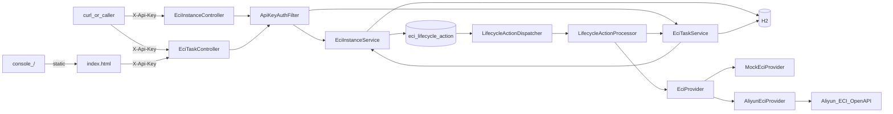

# eci-manager — Agent 上下文（AGENT_CONTEXT.md）

> 供 Cursor / 其他 AI Agent 快速理解 **eci-manager** 子工程：结构、架构、已锁定决策、联调结论与约束。执行规则见 [AGENTS.md](AGENTS.md)。  
> 人类可读详细文档：[docs/设计与使用说明.md](docs/设计与使用说明.md)；**逐步测试（Mock/真云每条命令）：** [docs/测试说明.md](docs/测试说明.md)；快速上手：[README.md](README.md)。  
> 主仓全局上下文见 [AGENT_CONTEXT.md](../docs/AGENT_CONTEXT.md)（若未收录本子工程，以本文为准）。

**最后更新：** 2026-10-19（任务云端状态快照与安全取消契约）

**3DGS：** 操作见 [`docs/3dgs-ECI使用说明.md`](docs/3dgs-ECI使用说明.md)（`submit-3dgs-standard.sh`，默认 `shmSize=8Gi`）。**失败取证已实现：** `fetchContainerLog` → 落库 `containerLogTail` → 持久化 not-before → DELETE；成功不存全量日志。仍待联合 3dgs：traceback 刷 stderr、`PYTHONUNBUFFERED=1`。

---

## 1. 本子工程是什么

独立 **Spring Boot 3.3.5 / Java 17** 服务，目录在主仓 Monorepo 的 `eci-manager/`：

- **已交付（Demo 基座 D0–D3）：** REST + 阿里云 **ECI** OpenAPI 做容器实例 **创建 / 查询 / 删除**（关闭 = 删除，非 Stop）
- **已交付（PRD v2.0.3 T1–T3）：**
  - ✅ Task 1–4：任务模型、Provider、`/tasks` API、手动实例兼容
  - ✅ Task 5：`TaskLifecycleWatcher`、云终态自动删、`maxRuntimeSec`→TIMEOUT
  - ✅ Task 6：Mock `mock-auto-complete-sec` 时间触发终态 + 端到端 IT
  - ✅ Task 7：README / API / 设计说明 / example yml / 验收清单
  - ✅ 测试补强：`TaskLifecycleWatcherUnitTest`、`EciTaskLifecycleMockIT`、`ManualInstanceNoAutoDeleteIT`、`StartupCompensationRunnerTest`；Mock 可注入时钟
- **已交付（OSS 集成 O1–O5.2，2026-07-31）：**
  - ✅ `eci.oss` + `OssStorageService` + `POST /tasks` 可选 `storage`
  - ✅ 联调镜像源码 `test-images/oss-smoke/`；文档 API §3.1 / 设计说明 §4.4
  - ✅ 真云：`python_mirror` + `storage.mode=test` + **内网** OSS endpoint → `SUCCEEDED` 且对象写入 Bucket
  - 📋 Task 7 完整验收清单（keys/无 storage 回归等）可按 PRD 附录 B 继续
- **已交付（失败日志可观测性，2026-09-02～09-05）：**
  - ✅ 删实例前 `DescribeContainerLog` → 任务字段 `containerLogTail`（方案 A）
  - ✅ 可选宽限 `eci.failure-log-grace-sec` 默认 90（方案 C；`0` 关闭）
  - ✅ TIMEOUT 与 Failed 同序（先抓日志再删）；成功任务不存全量日志
  - ✅ Mock/单测锁定 fetch→persist→delete；详节见下方 **§5.1**
- **已交付（当前钥执行器 C1–C5，2026-09-08～09-09）：**
  - ✅ 成对运行时 AK → `STATIC_AK`（`DefaultProfile.getProfile(region, ak, sk)`）
  - ✅ 每 resource 一把**当前钥**落盘 + GET/PUT `/runtime-credentials` + 热重建
  - ✅ HTTP Api-Key 配置鉴权（`eci.api-key` / `ECI_API_KEY`）
  - ✅ `POST /runtime-credentials/test`（草稿或已保存；不改当前）
  - ✅ 8081 只保存当前钥；主后端 8080 已实现 AK 目录、测试与选用推送；`.env` 是种子
- **已交付（P0 生命周期可靠性，2026-09-21）：**
  - ✅ `eci_lifecycle_action` 持久化 CREATE/DELETE 动作、租约、退避与启动恢复；移除 `AsyncLifecycleWorker` 长轮询
  - ✅ DELETE 失败 2 秒起、300 秒封顶指数退避无限重试；`delete-timeout-sec` 只告警，不停止清理
  - ✅ Failed/TIMEOUT 的 `failure-log-grace-sec` 是持久化 not-before，不阻塞 watcher；硬顺序仍为抓日志→持久化失败→登记删除
  - ✅ P0 CREATE 使用本地实例 UUID ClientToken 与 `xjicloud-local-instance-id` Tag；未知结果继续用同 token 恢复
  - ✅ pre-P0 无 token CREATE 只创建 `Legacy CREATE outcome unknown` 隔离标记，禁止自动重放或云侧猜测；首次处理记录安全 ERROR，需人工核对后恢复
  - ✅ 任务取消状态为 `CANCELLING → CANCELLED`；仅实例 `TERMINATED`/`NotFound` 后写 `CANCELLED`
  - ✅ TaskResponse 暴露 `instanceStatus`、`cloudStatus`、安全 `statusReason` 与 `cleanupConfirmed`；状态说明落在 `eci_instance.status_reason`，清理仅在实例 `TERMINATED` 时确认
  - ✅ FAILED cancel 幂等登记 DELETE 并保留失败证据；已发出但未收响应的 CREATE 以原 client token 恢复，未知旧 CREATE 仍隔离
  - ✅ H2 启动时幂等扩展旧 `eci_task.status` ENUM，先于 Hibernate 与生命周期恢复；升级前应停服务并备份数据库
  - ✅ Mock 覆盖崩溃/未知 CREATE、DELETE 重试/超时、取消收敛；真云验证须明确授权
- **已交付（主后端训练派发，2026-09-23）：**
  - ✅ `POST /tasks` 支持可选 `clientRequestId`；同 key 返回既有任务，避免歧义重试创建第二个 ECI task
  - ✅ 主 backend 使用 `storage.mode=keys` 传输入对象 key 与固定输出 key，并显式命令运行 one-shot 训练入口
  - ✅ 重复 key 冲突时回滚新建事务，再读取唯一键胜出的既有任务；未提供 key 的旧调用仍每次新建
- **已交付（shm EmptyDir，2026-09-16）：**
  - ✅ `POST /tasks` / `POST /instances` 可选 `shmSize`；配置 `eci.default-shm-size`（默认空）
  - ✅ `AliyunEciProvider` 挂 Memory EmptyDir 到 `/dev/shm`；须 >64Mi 且严格小于容器 memory
  - ✅ 3dgs 标准档传 `8Gi`；bootstrap 不再 remount / 强制 `num_workers=0`
- **已交付（本地操作台，2026-09-16）：**
  - ✅ `SecurityConfig` 放行 `/`、`/index.html`、`/console/**`、`/favicon.ico`
  - ✅ 静态操作台（无 Node）：Api-Key 闸门、MOCK/CLOUD 徽章、任务提交/轮询/计时/日志尾部、实例与当前云钥 Tab
  - ✅ `GET /api/v1/eci/meta`（需 Api-Key，响应不含云密钥）；`GET /api/v1/eci/tasks/{id}/logs`
  - ✅ `ApplicationReadyEvent` 打开 `http://127.0.0.1:{port}/`（WSL: `cmd.exe /c start`）；`./scripts/start.sh mock|cloud`
- **独立进程**、独立 `pom.xml`，端口 **8081**，**禁止改动**主仓 `backend/` 业务代码
- 对应 PRD：仓库根目录 [`ECI任务驱动容器编排服务产品需求文档(PRD).md`](../ECI任务驱动容器编排服务产品需求文档(PRD).md) **v2.0.3**
- **OSS 增量 PRD：** [`ECI任务OSS对象存储集成产品需求文档(PRD).md`](prd/ECI任务OSS对象存储集成产品需求文档(PRD).md) **v1.0**

**当前非目标（一期）：** 训练队列、Worker 注册/心跳、自动扩缩、独立 Node/React 前端、业务回调、镜像注册表、批量提交、运行时切换 `EciProvider`；`storage.mode=dataset` / 响应 `storageResolved`；SSE/WebSocket 流式日志；OSS 存全量容器日志（方案 B）；**8081 多钥目录 / 按 id 选钥**（主后端 8080 已提供）。主 backend 已通过 `/tasks`、`clientRequestId` 和 `storage.mode=keys` 接入；本地静态操作台已交付，不另起构建步骤。

### 1.1 下一步路线图（按紧急程度）

> **执行规则：** 先完成 P0，再继续真云规模化使用或主后端集成。每一项单独确认契约、单独按 TDD 实现和审查，不把多个阶段捆成一次大改。本文只记录方向与验收口径；开始实现时仍须先写对应设计或计划。
>
>

#### P0：云资源安全与状态一致性（最紧急）

这些问题可能造成 ECI 残留、额外费用或本地终态与真实资源不一致，应优先于新增功能。

| 顺序 | 任务 | 当前风险 | 最小实现范围 | 完成标准 |
|------|------|----------|--------------|----------|
| **P0-1** | 删除失败持久化重试 + 非阻塞宽限 | 已交付：动作表持久化宽限与清理重试，避免 watcher 阻塞 | `failure-log-grace-sec` 写入 DELETE `not-before`；DELETE 失败按有上限退避无限重试，继续登记 `lastError`，`FAILED` 实例仍清理 | 同时失败 20 个任务不互相阻塞；模拟前两次 Delete 失败后最终 `TERMINATED`；日志仍严格保持“抓取→持久化→宽限→删除” |
| **P0-2** | 创建幂等与崩溃补偿 | 已交付：稳定 token、未知结果恢复与启动动作补偿 | P0 请求使用本地实例 UUID 作为阿里云 `ClientToken`，写入本地 UUID Tag；未知 CREATE 超时仍后台恢复并最终清理。pre-P0 无 token 历史行进入隔离并人工核对 | Create 成功后模拟写 cloudId 前崩溃，重启后至多一个 ECI，且本地最终关联并清理 |
| **P0-3** | 取消终态契约对齐 | 已交付：增加 `CANCELLING`，避免清理失败被终态掩盖 | 取消先写 `CANCELLING` 并登记 DELETE；实例 `TERMINATED`/`NotFound` 后条件更新 `CANCELLED`；同步 API、测试与文档 | 返回 `CANCELLED` 时云实例必为 `TERMINATED` 或确认不存在；取消幂等；竞态由条件更新测试覆盖 |

#### P1：完成当前 3DGS 里程碑与测试可信度

| 顺序 | 任务 | 最小实现范围 | 完成标准 |
|------|------|--------------|----------|
| **P1-1** | 3DGS 失败取证收尾 | bootstrap 顶层异常输出 traceback 到 stderr 并 flush；提交环境加入 `PYTHONUNBUFFERED=1`；按现有脚本完成 O5.3 / 真云失败冒烟 | 故意失败任务的 `containerLogTail` 可直接定位根因；任务为 `FAILED`；实例已删除；控制台确认无残留 |
| **P1-2** | 测试后台任务隔离 | 非生命周期 Spring 测试关闭 scheduling；生命周期 IT 显式控制 watcher；后台未捕获异常应使测试失败 | `mvn test` 继续全绿，日志中不再出现 scheduler `NullPointerException` 或跨测试上下文噪声 |

#### P2：接入主后端前的 API、数据与安全治理

| 顺序 | 任务 | 最小实现范围 | 完成标准 |
|------|------|--------------|----------|
| **P2-1** | 查询分页与响应脱敏 | 任务/实例列表分页；拆分 summary/detail DTO；列表不返回 `env`、`containerLogTail`；详情对预签名 URL 和敏感 env 值脱敏，日志继续走 `/logs` | 历史任务增长后响应大小有界；API 响应不暴露 Secret 或有效预签名 URL；操作台适配分页 |
| **P2-2** | 输入校验与稳定错误码 | 校验名称、镜像、CPU、内存、GPU、env 数量/长度、command/args、日志行数；通用 500 不返回原始异常文案 | 非法请求稳定返回 400；内部异常只记录服务端 requestId，客户端得到固定安全文案 |
| **P2-3** | 生产持久化与凭据保护 | 明确 H2 仅供本地；生产使用 PostgreSQL；引入 Flyway，关闭生产 `ddl-auto=update`；当前 AK/SK 使用 KMS、外部 Secret Store 或部署主密钥字段加密 | 可从现有 H2 数据迁移/回滚；数据库文件泄露时不能直接读取 SK；升级有可重复迁移测试 |
| **P2-4** | 可观测性与资源巡检 | 增加任务状态、清理重试、云 API 延迟/错误、疑似残留资源指标；readiness 检查 DB 和配置状态；用 Tag 做云侧残留巡检 | 能回答“有多少任务卡住、多少实例待清理、最近失败原因”；告警可定位 taskId/local instanceId/cloudInstanceId |

#### P3：产品集成与后续扩展（P0-P2 后）

1. 主后端统一 AK 目录及 `PUT /runtime-credentials`、`POST .../test` 集成已完成；8081 继续只保存每个 resource 的当前钥，不新增第二套目录。
2. 如需进一步封装，再设计 `storage.mode=dataset` / `storageResolved`；当前 backend 使用 `storage.mode=keys`，契约为输入 OSS key 列表和输出 OSS key。
3. 仍不在本阶段加入训练队列、Worker 注册/心跳、自动扩缩、批量提交、独立前端或运行时 Provider 切换；这些能力必须另立 PRD。

**P0 已交付。** 后续改动仍须按对应设计/计划单独确认，不得以“顺手重构”为由扩大范围。

---

## 2. 目录结构

```
eci-manager/
├── pom.xml
├── README.md
├── AGENTS.md                        # Agent 执行规则与硬约束
├── AGENT_CONTEXT.md                 # 详细上下文、决策、联调与测试记录（本文件）
├── .env.example                     # 含 ECI_OSS_*、ECI_FAILURE_LOG_*、ECI_DEFAULT_SHM_SIZE（.env gitignore）
├── scripts/
│   ├── load-env.sh / start.sh
│   ├── run-hello-python.sh          # 真云：普通 Python 任务（无 storage）
│   ├── debug-oss-smoke.sh           # 真云：exit0 + storage.mode=test 冒烟
│   ├── submit-3dgs-standard.sh      # POST 标准档 3DGS 任务
│   ├── 3dgs-bootstrap.py            # 容器内 bootstrap（含 ply fallback）
│   ├── oss-presign-3dgs.py          # 本机预签名
│   └── run-eci-oss.sh               # conda eci-oss 包装
├── test-images/oss-smoke/           # eci-oss-test 联调镜像（Dockerfile/run.py）
├── docs/
│   ├── 设计与使用说明.md            # §4.4 eci.oss
│   ├── API文档.md                   # §3.1 storage；TaskResponse 生命周期快照字段
│   ├── 测试说明.md
│   └── 3dgs-ECI使用说明.md          # 3DGS 真云一键提交与注意事项
└── src/
    ├── main/java/com/xjicloud/eci/
    │   ├── config/          # EciProperties、OssProperties、EciMetaController、ConsoleBrowserLauncher
    │   ├── credential/      # 当前云钥 GET/PUT/test
    │   ├── oss/             # OssStorageService（含 applyRuntimeKeys）
    │   ├── task/storage/    # TaskStorageResolver、DTO
    │   └── instance/ … task/ … provider/ … lifecycle/
    └── main/resources/static/       # 本地操作台 index.html + console/
```

配置：

| 文件 | 作用 |
|------|------|
| `.env` / `.env.example` | **推荐**：HTTP Api-Key、网络、**种子** `ECI_ACCESS_KEY_*` / `ECI_OSS_*`（`.env` gitignore） |
| `scripts/load-env.sh` / `start.sh` | 加载 `.env`；`ALIBABA_CLOUD_*` **仅脚本**映射到 `ECI_ACCESS_KEY_*`（Java 不读） |
| `application.yml` | 端口 8081、默认 mock、H2、任务轮询/超时、`failure-log-*`、`lifecycle-action.*`、`eci.console.open-browser` |
| `eci.lifecycle-action.*` | 默认 `1000/20/60/2/300/5`：dispatcher 周期、批量、租约、初始退避、退避上限、ERROR 告警起始次数 |
| `application-dev.yml` | `mock=true` |
| `application-cloud.yml` | `mock=false` + 推荐阿里云镜像 |
| `application-local.yml.example` | 旧模板（推荐改用 `.env`） |
| `src/test/resources/application.properties` | 测试默认 `eci.failure-log-grace-sec=0`（避免 IT 卡 90s） |

仓库便携 JDK/Maven：根目录 `.tools/`（gitignore）+ `.tools/env.sh`（在 `eci-manager/` 下：`source ../.tools/env.sh`）。

---

## 3. 系统架构



### 职责边界

| 层 | 职责 |
|----|------|
| Instance Controller | 手动实例 HTTP |
| Task Controller | 任务提交/查询/取消/只读 logs |
| EciTaskService | 任务落库、驱动 `createForTask`、cancel、`onInstanceRunning`/`onInstanceFailed`(可带 `containerLogTail`)/`markSucceeded` |
| EciInstanceService | **本地实例状态权威**；`createForTask` 写 `taskId`；`deleteForTaskCancel`（允许 CREATING）；refresh 钩子通知任务 |
| EciProvider | 云侧 Create / Describe / **fetchContainerLog** / Delete |
| LifecycleActionDispatcher / Processor | 持久化动作的租约领取与单步 Create/Describe/Delete；不循环、不 sleep |
| LifecycleActionService | 动作幂等、租约/退避、实例终态和任务终态收敛 |
| TaskLifecycleWatcher | 按 `task-poll-interval-sec` 扫 STARTING/RUNNING；Failed/TIMEOUT：**抓日志→落库→持久化 not-before→删**；不阻塞 watcher |
| StartupCompensationRunner | 启动扫实例 CREATING/STOPPING/RUNNING + 非终态任务对齐 |
| ApiKeyAuthFilter | 按应用内路径拦截 `/api/v1/eci/**`（非根 context path 也须生效）；只比对进程配置 `eci.api-key`；`/` 操作台与 `/actuator/health` 公开 |
| RuntimeCredentialService | 每 resource 当前云钥：种子、GET/PUT、热切；`test` 只读 |

### 实例状态机（本地权威）

```
CREATING → RUNNING | FAILED
RUNNING  → STOPPING → TERMINATED
CREATING|RUNNING|STOPPING|FAILED + 云侧已删/NotFound → TERMINATED（refresh）
```

短任务云侧可能 Pending→Succeeded（未见 Running）：非 `Always` 策略下，`LifecycleActionProcessor` 将 Succeeded 对齐为本地 `RUNNING`，再登记 DELETE；实例终止后任务才 `SUCCEEDED`。`Always` 下 Succeeded 不作为任务成功证据。

### 任务状态机（P0）

```
PENDING → STARTING → RUNNING → SUCCEEDED | FAILED
STARTING → SUCCEEDED | FAILED（短任务可跳过 Running）
PENDING|STARTING|RUNNING → CANCELLING → CANCELLED（cancel 后清理完成）
任意非终态 → FAILED（创建失败、云 Failed、TIMEOUT、资源已清）
```

`SUCCEEDED` 仅在云侧 Succeeded **且** 本地实例已 `TERMINATED` 后落库。人工 `DELETE` 关联实例不会猜成功（任务 → `FAILED`「进程中断或资源已清理」）。

### 创建语义（已锁定：**异步**）

- `POST` **立即**返回；后台调云  
- **先 `repository.save` 再由 dispatcher 投递短步骤动作**
- 任务路径：先存任务 → `createForTask` → 任务 `STARTING` + `instanceId`

删除：

- 手动 `DELETE /instances`：`CREATING` → **409**  
- 任务 `cancel`：走 `deleteForTaskCancel`（无 cloudId 的 CREATING → 本地 TERMINATED；有 cloudId → STOPPING+删）

### 鉴权 vs 云凭证（两种身份，勿混）

| 名称 | 用途 | 来源 |
|------|------|------|
| HTTP Api-Key（`eci.api-key` / `ECI_API_KEY` / `X-Api-Key`） | 保护本服务 REST | 进程配置唯一权威；改配置后重启 |
| 阿里云当前钥 | 调 ECI OpenAPI / 本服务 OSS presign | 每种 `resource` **一把当前 AK**（库表 `eci_runtime_config`） |

**8081 只有当前钥**，没有多钥目录、没有按 id 选钥。统一 AK 列表已由主后端 8080 管理，并通过 `PUT /runtime-credentials` 和 `POST .../test` 推送与测试凭据。

HTTP Api-Key 只从进程配置 `eci.api-key` 读取；`ECI_API_KEY` 只是把值注入该配置。所有受保护请求都必须传配置中的 `X-Api-Key`，改钥必须修改部署的 env/yml 并重启。主后端调用 8081 时仍传同一配置值的 `X-Api-Key`。HTTP Api-Key 不写入 `eci_runtime_config`，也不从该表恢复。

升级时，H2 中可能残留旧版本的 `eci.api-key`、`previous`、`previous-expires-at` 行，但新版本一律忽略，不能覆盖配置或继续授权。曾经通过旧 PUT 轮换过的部署，必须在升级前把当时仍有效的当前 HTTP Api-Key 回写到受保护的 env/yml，再停止旧版本并启动新版本；不要回写已撤销或仅处于旧重叠窗口的钥。旧行可留在 H2，不需要迁移读取或新写入。

**云当前钥的 `.env` 是种子，不是运行时权威：** `ECI_ACCESS_KEY_*` / `ECI_OSS_*` 只在对应 current 行**不存在**时写入。已 PUT 落盘的热切结果，启动时**不会**被 `.env` 打回。

**`ALIBABA_CLOUD_*` 仅脚本映射：** Java **不读**该变量。`scripts/load-env.sh` 在 `ECI_ACCESS_KEY_*` 为空且无 `ALIBABA_CLOUD_SECURITY_TOKEN` 时，才把它 export 成 `ECI_ACCESS_KEY_*`。成对非空的 `eci.access-key-id/secret`（通常来自该种子）走 **STATIC_AK**。当前钥为空时才回退 ECS RAM 角色 / SDK 默认链；这两种凭证都在首次云 API 请求时解析，不阻断服务启动。非 ECS 且无可用默认凭证时，首次云操作可能等待 IMDS 超时后以凭证错误失败。

网络项仍要配：`api-key`、`region-id`、`vswitch-id`、`security-group-id`。启动时 `ProviderConfig` 还会校验轮询/超时间隔为正数。

契约与 curl：[docs/API文档.md](docs/API文档.md) §5；配置详解：[docs/设计与使用说明.md](docs/设计与使用说明.md) §4。

---

## 4. HTTP API 摘要

前缀：`/api/v1/eci`；响应：`{ success, message, data }`。

### 实例

| 方法 | 路径 | 行为 |
|------|------|------|
| POST | `/instances` | 异步创建；`image` **可选**→默认配置；`taskId=null` |
| DELETE | `/instances/{id}` | 删云；TERMINATED 幂等；CREATING→409 |
| GET | `/instances?status=` | 列表 |
| GET | `/instances/{id}` | 详情（含 `taskId`） |
| POST | `/instances/{id}/refresh` | Describe 回写；可推进任务 Running/Failed |

创建可选：`name`、`image`、`cpu`、`memory`、`env`、`instanceType`、`gpu`、`imageSnapshotId`、`shmSize`、`restartPolicy`、`command`、`args`。

### 任务

| 方法 | 路径 | 行为 |
|------|------|------|
| POST | `/tasks` | **`image` 必填**；可选 `storage`、`shmSize`；立即返回 taskId + STARTING + instanceId |
| GET | `/tasks?status=` | 列表 |
| GET | `/tasks/{id}` | 详情（实例/云状态快照、清理证据；失败时含 `failureReason` + `containerLogTail`） |
| GET | `/tasks/{id}/logs?tailLines=` | 运行中走 `fetchContainerLog`；终态走 `containerLogTail`；尚无 cloudId → 200 空日志 |
| POST | `/tasks/{id}/cancel` | 幂等 CANCELLING → CANCELLED；FAILED 保留终态并持久化删关联实例 |

未传规格/重启/超时 → 用配置默认值，**实际值写入任务行**。

有 `storage`：须 `eci.oss.enabled` 且配置完整，否则 **400 不落库**；注入 `XJI_OUTPUT_UPLOAD_URL` 等（禁止 AK/SK 进容器）。契约见 [docs/API文档.md](docs/API文档.md) §3.1。

失败取证字段：`failureReason` 仍为短文案（≤1000）；容器日志尾部落独立字段 **`containerLogTail`**（`@Lob`），实例删除后仍可从 `GET /tasks/{id}` 读取。

TaskResponse 新增 `instanceStatus`、`cloudStatus`、`statusReason`、`cleanupConfirmed`，字段名与主 backend 消费端一致。`statusReason` 只取 provider 状态说明，经 URL、凭据字段、环境变量赋值检测后限长；命中敏感格式时返回固定安全文案，不复制 SDK 异常消息。`cleanupConfirmed` 只有关联实例状态为 `TERMINATED` 才为 true；缺失实例、未知 CREATE、空/未知云状态或仍待删除时为 false，DELETE 受理不作为清理证据。

数据库升级：`schema.sql` 以幂等语句为 `eci_instance` 增加可空 `status_reason VARCHAR(1024)`、`cloud_succeeded_reason VARCHAR(1024)` 和 `cloud_succeeded BOOLEAN NOT NULL DEFAULT FALSE`。非 `Always` 任务的现有 `cloudStatus=Succeeded` 记录仍按成功证据处理；H2 默认 `spring.sql.init.mode=always` 会在 Hibernate 启动前应用，关闭 SQL 初始化的部署须在升级前执行等价 `ALTER TABLE`，无需数据回填。

### 当前云钥与 HTTP Api-Key

均需 `X-Api-Key`。GET/响应/日志**永不含 SK**。本期**不能**清空当前钥（避免误切 IMDS）。

| 方法 | 路径 | 行为 |
|------|------|------|
| GET | `/runtime-credentials` | 当前钥 hint + `mode`（`MOCK` / `STATIC_AK` / RAM 链名） |
| PUT | `/runtime-credentials` | 成对 id/secret 覆盖该 `resource` 并热重建 |
| POST | `/runtime-credentials/test` | 测草稿或已保存当前钥；不改当前云钥 |

`resource`：`ECI_OPENAPI` \| `OSS`。Mock 下测 ECI → 400。OSS 缺 endpoint/bucket → 400。完整字段见 [docs/API文档.md](docs/API文档.md) §5。

### 其它

| GET | `/` | 本地操作台静态页（无 Api-Key） |
| GET | `/api/v1/eci/meta` | 模式与默认规格；`ossEnabled`/`ossConfigured`；**无** endpoint/bucket/密钥 |
| GET | `/actuator/health` | 无 Api-Key |

---

## 5. 本次对话上下文与已确认决策

| 议题 | 结论 |
|------|------|
| 仓库位置 | 主仓子目录 `eci-manager/`，独立 Maven |
| 创建 HTTP | **异步受理**，非阻塞至 Running |
| 关闭 | **删除**实例 |
| 联调镜像 | 真实模式用**阿里云仓库**镜像（Docker Hub 易 Pending）；个人 ACR：`…/ylif4/python_mirror:3.12`（**VPC 域名**） |
| OSS endpoint（ECI 任务） | 须 **`https://oss-cn-{region}-internal.aliyuncs.com`**；公网 endpoint 在无 NAT 的 ECI 上 PUT 会超时 → exit 1 / Failed |
| OSS 联调 | `storage.mode=test` + 容器 PUT `XJI_OUTPUT_UPLOAD_URL`；本机探针失败（内网）属预期，以 ECI 终态为准 |
| Failed 诊断 | 短 `failureReason`（exitCode/events）+ 任务字段 `containerLogTail`（删前日志尾） |
| 失败日志顺序 | **硬约束** `fetchContainerLog` → 落库 FAILED(+logTail) →（可选 grace）→ `ensureDelete`；拉日志失败不阻断删除 |
| `failure-log-tail-lines` | 默认 **1000**（`ECI_FAILURE_LOG_TAIL_LINES`） |
| `failure-log-grace-sec` | 默认 **90**（`ECI_FAILURE_LOG_GRACE_SEC`）；持久化 DELETE not-before，不阻塞 watcher；测试 / 可配 `0` |
| 成功任务日志 | **不存** `containerLogTail`（防磁盘膨胀） |
| 生产选型 ECI/CCI | 待定，不阻塞 |
| 云凭证 | 每 resource 一把当前钥（落盘+热切）；`.env` 仅种子；Java 不读 `ALIBABA_CLOUD_*`；成对 AK → STATIC_AK；空则 RAM/默认链 |
| 8081 目录 | 8081 不提供；列表与绑定已由主后端 8080 管理 |
| P0 范围 | Task 1–8 完成；动作恢复、删除重试、取消收敛与 Mock 验证已纳入 |
| `notifyTaskOnStatusChange` 不通知 TERMINATED | **有意为之**；SUCCEEDED 由 `TaskLifecycleWatcher` 在 Describe=Succeeded 且实例 TERMINATED 后写入 |
| 手动实例 | 云终态不触发本地自动删（无 task watcher）；见 `ManualInstanceNoAutoDeleteIT` |
| Always/OnFailure | 忽略相应策略下的云 Failed 时**不**误调 `onInstanceRunning`；`Always` 下云 Succeeded 不作为任务成功证据 |
| 测试文档 | `docs/测试说明.md` §0.3 自动化覆盖表 |
| `/dev/shm` | 可选 `shmSize` 挂 Memory EmptyDir；默认不挂（64Mi）；3dgs 标准档 `8Gi`；计入实例内存，须小于 `memory` |

### 真云联调脚本（2026-07-31）

**启动（终端 A）：**

```bash
cd ~/XJI/XJICloud/eci-manager
source ../.tools/env.sh
./scripts/start.sh
```

**普通 Python 任务（无 storage，终端 B）：**

```bash
cd ~/XJI/XJICloud/eci-manager
./scripts/run-hello-python.sh
# 或换镜像：
# export CLOUD_IMAGE='alibaba-cloud-linux-3-registry-vpc.cn-hangzhou.cr.aliyuncs.com/alinux3/python:3.11.1'
# ./scripts/run-hello-python.sh
```

通过：`status=SUCCEEDED`，`failureReason=null`，实例多为 `TERMINATED`。失败可：

```bash
export TASK_ID=…   # 脚本会打印
curl -s -X POST "$BASE/api/v1/eci/tasks/$TASK_ID/cancel" -H "X-Api-Key: $ECI_API_KEY"
```

**OSS 冒烟（须 `.env`：`ECI_OSS_ENABLED=true` + 内网 endpoint）：**

```bash
./scripts/debug-oss-smoke.sh
```

手工 curl 步骤与变量约定见脚本头注释；**Api-Key 只从 `.env` / `source scripts/load-env.sh` 读取，勿写入文档或脚本。**

### 本地提交（对话中，未要求则勿 push）

| Commit | 说明 |
|--------|------|
| `7b172e6` | `feat(eci-manager): add task submit, query, and cancel APIs` |
| `2572dca` | `fix(eci-manager): harden sanitizeName and validate poll intervals` |
| `83fc612` | `test(eci-manager): assert manual instances expose null taskId` |
| `e9e891e` | `chore(eci-manager): snapshot first 3dgs POST/Shell test baseline`（改代码前基线：3dgs docs/scripts） |

（失败日志可观测性实现曾在工作区未单独 commit；以本 AGENT 与源码为准。）

### 测试执行结论

| 项 | 结果 | 日期 |
|----|------|------|
| `mvn test` | PASS（约 99 项，含 storage API） | 2026-07-31 |
| Watcher 单测 / Failed Mock IT / Watcher IT | PASS（含 fetch-before-delete、`containerLogTail`） | 2026-09-02 |
| Mock 手工 curl | 见 `docs/测试说明.md` §11 | |
| 真云 hello-python | `run-hello-python.sh` / 历史 SUCCEEDED | 2026-07-31 |
| 真云 OSS `mode=test` | 内网 endpoint → SUCCEEDED + `eci-test/{id}/output.txt` | 2026-07-31 |
| 真云 3DGS 失败取证冒烟 | 待：`submit-3dgs-standard.sh` 或故意失败镜像 | |

### 实现分期

- **D0–D3** Demo 基座  
- **T0–T3** 任务编排一期（mock 验收完成，2026-07-28）  
- **T3+** 生命周期测试补强（2026-07-30）  
- **O1–O5.2** OSS 配置/解析/API/联调镜像/文档（2026-07-31）  
- **L1** 失败日志可观测性（删前 Tail + 宽限，2026-09-02）  
- **C1–C5** 当前钥执行器（STATIC_AK、云当前钥落盘热切、POST test、文档，2026-09-09）；HTTP Api-Key 改为配置权威
- **shm** Memory EmptyDir 放大 `/dev/shm`（`shmSize`，2026-09-16）  
- **console** 本地静态操作台（`GET /`、`/meta`、`/tasks/{id}/logs`、就绪开浏览器，2026-09-16）  
- 后续统一以 **§1.1 路线图** 为准；旧“下一刀”已并入 P0–P3，不再从本分期列表单独判断优先级

### §5.1 变更记录：失败日志可观测性（2026-09-02）

**问题：** POST 任务云侧 Failed 时 watcher 秒删实例 → 无法 `DescribeContainerLog` → `failureReason` 仅「云侧状态: Failed」，根因永久丢失。

**eci-manager 侧改动（不改 3dgs 镜像）：**

| 层 | 改动 |
|----|------|
| `EciProvider` | 新增 `fetchContainerLog(cloudId, tailLines)` |
| `AliyunEciProvider` | `DescribeContainerLog`；`describe` 填 exitCode/reason/events → `statusDetail` |
| `MockEciProvider` | 假日志 + `lifecycleCallOrder`（fetch/delete）供断言 |
| `EciTaskEntity` / `TaskResponse` | 新字段 `containerLogTail`（`@Lob`） |
| `EciTaskRepository.markFailedIfActive` | 同时写 `failureReason` + `containerLogTail` |
| `TaskLifecycleWatcher` | Failed + TIMEOUT：`failPersistThenDelete`；TIMEOUT 不再先删后标失败 |
| `EciProperties` / yml / `.env.example` | `failure-log-tail-lines=1000`，`failure-log-grace-sec=90` |
| 测试 | `TaskLifecycleWatcherUnitTest` InOrder；`EciTaskLifecycleMockFailedIT` 删后仍可读 Tail |
| 文档 | `docs/API文档.md`、`AGENT_CONTEXT.md`、`docs/3dgs-ECI使用说明.md` |

**范围外（留给联合 3dgs）：** bootstrap 异常 traceback→stderr+flush；POST env `PYTHONUNBUFFERED=1`；方案 B（OSS 全量日志）。

### 代码修复备忘（历史 + 本轮）

1. `sanitizeName`：同一 create 共用一次规范化名；折叠非法字符/连字符，空串回退 `eci-demo`  
2. `refresh`：NotFound 时 CREATING/FAILED→TERMINATED；**Succeeded** 时 CREATING→RUNNING  
3. `pollUntilRunning`：Succeeded 与 Running 同等视为创建成功路径  
4. Describe：空 group / null status → NotFound 视图；**Failed 时拼 exitCode/events 到 statusDetail**  
5. 启动校验：轮询/超时间隔必须为正  
6. OSS：ECI 任务用内网 endpoint；`storage` 门控 400 不落库  
7. 失败取证：`fetchContainerLog` 异常返回可读串/空，**不阻断**后续 delete；测试勿用 yml `eci:` 整树覆盖（会抹掉 `task-poll-interval-sec`），用 `application.properties` 扁平键  
8. shm：`shmSize` 创建时挂 Memory EmptyDir 到 `/dev/shm`；须 >64Mi 且严格小于容器 memory；SDK 1.3.3 无 SizeLimit setter，用 `Volume.1.EmptyDirVolume.SizeLimit` 查询参数；3dgs 勿再 `num_workers=0`  

### 真实联调结论（基座 + OSS）

| 尝试 | 规格 / 镜像 | 结果 |
|------|-------------|------|
| 1 | `nginx:alpine`（Docker Hub） | 长期 Pending → 超时 FAILED |
| 2 | `eci_open/nginx:1.14.2` 1c2g | RUNNING → DELETE OK |
| 3 | GPU 规格 + nginx | `OperationDenied.NoStock` |
| 4 | `ALIBABA_CLOUD_*` + 小规格 | RUNNING → DELETE OK |
| 5 | `python_mirror` + `print` | SUCCEEDED |
| 6 | `storage=test` + 公网 OSS | Running≈120s → exit 1 Failed（无 NAT） |
| 7 | `storage=test` + **内网** OSS | SUCCEEDED + 对象落 Bucket |

### 运维注意

- 真实模式**计费**：测完必须 DELETE/cancel，并到控制台确认无残留  
- **不要**把长期 AK / Api-Key 写入 Git 或 `AGENTS.md` / `AGENT_CONTEXT.md` 明文  
- 路径参数用真实 UUID，勿写字面量 `{id}`  
- `ECI_API_KEY` 须与配置 `api-key` 一致；新终端先 `source scripts/load-env.sh`  
- ECI 拉个人 ACR：用 **-vpc** 域名；本机 push 用公网 ACR 域名  
- 逐步命令：脚本优先；详解见 [docs/测试说明.md](docs/测试说明.md)、[docs/设计与使用说明.md](docs/设计与使用说明.md) §4.4  

### 启动速查

```bash
cd eci-manager
source ../.tools/env.sh

# Mock 操作台（启动后打开 http://127.0.0.1:8081/）:
./scripts/start.sh mock

# 真云操作台（计费；须 .env）:
#   cp .env.example .env
./scripts/start.sh cloud

# 或无子命令：沿用 .env 的 SPRING_PROFILES_ACTIVE
# ./scripts/start.sh
# 日志：成对种子时 credentialMode=STATIC_AK；OSS enabled 时勿见 skipped（除非故意关闭）
# 无桌面/CI：ECI_CONSOLE_OPEN_BROWSER=false
```

自动化：`mvn test`（Mock，不调云）。

---

## 6. 与主仓关系

```
开发者或 XJICloud backend:8080
  ──HTTP+X-Api-Key──► eci-manager:8081 ──OpenAPI──► 阿里云 ECI

主 backend 负责训练队列调度、AK 目录与选用；eci-manager 负责当前钥和实例生命周期。
```

活动训练路径已接入主 backend，容器使用 OSS 预签名 URL 传输输入输出，不依赖 Worker 注册或心跳。

---

## 7. Agent 工作约束（本子工程）

- **不要**修改 `backend/`，除非用户明确要求  
- **不要**把 `application-local.yml`、长期 AccessKey、Api-Key 写入 Git、静态操作台或文档明文  
- 本地操作台已交付；不要另起 Node/React 工程，不要运行时热切 Provider  
- 云身份：当前钥成对则 **STATIC_AK**（种子 `ECI_ACCESS_KEY_*`；`ALIBABA_CLOUD_*` 仅 `load-env.sh` 映射）；空则 ECS RAM / 默认链  
- 保持：本地状态权威、异步创建、删除=删云、一任务一实例  
- 后续优先级以 **§1.1 路线图** 为准；具体任务的实现进度以对应计划文件勾选为准；逐步测试命令看 `docs/测试说明.md`
- 用户未明确要求时：**不要**自动 `git commit` / `git push`  

---

## 8. 相关文件索引

| 路径 | 说明 |
|------|------|
| `../ECI任务驱动容器编排服务产品需求文档(PRD).md` | 需求 v2.0.3 |
| `prd/ECI任务OSS对象存储集成产品需求文档(PRD).md` | OSS 增量 PRD v1.0 |
| `scripts/run-hello-python.sh` | 真云普通 Python 任务 |
| `scripts/debug-oss-smoke.sh` | 真云 OSS storage 冒烟 |
| `scripts/submit-3dgs-standard.sh` | POST 标准档 3DGS |
| `scripts/3dgs-bootstrap.py` | 容器内 3DGS bootstrap |
| `docs/测试说明.md` | Mock/真云逐步测试 |
| `docs/设计与使用说明.md` | 结构 / 配置 / §4.4 OSS |
| `docs/API文档.md` | HTTP 契约 / storage / 当前钥 §5 / `containerLogTail` |
| `docs/3dgs-ECI使用说明.md` | 3DGS 真云提交、验收、踩坑与失败取证 |
| `src/.../credential/RuntimeCredentialController.java` | GET/PUT 当前云钥、POST test |
| `src/.../task/EciTaskService.java` | 任务业务（含 `onInstanceFailed(..., logTail)`） |
| `src/.../task/storage/TaskStorageResolver.java` | storage → env |
| `src/.../oss/OssStorageService.java` | presign |
| `src/.../provider/EciProvider.java` | Create/Describe/**fetchContainerLog**/Delete |
| `src/.../provider/AliyunEciProvider.java` | 真实云 SDK + DescribeContainerLog + Failed 诊断串 + shm EmptyDir |
| `src/.../provider/ShmSize.java` | shm SizeLimit 规范化与相对 memory 校验 |
| `src/.../lifecycle/TaskLifecycleWatcher.java` | 终态轮询；失败删前抓日志 |
| `src/.../lifecycle/action/LifecycleActionDispatcher.java` | 到期动作扫描、租约领取、短任务投递 |
| `src/.../lifecycle/action/LifecycleActionProcessor.java` | 单步 CREATE/DELETE/Describe 处理，不循环、不 sleep |
| `src/.../lifecycle/action/LifecycleActionService.java` | 动作幂等、实例终态和任务终态收敛 |
| `src/.../config/EciProperties.java` | 含失败取证、`lifecycleAction` 六项配置、`defaultShmSize`、`console.openBrowser` |
| `src/main/resources/static/` | 本地操作台（无构建） |
| `src/.../config/EciMetaController.java` | `GET /meta` |
| `src/.../task/EciTaskLogService.java` | `GET /tasks/{id}/logs` |
| `src/.../config/ProviderConfig.java` | Mock/Aliyun 装配 |
