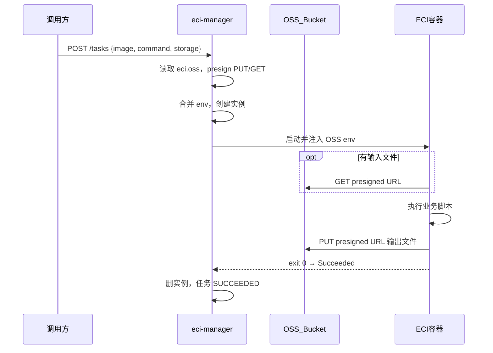

# ECI 任务 OSS 对象存储集成 — 产品需求文档 (PRD)

> 历史归档：本文保留原阶段的需求与草案，不代表当前实现。部署与调用请以 [README](../README.md) 和 [API 文档](../docs/API文档.md) 为准。

| **文档版本** | **创建日期** | **状态** | **适用对象** |
| ------------ | ------------ | -------- | ------------ |
| **v1.0** | 2026-07-30 | 草案 / 待评审 | 后端开发、容器运维、测试、评审人 |
| **产品定位** | eci-manager v2.1 增量：任务容器 OSS 读写能力 | 在现有任务驱动编排上增加 presigned URL 签发与容器 env 注入，实现「提交任务 → 容器写文件到 OSS」闭环 | |
| **前置文档** | [`ECI任务驱动容器编排服务产品需求文档(PRD).md`](../../ECI任务驱动容器编排服务产品需求文档(PRD).md) v2.0.3 | 本 PRD 为 v2.0.3 之上的增量需求；不替代前置 PRD | |
| **工程边界** | 只改 `eci-manager/` | **不修改**主仓 `backend/` 业务代码 | |

**关联文档：**

- 前置 PRD：[ECI任务驱动容器编排服务产品需求文档(PRD).md](../../ECI任务驱动容器编排服务产品需求文档(PRD).md)
- 主项目 OSS 参考：[backend/src/main/java/com/xjicloud/oss/OssStorageService.java](../../services/backend/src/main/java/com/xjicloud/oss/OssStorageService.java)、[Deploy.md](../../docs/Deploy.md) §5.5
- 容器 OSS 客户端参考：[gpu-worker/oss_client.py](../../services/gpu-worker/oss_client.py)
- 实现工程：[eci-manager/](../)

---

## 0. 本次评审建议决策（v1.0）

> 本节列出建议锁定的决策。若评审人无异议，团队将这些决策视为锁定，并据此编写实现计划；若有异议，请直接修改本表。

| # | 议题 | 建议结论 | 影响摘要 |
|---|------|----------|----------|
| 1 | OSS 配置归属 | eci-manager 使用独立配置段 `eci.oss`，字段语义对齐主项目 `xjicloud.oss` | 两个服务各自读配置；对接时填相同值即可共享 Bucket |
| 2 | 部署策略 | 联调阶段使用自建 Bucket；对接主项目时**只改配置值**，不改代码 | 降低联调风险，避免误写生产数据 |
| 3 | 鉴权方式 | Presigned URL；**禁止**将 AK/SK 写入容器 env | 与主项目 gpu-worker 模式一致 |
| 4 | 工作负载 | 一次性任务（`command`/`args` 执行完进程退出）；不实现 Worker 轮询协议 | 延续 v2.0.3 任务模型 |
| 5 | URL 签发方 | eci-manager 在创建容器前签发 presigned URL 并注入 env | 容器无需配置 OSS 凭证 |
| 6 | 对象 key 约定 | 复用主项目 `datasets/{jobId}/`、`outputs/{jobId}/model.ply`；联调用 `eci-test/{taskId}/` | 对接主项目时数据天然互通 |
| 7 | MVP 范围 | 先实现「提交任务 → 容器写文件到 OSS」；输入文件下载为可选增强 | 最小可验收闭环 |
| 8 | Bucket 开通 | 由运维手动创建 OSS Bucket 与 RAM 用户；eci-manager **不**自动建 Bucket | 基础设施与业务服务解耦 |

### 运行与构建约束（沿用 v2.0.3）

| 项 | 要求 |
|----|------|
| **运行环境** | 开发验证与演示都以 Linux 为准 |
| **JDK** | JDK 17 |
| **构建** | Maven 3.9+；工程位于 `eci-manager/` |
| **端口** | `8081`（不变） |
| **鉴权** | `X-Api-Key`（不变） |

---

## 1. 背景与目标

### 1.1 背景

eci-manager v2.0.3 已完成任务驱动容器编排能力：调用方通过 `POST /api/v1/eci/tasks` 提交任务，服务自动创建 ECI 实例、轮询云侧终态、超时保护与自动删除。

当前缺口：

1. **eci-manager 无 OSS 能力**：`env` 字段仅透传，服务无法为容器签发存储访问地址。
2. **容器无法将结果写入对象存储**：一次性任务执行完后，产出物无法自动落盘到 OSS。
3. **与主项目存储未对齐**：XJICloud 主仓 `backend/` 已通过 presigned URL 实现 OSS 读写（用户浏览器直传、gpu-worker 下载/上传），但 eci-manager 尚未接入同一套约定。

用户已在云端建立与 ECI 同地域的独立 OSS Bucket，希望先完成 eci-manager 侧闭环验证，后续通过改配置对接主项目存储，无需改代码。

### 1.2 核心目标

**MVP 闭环：**

```
提交任务 → eci-manager 签发 presigned PUT URL → 创建 ECI 容器
→ 容器脚本上传结果文件到 OSS → 进程退出（exit 0）
→ 云侧 Succeeded → 任务 SUCCEEDED → 实例自动删除
```

| 目标 | 说明 |
|------|------|
| **OSS 读写能力** | eci-manager 内嵌 presign GET/PUT，技术栈与 backend 一致（AWS S3 SDK `software.amazon.awssdk:s3`） |
| **配置独立可切换** | `eci.oss.*` 先指向自建 Bucket；对接主项目时改为与 `xjicloud.oss` 相同值 |
| **容器 env 契约** | 定义标准环境变量名；容器脚本可复用 `gpu-worker/oss_client.py` 的 HTTP 方式 |
| **任务 API 扩展** | `POST /tasks` 新增可选 `storage` 块 |
| **向后兼容** | 无 `storage` 的请求行为与 v2.0.3 完全一致 |
| **验收可重复** | 提供联调镜像与 curl/脚本示例 |

### 1.3 非目标（v1.0 明确不做）

- 不实现 OSS Bucket 自动创建、RAM 角色自动绑定或 Terraform 编排。
- 不实现浏览器直传、OSS Bucket CORS 配置（属 `backend/` 与用户前端职责）。
- 不实现 Worker `register` / `heartbeat` / `jobs/next` 轮询协议。
- 不实现 `backend/` 调用 eci-manager 的集成代码（留后续独立 PRD）。
- 不实现 OSS 管理后台 UI 或 `system_config` 热更新（eci-manager 使用 yml/env 配置）。
- 不把 OSS AccessKey / SecretKey 注入容器环境变量。
- 不实现 OSS 对象生命周期管理、版本控制、跨 Bucket 复制。

### 1.4 成功标准（验收口径）

| # | 验收项 | mock ECI | cloud ECI |
|---|--------|----------|-----------|
| 1 | 配置完整 `eci.oss` 后服务可正常启动 | 可选（OSS 可独立测） | 必须 |
| 2 | `POST /tasks` + `storage.mode=test`，任务终态 `SUCCEEDED` | 允许 ECI mock + OSS 真 Bucket | 必须 |
| 3 | OSS 控制台可见 `eci-test/{taskId}/output.txt`（或指定 key） | 必须 | 必须 |
| 4 | 任务结束后 ECI 实例已自动删除 | mock 自动删 | 必须 |
| 5 | 无 `storage` 的旧 curl 用例行为不变 | 必须 | 必须 |
| 6 | 请求含 `storage` 但 OSS 未配置完整 → `400`，不创建云资源 | 必须 | 必须 |
| 7 | `mvn test` 覆盖 presign 与 env 注入逻辑 | 必须 | — |
| 8 | 将 `eci.oss` 改为主项目 Bucket 配置后，同一 `jobId` 路径可读写互通 | — | 对接验证 |

---

## 2. 产品形态与边界

### 2.1 形态

| 项 | 约定 |
|----|------|
| **形态** | eci-manager v2.1 增量；独立 Spring Boot 服务，端口 `8081` |
| **工程目录** | `eci-manager/` |
| **与主后端关系** | 独立进程；本期不修改 `backend/` |
| **调用方** | 开发联调用 curl；未来由 `backend/` HTTP 调用 |
| **存储** | 阿里云 OSS（S3 兼容 API）；预生产可对接 MinIO（与 backend 一致） |

### 2.2 架构与数据流



### 2.3 与主项目组件职责

| 组件 | 本期职责 | 不做 |
|------|----------|------|
| **eci-manager** | `eci.oss` 配置、presign、env 注入、ECI 生命周期 | 训练队列、用户上传、Worker 协议 |
| **backend** | 不变 | 本期不调用 eci-manager |
| **容器内脚本** | 读 env，HTTP 下载/上传 | 不持有 OSS AK/SK |
| **运维** | 手动创建 Bucket、RAM 用户、网络放通 | — |

### 2.4 与现有 gpu-worker 的差异

| 维度 | 现有 gpu-worker | eci-manager 一次性任务 |
|------|-----------------|------------------------|
| URL 签发方 | `backend` `OssStorageService` | `eci-manager` `OssStorageService` |
| URL 下发时机 | Worker 轮询 `GET /worker/jobs/next` 时 | 创建任务时写入容器 `env` |
| OSS 访问方式 | HTTP presigned（`oss_client.py`） | 相同 |
| 任务结束判定 | Worker 调 `complete` API | 容器进程退出 + ECI 云侧终态 |

---

## 3. 配置需求

### 3.1 新增 `eci.oss` 配置段

在 `eci-manager/src/main/resources/application.yml` 新增：

```yaml
eci:
  oss:
    enabled: true
    endpoint: ${ECI_OSS_ENDPOINT:}
    region: ${ECI_OSS_REGION:}
    bucket: ${ECI_OSS_BUCKET:}
    access-key: ${ECI_OSS_ACCESS_KEY:}
    secret-key: ${ECI_OSS_SECRET_KEY:}
    path-style-access: false
    presign-expiration-minutes: 60
```

环境变量示例见 `eci-manager/.env.example`（实现阶段补充）。

### 3.2 与 `xjicloud.oss` 字段对齐

| `eci.oss` 字段 | `xjicloud.oss` 字段 | 说明 |
|----------------|---------------------|------|
| `enabled` | — | eci-manager 专有；`false` 时拒绝带 `storage` 的请求 |
| `endpoint` | `endpoint` | 阿里云：`https://oss-cn-{region}.aliyuncs.com` |
| `region` | `region` | 如 `cn-hangzhou` |
| `bucket` | `bucket` | Bucket 名称 |
| `access-key` | `access-key` | RAM 用户 AK；不进 Git |
| `secret-key` | `secret-key` | RAM 用户 SK；不进 Git |
| `path-style-access` | `path-style-access` | 阿里云生产 `false`；MinIO `true` |
| `presign-expiration-minutes` | `presign-expiration-minutes` | presigned URL 有效期 |

对接主项目时，将 `eci.oss` 各字段值改为与 `xjicloud.oss`（或管理后台 OSS 配置）相同即可。

### 3.3 基础设施 checklist（运维手动）

| 项 | 要求 |
|----|------|
| Bucket 地域 | 与 `eci.region-id` 一致 |
| RAM 权限 | 最小权限：`oss:GetObject`、`oss:PutObject`；按需 `oss:ListObjects` |
| ECI 网络 | 安全组出站 HTTPS 443 到 `*.aliyuncs.com`（或内网 OSS 域名） |
| 密钥管理 | 通过环境变量或 `application-local.yml`（gitignore）注入 |
| 内网 endpoint | 同 VPC 可选 `oss-cn-{region}-internal.aliyuncs.com` 降低延迟与费用 |

### 3.4 配置切换路径

| 阶段 | `eci.oss.bucket` | 说明 |
|------|------------------|------|
| **联调（当前）** | 用户自建 Bucket | 与主项目隔离，安全验证 |
| **对接** | 与 `xjicloud.oss.bucket` 相同 | 仅改配置，对象 key 约定已对齐 |

---

## 4. 功能需求

### 4.1 OssStorageService（eci-manager 新增）

从 [backend/OssStorageService.java](../../services/backend/src/main/java/com/xjicloud/oss/OssStorageService.java) 精简移植，至少包含：

| 方法 | 说明 |
|------|------|
| `presignPutUrl(ossKey, contentType)` | 签发上传 URL |
| `presignGetUrl(ossKey)` | 签发下载 URL |
| `buildDatasetPrefix(jobId)` | 返回 `datasets/{jobId}/` |
| `buildDatasetImageKey(jobId, archivedName)` | 返回 `datasets/{jobId}/images/{name}` |
| `buildOutputKey(jobId)` | 返回 `outputs/{jobId}/model.ply` |
| `testConnection()` | 可选；`ListObjectsV2` 验证连通性 |
| `normalizeEndpointForSdk(...)` 等 | 阿里云 endpoint 规范化逻辑一并移植 |

**Maven 依赖：**

```xml
<dependency>
  <groupId>software.amazon.awssdk</groupId>
  <artifactId>s3</artifactId>
  <version>2.29.45</version>
</dependency>
```

与 [backend/pom.xml](../../services/backend/pom.xml) 版本保持一致。

**说明：** eci-manager 一期不实现 `system_config` 热更新；配置变更需重启服务。后续可评估与 backend 抽取 `xjicloud-oss-common` 共享模块。

### 4.2 任务 API 扩展：`storage` 块

在 [CreateTaskRequest.java](../src/main/java/com/xjicloud/eci/task/dto/CreateTaskRequest.java) 新增可选字段 `storage`：

```json
{
  "name": "oss-smoke",
  "image": "registry-vpc.cn-hangzhou.aliyuncs.com/your-ns/eci-oss-test:latest",
  "command": ["python3", "/app/run.py"],
  "maxRuntimeSec": 600,
  "storage": {
    "mode": "test"
  }
}
```

#### 4.2.1 `storage` 字段定义

| 字段 | 类型 | 必填 | 说明 |
|------|------|------|------|
| `mode` | string | 是（当 `storage` 存在时） | `test` / `keys` / `dataset` |
| `jobId` | UUID string | `dataset` 模式必填 | 主项目训练任务 ID |
| `outputKey` | string | `keys` 模式必填；`test` 可省略 | 输出对象 key |
| `outputFileName` | string | 否 | `test` 模式默认 `output.txt` |
| `inputKeys` | string[] | 否 | 输入对象 key 列表；有则签发 GET presigned |

#### 4.2.2 `storage.mode` 行为

| mode | 行为 | MVP |
|------|------|-----|
| `test` | 自动生成 `eci-test/{taskId}/{outputFileName}`，仅 presign 输出 PUT | **是** |
| `keys` | 使用调用方指定的 `outputKey`；`inputKeys` 可选 | **是** |
| `dataset` | 根据 `jobId` 生成 `outputs/{jobId}/model.ply`；`inputKeys` 可选 | 二期 |

`test` 模式下 `{taskId}` 由 eci-manager 在受理任务时生成的 UUID 替换。

#### 4.2.3 校验规则

| 条件 | 结果 |
|------|------|
| 无 `storage` | 与 v2.0.3 行为一致，不触发 OSS 逻辑 |
| 有 `storage` 且 `eci.oss.enabled=false` | `400`，message 说明 OSS 未启用 |
| 有 `storage` 且 OSS 配置不完整（缺 endpoint/bucket/密钥等） | `400`，**不创建云资源** |
| `mode` 非法或必填字段缺失 | `400` |
| `inputKeys` 非空 | 为每个 key 签发 GET presigned，写入 `XJI_INPUT_FILES_JSON` |

#### 4.2.4 env 合并规则

在 [EciTaskService.create()](../src/main/java/com/xjicloud/eci/task/EciTaskService.java) 中：

1. 解析 `storage`，生成 presigned URL 与元信息。
2. 写入标准 OSS env 变量（见 §4.3）。
3. 与调用方传入的 `env` 合并：**调用方同名 key 优先**（便于调试覆盖）。
4. 将合并后的 env 传给实例创建流程（现有链路不变）。

### 4.3 容器 env 契约

eci-manager 自动注入以下环境变量：

| 环境变量 | 示例 | 说明 |
|----------|------|------|
| `XJI_OSS_ENDPOINT` | `https://oss-cn-hangzhou.aliyuncs.com` | OSS endpoint（元信息） |
| `XJI_OSS_BUCKET` | `xjicloud-eci-dev` | Bucket 名 |
| `XJI_OSS_REGION` | `cn-hangzhou` | 地域 |
| `XJI_TASK_ID` | UUID | eci-manager 任务 ID |
| `XJI_OUTPUT_OSS_KEY` | `eci-test/{taskId}/output.txt` | 输出对象 key |
| `XJI_OUTPUT_UPLOAD_URL` | `https://...` | presigned PUT URL |
| `XJI_INPUT_FILES_JSON` | 见下文 | 可选；输入文件列表 JSON |

`XJI_INPUT_FILES_JSON` 结构与主项目 `WorkerImageItem` 一致：

```json
[
  {
    "fileName": "001.jpg",
    "ossKey": "datasets/{jobId}/images/001.jpg",
    "downloadUrl": "https://..."
  }
]
```

容器脚本应使用 `downloadUrl` / `XJI_OUTPUT_UPLOAD_URL` 进行 HTTP 读写，**不得**依赖 AK/SK。可参考 [gpu-worker/oss_client.py](../../services/gpu-worker/oss_client.py)。

### 4.4 联调镜像 `eci-oss-test`

实现阶段在 `eci-manager/test-images/oss-smoke/` 提供最小联调镜像：

| 项 | 约定 |
|----|------|
| 基础镜像 | `python:3.12-slim` 或等价 |
| 依赖 | `requests` |
| 脚本行为 | 生成测试内容 → `PUT XJI_OUTPUT_UPLOAD_URL` → `exit 0` |
| 可选 | 若存在 `XJI_INPUT_FILES_JSON`，先下载再处理 |

镜像需推送至与 ECI 同 VPC 可达的镜像仓库（ACR  vpc 域名）。

### 4.5 任务响应扩展（可选，二期）

`GET /api/v1/eci/tasks/{id}` 响应可增加 `storageResolved`（不含 presigned URL）：

```json
{
  "storageResolved": {
    "mode": "test",
    "outputKey": "eci-test/550e8400-.../output.txt",
    "inputKeys": []
  }
}
```

一期 MVP 可不实现；验收以 OSS 控制台文件存在为准。

---

## 5. API 变更摘要

前缀、鉴权、响应包装与 v2.0.3 一致：`/api/v1/eci`，`X-Api-Key`，`{ success, message, data }`。

| 方法 | 路径 | 变更 |
|------|------|------|
| POST | `/api/v1/eci/tasks` | 请求体新增可选 `storage`；成功响应形态不变 |
| GET | `/api/v1/eci/tasks/{id}` | 一期不变；二期可增加 `storageResolved` |
| 其余 | `/instances`、`/tasks` 列表与取消等 | 不变 |

---

## 6. 对象存储路径约定

与主项目 [OssStorageService](../../services/backend/src/main/java/com/xjicloud/oss/OssStorageService.java) 保持一致：

| 用途 | Key 模板 | 使用方 |
|------|----------|--------|
| 数据集前缀 | `datasets/{jobId}/` | 对接主项目 |
| 单张图片 | `datasets/{jobId}/images/{archivedName}` | 对接主项目 |
| 训练产出 | `outputs/{jobId}/model.ply` | 对接主项目 |
| 联调测试 | `eci-test/{taskId}/{fileName}` | eci-manager 联调 |

对接主项目后，backend 创建的 `jobId` 与 eci-manager 任务 `storage.jobId` 一致时，输入输出对象天然共享，无需数据迁移。

---

## 7. 风险与约束

| 风险 | 缓解措施 |
|------|----------|
| presigned URL 过期 | 默认 60 分钟；`maxRuntimeSec` 应小于有效期，或调大 `presign-expiration-minutes` |
| eci-manager 与 backend 各维护一份 `OssStorageService` | 一期复制移植；三期可抽公共模块 |
| 输入文件过多导致 env 过大 | 一期用 `inputKeys[]` 显式传递；超大列表二期改 manifest 单 URL |
| Mock ECI + 真实 OSS | 允许分离验证：ECI `mock=true`，OSS 走真实 Bucket |
| 代码重复与 endpoint 规范化漂移 | 移植时保留 backend 单元测试中的 endpoint 规范化用例 |
| 安全组未放通 OSS | 联调 checklist 加入出站 443 验证 |

---

## 8. 实施分期

| 期 | 内容 | 交付 |
|----|------|------|
| **一期 MVP** | `eci.oss` + `OssStorageService` + `storage.mode=test/keys` + env 注入 + 联调镜像 + 文档 | 本 PRD 范围 |
| **二期** | `storage.mode=dataset`、任务响应 `storageResolved`、backend 集成 PRD | 独立文档 |
| **三期** | 抽取 `xjicloud-oss-common` 共享模块（可选） | 技术债 |

---

## 9. 文档同步（实现阶段）

PRD 批准并开始实现后，需同步更新：

| 文档 | 变更 |
|------|------|
| [eci-manager/docs/API文档.md](../docs/API文档.md) | `storage` 字段、env 契约、错误码 |
| [eci-manager/.env.example](../.env.example) | `ECI_OSS_*` 环境变量 |
| [eci-manager/docs/设计与使用说明.md](../docs/设计与使用说明.md) | 实现进度、OSS 配置 § |
| [ECI任务驱动容器编排服务产品需求文档(PRD).md](../../ECI任务驱动容器编排服务产品需求文档(PRD).md) | 关联本 PRD 链接 |

---

## 附录 A：配置示例

### A.1 联调（自建 Bucket，阿里云）

```yaml
# application-local.yml（勿提交 Git）
eci:
  mock: false
  region-id: cn-hangzhou
  vswitch-id: vsw-xxx
  security-group-id: sg-xxx
  oss:
    enabled: true
    endpoint: https://oss-cn-hangzhou.aliyuncs.com
    region: cn-hangzhou
    bucket: your-eci-dev-bucket
    access-key: ${ECI_OSS_ACCESS_KEY}
    secret-key: ${ECI_OSS_SECRET_KEY}
    path-style-access: false
    presign-expiration-minutes: 120
```

### A.2 对接主项目（与 backend 相同 Bucket）

```yaml
eci:
  oss:
    enabled: true
    endpoint: https://oss-cn-shanghai.aliyuncs.com
    region: cn-shanghai
    bucket: xjicloud
    access-key: ${ECI_OSS_ACCESS_KEY}
    secret-key: ${ECI_OSS_SECRET_KEY}
    path-style-access: false
    presign-expiration-minutes: 120
```

与 [deploy/config/application-prod.yml.example](../../deploy/config/application-prod.yml.example) 中 `xjicloud.oss` 保持一致即可。

---

## 附录 B：curl 联调示例

环境变量：

```bash
export ECI_API_KEY='your-api-key'
export ECI_BASE='http://127.0.0.1:8081'
```

### B.1 提交 OSS 冒烟任务（`mode=test`）

```bash
curl -s -X POST "$ECI_BASE/api/v1/eci/tasks" \
  -H "Content-Type: application/json" \
  -H "X-Api-Key: $ECI_API_KEY" \
  -d '{
    "name": "oss-smoke",
    "image": "registry-vpc.cn-hangzhou.aliyuncs.com/your-ns/eci-oss-test:latest",
    "command": ["python3", "/app/run.py"],
    "maxRuntimeSec": 600,
    "storage": {
      "mode": "test"
    }
  }'
```

记录返回的 `data.id` 为 `TASK_ID`。

### B.2 轮询任务状态

```bash
curl -s -H "X-Api-Key: $ECI_API_KEY" \
  "$ECI_BASE/api/v1/eci/tasks/$TASK_ID"
```

期望终态：`status` 为 `SUCCEEDED`。

### B.3 验证 OSS 输出

在 OSS 控制台查看对象：

```
eci-test/{TASK_ID}/output.txt
```

或使用 ossutil / 阿里云 CLI 下载验证。

### B.4 指定输出 key（`mode=keys`）

```bash
curl -s -X POST "$ECI_BASE/api/v1/eci/tasks" \
  -H "Content-Type: application/json" \
  -H "X-Api-Key: $ECI_API_KEY" \
  -d '{
    "name": "oss-keys",
    "image": "registry-vpc.cn-hangzhou.aliyuncs.com/your-ns/eci-oss-test:latest",
    "command": ["python3", "/app/run.py"],
    "storage": {
      "mode": "keys",
      "outputKey": "eci-test/manual-run/output.ply",
      "inputKeys": [
        "eci-test/fixtures/sample-input.txt"
      ]
    }
  }'
```

提交前需确保 `inputKeys` 所指对象已存在于 Bucket 中。

---

## 附录 C：联调镜像脚本参考

`eci-manager/test-images/oss-smoke/run.py`（实现阶段提供）：

```python
#!/usr/bin/env python3
import json
import os
import sys
from datetime import datetime, timezone
from pathlib import Path

import requests

def main() -> int:
    upload_url = os.environ.get("XJI_OUTPUT_UPLOAD_URL")
    if not upload_url:
        print("XJI_OUTPUT_UPLOAD_URL is required", file=sys.stderr)
        return 1

    body = f"eci-oss-smoke ok at {datetime.now(timezone.utc).isoformat()}\n".encode()
    response = requests.put(
        upload_url,
        data=body,
        headers={"Content-Type": "text/plain"},
        timeout=120,
    )
    response.raise_for_status()

    input_json = os.environ.get("XJI_INPUT_FILES_JSON")
    if input_json:
        for item in json.loads(input_json):
            print(f"input available: {item.get('ossKey')}")

    print(f"uploaded to {os.environ.get('XJI_OUTPUT_OSS_KEY')}")
    return 0

if __name__ == "__main__":
    raise SystemExit(main())
```

---

## 附录 D：未来 backend 对接面（本期不实现）

供二期集成参考；本期 **不修改** `backend/`。

```java
// 伪代码：TrainingJob 入队后由调度组件提交 eci-manager 任务
POST http://eci-manager:8081/api/v1/eci/tasks
Headers: X-Api-Key: ${eci.api-key}
Body: {
  "image": "acr.../xjicloud-gpu-worker:latest",
  "command": ["python3", "/app/run_once.py"],
  "storage": {
    "mode": "keys",
    "outputKey": "outputs/{jobId}/model.ply",
    "inputKeys": ["datasets/{jobId}/images/001.jpg", "..."]
  },
  "env": { "CUDA_VISIBLE_DEVICES": "0" },
  "maxRuntimeSec": 14400
}
```

backend 只传 `jobId` 与 key 列表；presigned URL 由 eci-manager 统一签发。
