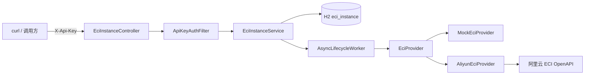

# eci-manager 设计与使用说明

本文描述 XJICloud 主仓子目录 `eci-manager/` 的工程结构、架构、配置、HTTP 接口与使用方法。对应 PRD：`ECI容器管理后端Demo产品需求文档(PRD).md` v1.1。

快速上手亦可先看同目录上级的 [README.md](../README.md)。

---

## 1. 概述

| 项 | 说明 |
|----|------|
| 定位 | 独立 Demo：用 Spring Boot 调用阿里云 ECI OpenAPI，验证容器实例创建 / 查询 / **删除** |
| 形态 | 独立 Maven 工程，**不修改**主仓 `backend/` |
| 端口 | `8081`（避免与主后端 `8080` 冲突） |
| 栈 | Spring Boot 3.3.5、Java 17、H2 文件库、阿里云 Java SDK（ECI） |
| 关闭语义 | 删除云实例（非 Stop 保留） |
| 鉴权 | 请求头 `X-Api-Key`，与配置 `eci.api-key` 比对 |

### Mock vs 真实

| 模式 | 条件 | 行为 |
|------|------|------|
| Mock | `eci.mock=true`（默认 `dev`） | 不调云；`cloudInstanceId` 形如 `mock-eci-...` |
| 真实 | `eci.mock=false`（`cloud` + `local`） | 调阿里云 Create / Describe / Delete |

本阶段**不**实现训练队列、Worker 协议、CCI、前端。

---

## 2. 目录与包结构

```
eci-manager/
  pom.xml
  README.md
  docs/设计与使用说明.md          ← 本文
  src/main/java/com/xjicloud/eci/
    EciManagerApplication.java    启动入口
    common/                       统一响应与异常
    auth/                         Api-Key 过滤器
    config/                       配置、安全、异步、Provider 装配
    instance/                     REST + 业务 + 持久化
    provider/                     云侧抽象：Mock / Aliyun
    lifecycle/                    异步创建轮询 / 删除确认 / 启动补偿
  src/main/resources/
    application.yml               公共默认（mock、端口等）
    application-dev.yml           mock=true
    application-cloud.yml         mock=false + 推荐阿里云镜像
    application-local.yml.example 真实模式模板（复制为 local，勿提交）
```

### 包职责

| 包 | 职责 |
|----|------|
| `common` | `ApiResponse`、`BusinessException`、`GlobalExceptionHandler` |
| `auth` | `ApiKeyAuthFilter`：校验 `/api/v1/eci/**` |
| `config` | `EciProperties`、`SecurityConfig`、`AsyncConfig`、`ProviderConfig` |
| `instance` | Controller / Service / Entity / Repository / DTO / 状态枚举 |
| `provider` | `EciProvider` 及 Mock、Aliyun 实现；不含本地状态机 |
| `lifecycle` | `AsyncLifecycleWorker`：后台调云并轮询状态 |

---

## 3. 架构与数据流



**职责边界**

- Controller：HTTP 契约与参数
- Service：本地状态权威、幂等删除、触发异步任务
- Provider：只做云侧 Create / Describe / Delete
- Worker：创建后轮询 Running；删除后确认消失；超时写 `FAILED`

### 本地状态机

```
CREATING → RUNNING | FAILED
RUNNING  → STOPPING → TERMINATED | FAILED
CREATING / RUNNING / STOPPING + 云侧已删 → TERMINATED（refresh 可回写）
```

### 异步创建时序

1. `POST`：落库 `CREATING`，立即返回本地 UUID  
2. 后台：`create` → 写入 `cloudInstanceId` → 轮询 Describe 至 Running / 失败 / 超时  
3. 调用方用 `GET` / `refresh` 查看进度  

删除同理：先置 `STOPPING` 再异步 Delete；已是 `TERMINATED` 的 DELETE **幂等成功**。

### 进程崩溃与启动补偿

H2 持久化后，进程崩溃可能留下 `CREATING` / `STOPPING`。启动时 `StartupCompensationRunner` 扫描这些状态（含 `RUNNING`）：

1. 无 `cloudInstanceId` 的 `CREATING` → 本地标记 `FAILED`
2. 有云 ID：先 `refresh` 对齐；云侧 NotFound → `TERMINATED`，不再启异步
3. refresh 后仍为 `CREATING` / `STOPPING` → 续跑轮询（`resumeCreatePoll` / `resumeDelete`，不重复 Create）
4. `RUNNING` 只 refresh

编排在 Runner，**整批不加长事务**；每条写库独立提交。单条失败只打日志，不阻断启动。

Demo 假定单实例；若日后多节点同时启动会并发补偿，需加分布式锁（本阶段不做）。

---

## 4. 配置项

前缀：`eci.`（见 `EciProperties`）

| 键 | 说明 |
|----|------|
| `mock` | 是否 Mock |
| `api-key` | HTTP 鉴权密钥（必填非空） |
| `access-key-id` / `access-key-secret` | 阿里云 AK（真实模式必填） |
| `region-id` | 如 `cn-hangzhou` |
| `vpc-id` | 可选记录 |
| `vswitch-id` / `security-group-id` | 真实模式必填 |
| `default-image` | 未传 `image` 时使用 |
| `default-cpu` / `default-memory` | 默认规格 |
| `create-timeout-sec` | 等待 Running / 删除完成超时（默认 300） |
| `poll-interval-ms` | 轮询间隔（默认 3000） |

### Profile

| Profile | 作用 |
|---------|------|
| `dev`（默认） | `mock=true` |
| `cloud` | `mock=false`，推荐阿里云镜像 |
| `local` | 本地密钥与网络（`application-local.yml`，gitignore） |

真实启动示例：`SPRING_PROFILES_ACTIVE=cloud,local`

### 推荐镜像（真实模式）

Docker Hub 的 `nginx:alpine` 在无 NAT 时可能一直 Pending。真实联调推荐：

`registry-vpc.cn-hangzhou.aliyuncs.com/eci_open/nginx:1.14.2`

（已写入 `application-cloud.yml` 与 `application-local.yml.example`）

凭证与 `api-key` **不得提交 Git**。

---

## 5. HTTP 接口

### 约定

- 前缀：`/api/v1/eci`
- 响应：`{ "success": boolean, "message": string|null, "data": ... }`
- 鉴权：`X-Api-Key`（`/actuator/health` 除外）
- 错误：业务异常经 `GlobalExceptionHandler`；缺/错 Key → **401**

### 接口一览

| 方法 | 路径 | 说明 |
|------|------|------|
| POST | `/api/v1/eci/instances` | 异步创建，返回 `CREATING` |
| DELETE | `/api/v1/eci/instances/{id}` | 删除；已终止幂等成功 |
| GET | `/api/v1/eci/instances?status=` | 列表，可选状态过滤 |
| GET | `/api/v1/eci/instances/{id}` | 详情 |
| POST | `/api/v1/eci/instances/{id}/refresh` | Describe 回写本地状态 |
| GET | `/actuator/health` | 存活探测 |

### 创建请求体（均可选，有默认值）

```json
{
  "name": "demo-1",
  "image": "registry-vpc.cn-hangzhou.aliyuncs.com/eci_open/nginx:1.14.2",
  "cpu": 1.0,
  "memory": 2.0,
  "env": {
    "XJICLOUD_BACKEND_URL": "http://10.0.1.20:8080",
    "WORKER_SECRET": "change-me",
    "WORKER_NAME": "demo-1"
  }
}
```

`env` 透传进容器，便于日后对接 Worker（本阶段可不联调）。

### 实例响应主要字段

| 字段 | 说明 |
|------|------|
| `id` | 本地 UUID |
| `status` | 本地状态机 |
| `cloudInstanceId` | 云侧 ID（或 mock-eci-...） |
| `cloudStatus` | 最近一次云侧状态字符串 |
| `failureReason` | 失败原因 |
| `image` / `cpu` / `memory` / `env` | 规格与环境变量 |

### 行为注意

- 创建：**异步**，勿期望 POST 直接返回 `RUNNING`
- 删除：`CREATING` 中禁止删除（409）；`TERMINATED` 再删仍成功
- `refresh`：云侧已不存在且本地为 `CREATING`/`RUNNING`/`STOPPING` 时会落到 `TERMINATED`

---

## 6. 使用方法

### 环境

- Linux + JDK 17 + Maven 3.9+
- 若无系统 JDK/Maven：`source ../.tools/env.sh`（仓库便携工具链）

### Mock 联调

```bash
cd eci-manager
source ../.tools/env.sh
export ECI_API_KEY=dev-eci-api-key-change-me
mvn spring-boot:run
```

用真实 UUID 替换路径中的 id（不要写字面量 `{id}`）：

```bash
curl -s -X POST http://127.0.0.1:8081/api/v1/eci/instances \
  -H "Content-Type: application/json" \
  -H "X-Api-Key: $ECI_API_KEY" \
  -d '{"name":"demo-1"}'
```

### 真实联调

1. `cp src/main/resources/application-local.yml.example src/main/resources/application-local.yml`
2. 填写 RAM 用户 AK、地域、交换机、安全组、`api-key`；镜像用阿里云仓库地址
3. 启动：

```bash
export SPRING_PROFILES_ACTIVE=cloud,local
export ECI_API_KEY='<与 yml 中 api-key 一致>'
mvn spring-boot:run
```

日志应出现：`ECI provider mode: ALIYUN`。

4. curl 创建 → 轮询至 `RUNNING` → 控制台（杭州）核对 → **DELETE** → 确认 `TERMINATED` 且控制台无残留

> **费用：** 真实实例按量计费，测完必须删除。

### 常见问题

| 现象 | 处理 |
|------|------|
| `JAVA_HOME is not defined` | `source ../.tools/env.sh` |
| Api-Key 无效 | `export ECI_API_KEY` 与配置一致；勿漏请求头 |
| 一直 Pending / 超时 FAILED | 改用阿里云镜像；检查 NAT/权限/可用区 |
| UUID 转换失败 | 路径里写了字面量 `{id}`，应换成返回的真实 UUID |
| 启动报 vswitch/AK 必填 | 未激活 `local`，或 yml 未加载 |

---

## 7. 验收与测试

### 自动化（Mock）

```bash
cd eci-manager
source ../.tools/env.sh
mvn test
```

覆盖：健康检查、缺 Key 拒绝、创建→RUNNING→删除→TERMINATED、幂等删除；refresh 在云侧缺失时将 `CREATING` 置为 `TERMINATED`；启动补偿各分支（无 cloudId FAILED、Pending 续跑、NotFound 不 resume）。

### 手工真实验收（对应 PRD）

1. ALIYUN 模式可启动  
2. POST 后控制台可见 ECI，本地最终 `RUNNING`  
3. DELETE 后云上删除，本地 `TERMINATED`  
4. 错误 Api-Key → 401，不创建资源  

---

## 8. 与主系统关系（后续）

本服务只负责实例生命周期。后续可由 XJICloud Backend HTTP 调用本服务，或代码迁入并替换为 CCI Provider（生产选型待定）。容器业务通过 `env` 预留 `XJICLOUD_BACKEND_URL` / `WORKER_SECRET` / `WORKER_NAME`。
