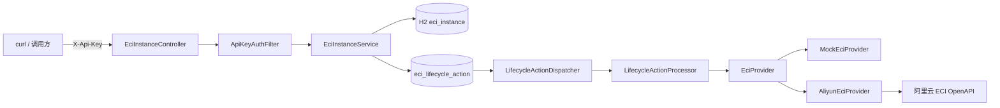
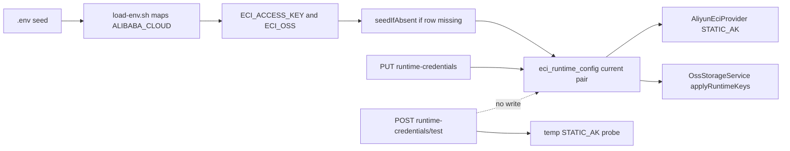

# eci-manager 设计与使用说明

命令中的 `/path/to/XJICloud` 请替换为实际仓库路径；运行前需安装 JDK 17 和 Maven 3.9+。

本文描述 XJICloud 主仓子目录 `eci-manager/` 的工程结构、架构、配置、HTTP 接口与使用方法。

- **现行 PRD：** [`ECI任务驱动容器编排服务产品需求文档(PRD).md`](../../ECI任务驱动容器编排服务产品需求文档(PRD).md) **v2.0.3**
- **OSS 集成 PRD（v2.1 规划）：** [`ECI任务OSS对象存储集成产品需求文档(PRD).md`](../prd/ECI任务OSS对象存储集成产品需求文档(PRD).md) **v1.0**
- 前身 Demo PRD v1.1 已被 v2.0 取代；本文以架构、配置与使用为主。
- **HTTP API 完整说明（业务导读 / 字段 / 状态码 / 当前钥 / 联调速查）：** [API文档.md](./API文档.md)

快速上手亦可先看同目录上级的 [README.md](../README.md)。

---

## 1. 概述

| 项 | 说明 |
|----|------|
| 定位 | 独立服务：Spring Boot 调用阿里云 ECI OpenAPI；在 Demo 基座上演进任务驱动编排（PRD v2.0.3） |
| 形态 | 独立 Maven 工程，**不修改**主仓 `backend/` |
| 端口 | `8081`（避免与主后端 `8080` 冲突） |
| 栈 | Spring Boot 3.3.5、Java 17、H2 文件库、阿里云 Java SDK（ECI） |
| 关闭语义 | 删除云实例（非 Stop 保留） |
| 鉴权 | 请求头 `X-Api-Key`，与配置 `eci.api-key` 比对 |

### 实现进度（2026-07-31）

| 能力 | 状态 |
|------|------|
| 实例创建 / 查询 / 删除 / refresh；Api-Key；Mock/Cloud | ✅ |
| 创建可选 `restartPolicy`、`command`、`args`、`instanceType`、`gpu`、`imageSnapshotId`、`shmSize` | ✅ |
| 任务表 `eci_task`、`POST/GET /tasks`、取消 | ✅ T1 |
| `TaskLifecycleWatcher`、终态自动删、`maxRuntimeSec` 超时 | ✅ T2 |
| Mock `mock-auto-complete-sec` 时间触发终态 | ✅ T3 |
| 生命周期测试补强（Watcher 单测、手动实例 IT、启动补偿） | ✅ T3+ |
| OSS `eci.oss` + `OssStorageService` + `storage` 解析 + create 接入（O1–O4） | ✅ |
| OSS 联调镜像 `test-images/oss-smoke` + API/设计文档 storage 正式节（O5.1–O5.2） | ✅ |
| OSS 云端验收（O5.3 / Task 7） | 📋 待做 |
| 当前云钥 GET/PUT/test + HTTP Api-Key 配置鉴权 | ✅ |

### Mock vs 真实

| 模式 | 条件 | 行为 |
|------|------|------|
| Mock | `eci.mock=true`（默认 `dev`） | 不调云；`cloudInstanceId` 形如 `mock-eci-...`；创建后约 `mock-auto-complete-sec` 秒自动迁 Succeeded/Failed；亦可用 `simulateStatus` 钩子 |
| 真实 | `eci.mock=false`（`cloud` + `local`） | 调阿里云 Create / Describe / Delete；透传 RestartPolicy / Commands / Args / ImageSnapshotId；有 `shmSize` 时挂 Memory EmptyDir 到 `/dev/shm` |

本阶段**不**实现训练队列、Worker 协议、CCI、前端、业务回调。

---

## 2. 目录与包结构

```
eci-manager/
  pom.xml
  README.md
  .env.example                    配置模板（复制为 .env，gitignore；含 ECI_OSS_*）
  scripts/
    load-env.sh                   加载 .env
    start.sh                      启动服务
  test-images/oss-smoke/          OSS 联调镜像（eci-oss-test）
    Dockerfile                    基座：个人 ACR python_mirror:3.12（Alpine）
    run.py                        读 XJI_OUTPUT_UPLOAD_URL → PUT
    requirements.txt
  docs/设计与使用说明.md          ← 本文
  src/main/java/com/xjicloud/eci/
    EciManagerApplication.java    启动入口
    common/                       统一响应与异常
    auth/                         Api-Key 过滤器
    config/                       EciProperties、OssProperties、安全、异步、Provider
    credential/                   当前云钥 GET/PUT/test
    oss/                          OssStorageService（presign + applyRuntimeKeys）
    instance/                     REST + 业务 + 持久化
    task/                         任务实体/REST/Service；storage/ 解析 DTO
    provider/                     云侧抽象：Mock / Aliyun
    lifecycle/                    异步创建轮询 / 删除确认 / 启动补偿
  src/main/resources/
    application.yml               公共默认（mock、端口、eci.oss 占位）
    application-dev.yml           mock=true
    application-cloud.yml         mock=false + 推荐阿里云镜像
    application-local.yml.example 真实模式模板（复制为 local，勿提交）
```

### 包职责

| 包 | 职责 |
|----|------|
| `common` | `ApiResponse`、`BusinessException`、`GlobalExceptionHandler` |
| `auth` | `ApiKeyAuthFilter`：按应用内路径校验 `/api/v1/eci/**`，包括设置非根 servlet context path 的部署 |
| `config` | `EciProperties`、`OssProperties`、`SecurityConfig`、`AsyncConfig`、`ProviderConfig` |
| `credential` | 当前云钥 GET/PUT/test 与持久化；HTTP Api-Key 由 `auth` 读取进程配置 |
| `oss` | `OssStorageService`：S3 兼容客户端、presigned PUT/GET、热切 |
| `instance` | Controller / Service / Entity / Repository / DTO / 状态枚举 |
| `task` | 任务 API / `EciTaskService`；`task.storage` 解析并注入 env |
| `provider` | `EciProvider` 及 Mock、Aliyun 实现；不含本地状态机 |
| `lifecycle` | `LifecycleActionDispatcher` / `LifecycleActionProcessor`：持久化动作、租约与短步骤云调用 |

---

## 3. 架构与数据流



**职责边界**

- Controller：HTTP 契约与参数
- Service：本地状态权威、幂等登记 CREATE/DELETE 动作
- Provider：只做云侧 Create / Describe / Delete
- Dispatcher/Processor：领取有租约的到期动作，每一步最多一次云调用；不循环、不 `sleep`
- Watcher：识别任务终态/超时，按“抓日志 → 落库 → not-before → DELETE”登记清理

### 本地状态机

```
CREATING → RUNNING | FAILED
RUNNING  → STOPPING → TERMINATED
CREATING / RUNNING / STOPPING / FAILED + 云侧已删 → TERMINATED（refresh 可回写）
```

### 异步创建时序

1. `POST`：落库 `CREATING`，立即返回本地 UUID  
2. 后台：`create` → 写入 `cloudInstanceId` → 轮询 Describe 至 Running / 失败 / 超时  
3. 调用方用 `GET` / `refresh` 查看进度  

删除同理：先置 `STOPPING` 再异步 Delete；已是 `TERMINATED` 的 DELETE **幂等成功**。

### 进程崩溃与启动补偿

H2 持久化后，进程崩溃可能留下 `CREATING` / `STOPPING` / 非终态任务。启动时 `StartupCompensationRunner`：

1. 恢复已过期的生命周期动作租约，使其回到可领取状态
2. `CREATING` 且缺动作时：有 cloudId 补建 `WAIT_RUNNING`；只有能确认是 P0 流程的行才补建 tokenized CREATE。pre-P0 无 cloudId 历史行创建隔离标记，不重放 CREATE
3. `STOPPING` 且未 `TERMINATED` 时补建/唤醒 DELETE
4. 任务实例为 `FAILED` 且仍有 cloudId 时补建 DELETE；手动实例不因云终态自动删除
5. 一条坏数据只记录日志，不阻断其他记录恢复

运行中：`TaskLifecycleWatcher` 按 `task-poll-interval-sec` 扫描 STARTING/RUNNING，处理云终态自动删与超时。

编排在 Runner，**整批不加长事务**；每条写库独立提交。单条失败只打日志，不阻断启动。

Demo 假定单实例；若日后多节点同时启动会并发补偿，需加分布式锁（本阶段不做）。

### P0 任务状态与生命周期动作

任务取消流转为 `PENDING/STARTING/RUNNING → CANCELLING → CANCELLED`。取消接口首次通常返回 `CANCELLING`，重复取消幂等；只有关联实例已 `TERMINATED` 或确认 `NotFound` 后才写入 `CANCELLED`。`SUCCEEDED` 同样要求云侧成功证据和本地实例 `TERMINATED`。

`eci_lifecycle_action` 持久化 CREATE/DELETE 的阶段、租约、退避、`lastError` 和完成时间。P0 CREATE 固定使用本地实例 UUID 作为 `ClientToken`，同时写入 `xjicloud-local-instance-id` Tag；未知结果使用同一 token 恢复，避免重复云实例。每个 processor 步骤最多调用一次云 API，不在线程内循环或 `sleep`。

DELETE 失败不会进入 `FAILED`，而是按 2 秒起、300 秒封顶的指数退避无限重试。`delete-timeout-sec` 只记录超时告警，不停止清理；实例保持 `STOPPING`，直到 `Deleted`/`NotFound` 证据将其置为 `TERMINATED`。Failed/TIMEOUT 先抓日志并持久化任务失败，再把 `failure-log-grace-sec` 作为 DELETE 的持久化 not-before，watcher 不等待宽限。`create-timeout-sec` 只控制 P0 tokenized CREATE 的业务失败暴露；pre-P0 无 token 历史 CREATE 保持隔离，不会后台重放或自动查云。

### 旧版 CREATE 隔离与人工核对

pre-P0 `AsyncLifecycleWorker` 创建的请求没有 ClientToken、本地 UUID Tag 或可从数据库重建的云组名。启动补偿或无云 ID 的 DELETE 依赖检查会创建唯一的 `Legacy CREATE outcome unknown` CREATE 动作；processor 将其保持 `WAITING`，不调用 Provider Create，也不自动猜测云资源。第一次处理记录只含 `actionId` 和 `instanceId` 的 ERROR，后续重试不重复告警。这样做是为了避免升级后重放导致重复计费资源。

人工核对步骤：

1. 在服务停写窗口读取隔离行（不包含凭据）：

```sql
SELECT a.id AS action_id, a.instance_id, i.name, i.image, i.created_at
FROM eci_lifecycle_action a
JOIN eci_instance i ON i.id = a.instance_id
WHERE a.action_type = 'CREATE'
  AND a.last_error LIKE 'Legacy CREATE outcome unknown%';
```

2. 在同地域 ECI 控制台或经批准的只读 OpenAPI 查询中，按本地规格和 `created_at` 时间窗口核对历史容器组。无法唯一确认时，保持该动作 `WAITING`，不要重新提交 CREATE。
3. 仅在确认唯一云实例后，由 DBA 备份并在单事务中写入该实例的 `cloud_instance_id`，将 CREATE 动作改为 `phase=WAIT_RUNNING`、`status=READY`，并把 `last_error` 改为人工核对记录；之后由动作协调器 Describe，并按实例的停止/任务状态继续 Delete。确认云侧不存在资源时，按同一 DBA 变更流程将本地实例和动作收敛为终态。

---

## 4. 配置与云凭证

前缀：`eci.`（见 `EciProperties`）

8081 是当前钥执行器：每种 `resource`（`ECI_OPENAPI` / `OSS`）只有一把当前 AccessKey，可 GET/PUT 热切、POST 测通。统一 AK 目录已由主后端 8080 管理，选用后调用本服务 API 推送对应资源的当前钥；8081 不另存目录或目录 ID。

主后端目录项的新增、删除保护、按资源选用及两服务间调用顺序见[云访问密钥管理说明](./云访问密钥管理说明.md)。



| 键 | 说明 |
|----|------|
| `mock` | 是否 Mock（`true` 不调云） |
| `api-key` | HTTP 鉴权密钥（必填非空）；进程唯一权威，受保护请求头必须传同值 `X-Api-Key` |
| `ecs-ram-role-name` | 可选；当前 ECI 钥为空时用 InstanceProfile |
| `access-key-id` / `access-key-secret` | ECI 当前钥的**种子**（通常来自 `ECI_ACCESS_KEY_*`）。成对非空 → **STATIC_AK**。只在库中 current 行不存在时写入 |
| `region-id` | 如 `cn-hangzhou` |
| `vpc-id` | 可选记录 |
| `vswitch-id` / `security-group-id` | 真实模式必填 |
| `default-image` | 未传 `image` 时使用 |
| `default-cpu` / `default-memory` | 默认规格 |
| `default-shm-size` | 未传 `shmSize` 时放大 `/dev/shm`；空则保持 ECI 默认 64Mi |
| `create-timeout-sec` | CREATE 动作超时后暴露业务失败；未知 CREATE 仍用同一 token 后台恢复（默认 300） |
| `delete-timeout-sec` | DELETE 动作登记起的超时告警；清理继续重试，不停止（默认 300） |
| `poll-interval-ms` | 创建/删除轮询间隔（默认 3000） |
| `default-restart-policy` | 默认 `Never` |
| `default-max-runtime-sec` | 默认 `14400` |
| `task-poll-interval-sec` | 任务终态轮询周期（默认 10） |
| `mock-auto-complete-sec` | Mock 创建后自动终态秒数（默认 3；`<=0` 关闭） |
| `mock-auto-complete-status` | Mock 自动终态（默认 `Succeeded`） |
| `lifecycle-action.dispatch-interval-ms` | 动作 dispatcher 周期（默认 `1000`） |
| `lifecycle-action.batch-size` | 每轮最多领取动作数（默认 `20`） |
| `lifecycle-action.lease-sec` | 动作租约（默认 `60`） |
| `lifecycle-action.retry-initial-sec` | DELETE 失败初始退避（默认 `2`） |
| `lifecycle-action.retry-max-sec` | DELETE 失败退避上限（默认 `300`） |
| `lifecycle-action.cleanup-alert-attempts` | DELETE ERROR 告警起始次数（默认 `5`） |

HTTP 契约见 [API文档.md](./API文档.md) §5。热切 ECI **不**取消已有任务；之后的 create/describe/delete 用新钥。选钥不改 region / vswitch / sg / OSS endpoint。

### 4.0 使用 `.env`（推荐）

在 `eci-manager/` 目录：

```bash
cp .env.example .env
chmod +x scripts/*.sh
./scripts/start.sh          # 真云：.env 中 SPRING_PROFILES_ACTIVE=cloud,local
```

| `.env` 变量 | 映射到 | 说明 |
|-------------|--------|------|
| `SPRING_PROFILES_ACTIVE` | Spring profiles | 真云 `cloud,local`；Mock `dev` |
| `ECI_API_KEY` | `eci.api-key` | 进程唯一 HTTP Api-Key 配置；改值需重启 |
| `ECI_REGION_ID` 等 | `eci.region-id` 等 | 见 `application.yml` 中 `${ECI_*}` |
| `ECI_ACCESS_KEY_ID` / `SECRET` | `eci.access-key-id/secret` | ECI 当前钥**种子**；成对则 STATIC_AK |
| `ALIBABA_CLOUD_ACCESS_KEY_ID` / `SECRET` | **不进 Java** | 仅 `load-env.sh`：当 `ECI_ACCESS_KEY_*` 为空且无 STS token 时映射为种子 |
| `ALIBABA_CLOUD_SECURITY_TOKEN` | STS 可选 | 有 token 时**不**映射到 `ECI_ACCESS_KEY_*`，走 SDK 默认链 |
| `ECI_OSS_*` | `eci.oss.*` | OSS endpoint/bucket 为网络目标；AK/SK 是 OSS 当前钥**种子**。见 **§4.4** |

**云当前钥种子规则：** current 行不存在才从 properties 写入；已 PUT 的云热切结果启动时**不会**被 `.env` 打回。HTTP Api-Key 不属于种子，不写入 `eci_runtime_config`。

**HTTP Api-Key 升级边界：** H2 中可能残留旧 `eci.api-key`、`previous`、`previous-expires-at` 行，但新版本完全忽略，不能覆盖配置或继续授权。曾通过旧 PUT 轮换过的部署，升级前必须把当时仍有效的当前 HTTP Api-Key 回写到受保护的 env/yml，再停止旧版本并启动新版本；只回写当前有效钥，不回写已撤销或仅处于旧重叠窗口的钥。主后端调用 8081 时仍传配置中的 `X-Api-Key`。

`scripts/load-env.sh` 在启动前 `source` 即可；curl 时也可单独 source 取得 `$ECI_API_KEY`。`.env` 已 gitignore。完整字段见 [`.env.example`](../.env.example)。

### 4.1 两种身份（勿混）

| 身份 | 配置 | 作用 |
|------|------|------|
| 服务 HTTP | `eci.api-key` / `ECI_API_KEY` | 调用本服务 REST；配置是进程唯一权威，修改后重启 |
| 阿里云 ECI | 当前钥 `ECI_OPENAPI`；空则 RAM / 默认链 | Create/Describe/Delete ECI |
| 本服务 OSS | 当前钥 `OSS` + `eci.oss` endpoint/bucket | `POST /tasks` 带 `storage` 时签发 presign |

### 4.2 如何配置（按场景）

#### A. 仅本机 Mock（不调云）

1. 默认 `dev` profile（`eci.mock=true`）。  
2. `mvn spring-boot:run`，或 `.env` 中设 `SPRING_PROFILES_ACTIVE=dev` 后 `./scripts/start.sh`。  
3. curl 时 `export ECI_API_KEY=...` 或 `source scripts/load-env.sh`。  
4. Mock 下 `POST .../test` 的 `ECI_OPENAPI` → **400**；OSS 在配好 endpoint+bucket 后可测（CI 走 fake probe，不连真云）。

#### B. 本机 / WSL 真实调云（推荐：`.env`）

1. `cp .env.example .env`，填写 `ECI_API_KEY`、网络、**种子** `ECI_ACCESS_KEY_*`（或只填 `ALIBABA_CLOUD_*` 让 `load-env.sh` 映射）。  
2. `./scripts/start.sh`。成对种子时日志应含 `credentialMode=STATIC_AK`。  
3. 测完勿将 `.env` 提交 Git。

#### B-alt. 使用 `application-local.yml`（旧方式）

1. 复制模板：

```bash
cp src/main/resources/application-local.yml.example src/main/resources/application-local.yml
```

编辑网络与 `api-key`。云身份仍用种子：在 shell 里 `export ECI_ACCESS_KEY_ID` / `ECI_ACCESS_KEY_SECRET`（或先填 `ALIBABA_CLOUD_*` 再 `source scripts/load-env.sh`）。也可在 yml 写 `eci.access-key-id/secret`（与 env 绑定同一对字段）——成对非空即 STATIC_AK 种子。

2. `SPRING_PROFILES_ACTIVE=cloud,local` 启动。有成对种子时日志为 `credentialMode=STATIC_AK`。  
3. 测完 `unset` 环境变量中的密钥。

> RAM 角色可以先建好，但**没有可绑定的 ECS 时角色不会生效**；本机应给成对种子。

#### C. 生产 / 有 ECS（方式 A，推荐）

1. RAM：建角色，授信 **ECS**；自定义策略至少：

```json
{
  "Version": "1",
  "Statement": [
    {
      "Effect": "Allow",
      "Action": [
        "eci:CreateContainerGroup",
        "eci:DescribeContainerGroups",
        "eci:DeleteContainerGroup"
      ],
      "Resource": "*"
    }
  ]
}
```

2. **ECS 控制台** → 目标实例 → **绑定实例 RAM 角色**（角色挂在跑 eci-manager 的机器上，不是挂在 ECI 容器上）。  
3. 部署机填写 `api-key`、region、vswitch、sg。若**不**配置 ECI 当前钥（库与种子皆空），则走 RAM：

```yaml
eci:
  ecs-ram-role-name: <与控制台一致的角色名>
```

也可设环境变量 `ALIBABA_CLOUD_ECS_METADATA=<角色名>` / `ECI_ECS_RAM_ROLE_NAME`。  
4. 若要用指定 AK 而不是 RAM：`PUT /runtime-credentials` 写入 `ECI_OPENAPI` 当前钥（STATIC_AK），不要依赖启动时的 `.env` 覆盖已落盘行。  
5. `SPRING_PROFILES_ACTIVE=cloud,local` 启动。无当前钥时日志期望 `credentialMode=INSTANCE_PROFILE`。

### 4.3 实现说明（开发者）

- 成对当前钥 / 种子 → `DefaultProfile.getProfile(region, ak, sk)`（STATIC_AK），**禁止**测通走 IMDS。  
- 当前 ECI 钥为空：有 `ecs-ram-role-name` → `InstanceProfileCredentialsProvider`；否则 → `DefaultCredentialsProvider`（RAM 分支内部不改）。两种 provider 都在首次云 API 请求时解析，不要求启动前已有可用凭证。
- Java **不读** `ALIBABA_CLOUD_*`；映射只发生在 `load-env.sh`。  
- 非 ECS 且无种子、无角色时，链尾探测 `100.100.100.200` 可能在首次云 API 请求时超时；操作会返回凭证解析错误，管理 API 仍可启动并接收后续 PUT。
- `POST .../test` 建**临时**客户端，不写库、不 `reloadAccessKey` / `applyRuntimeKeys`。

### Profile

| Profile | 作用 |
|---------|------|
| `dev`（默认） | `mock=true` |
| `cloud` | `mock=false`，推荐阿里云镜像 |
| `local` | 本地网络与 api-key（`application-local.yml`，gitignore） |

真实启动：`SPRING_PROFILES_ACTIVE=cloud,local`

### 推荐镜像（真实模式）

Docker Hub 的 `nginx:alpine` 在无 NAT 时可能一直 Pending。推荐：

`registry-vpc.cn-hangzhou.aliyuncs.com/eci_open/nginx:1.14.2`

OSS 联调镜像见 **§4.4**（个人 ACR `ylif4/eci-oss-test`）。

### 4.4 OSS（`eci.oss`）与联调镜像

前缀：`eci.oss.`（`OssProperties`）。对接主项目时可与 `xjicloud.oss` 填相同值共享 Bucket。

| 键 | 环境变量 | 说明 |
|----|----------|------|
| `enabled` | `ECI_OSS_ENABLED` | 默认 `false`；为 false 时拒绝带 `storage` 的创建，服务仍可启动 |
| `endpoint` | `ECI_OSS_ENDPOINT` | 必填（启用时）。**ECI 同 VPC 任务**建议 `https://oss-cn-{region}-internal.aliyuncs.com`（无 NAT 时公网 endpoint 会导致容器 PUT 超时 exit 1） |
| `region` | `ECI_OSS_REGION` | 如 `cn-hangzhou`；主要透传容器 `XJI_OSS_REGION` |
| `bucket` | `ECI_OSS_BUCKET` | 必填（启用时） |
| `access-key` / `secret-key` | `ECI_OSS_ACCESS_KEY` / `ECI_OSS_SECRET_KEY` | OSS 当前钥**种子**（行不存在才写入）；**只留在服务侧**，不进容器 env |
| `path-style-access` | `ECI_OSS_PATH_STYLE_ACCESS` | 默认 `false`；阿里云场景由 SDK 侧处理 |
| `presign-expiration-minutes` | `ECI_OSS_PRESIGN_EXPIRATION_MINUTES` | 默认 `60` |

`isConfigured()`：`endpoint` + `bucket` + `access-key` + `secret-key` 均非空（种子判定，给旧 `init()` 用）。热切客户端看库里的 OSS 当前钥 + `hasTarget()`（endpoint/bucket）。有 `storage` 时须 `enabled` 且客户端已就绪，否则 **400，不落库、不建实例**。endpoint/bucket **不随**选钥改变。

容器注入键与合并规则见 [API文档.md](./API文档.md) §3.1。

#### 联调镜像 `eci-oss-test`

源码：`test-images/oss-smoke/`。基座为个人 ACR Python 3.12 Alpine：

`crpi-urdof1biefqsi8uj-vpc.cn-hangzhou.personal.cr.aliyuncs.com/ylif4/python_mirror:3.12`

本机构建若 VPC 域名不可达，可先把公网同镜像打上 VPC 标签再 `docker build`：

```bash
docker tag \
  crpi-urdof1biefqsi8uj.cn-hangzhou.personal.cr.aliyuncs.com/ylif4/python_mirror:3.12 \
  crpi-urdof1biefqsi8uj-vpc.cn-hangzhou.personal.cr.aliyuncs.com/ylif4/python_mirror:3.12

cd eci-manager/test-images/oss-smoke
docker build -t eci-oss-test:local .
docker run --rm \
  -e XJI_OUTPUT_UPLOAD_URL='https://example.com' \
  -e XJI_OUTPUT_OSS_KEY='test/key' \
  eci-oss-test:local
# 预期：脚本读到 env；对 example.com PUT 非 2xx → 非 0 退出
```

推送到同一命名空间（ECI 用 VPC 域名拉取）：

```bash
docker tag eci-oss-test:local \
  crpi-urdof1biefqsi8uj-vpc.cn-hangzhou.personal.cr.aliyuncs.com/ylif4/eci-oss-test:latest
# 本机 push 通常用公网 endpoint：
docker tag eci-oss-test:local \
  crpi-urdof1biefqsi8uj.cn-hangzhou.personal.cr.aliyuncs.com/ylif4/eci-oss-test:latest
docker push \
  crpi-urdof1biefqsi8uj.cn-hangzhou.personal.cr.aliyuncs.com/ylif4/eci-oss-test:latest
```

#### OSS 联调 checklist（云端验收 = Task 7）

1. 构建并推送 `ylif4/eci-oss-test`（上表）
2. `.env` / `application-local.yml`：`ECI_OSS_ENABLED=true` + 完整 endpoint/bucket/AK/SK；Bucket 与 `eci.region-id` 同地域；RAM 含 `oss:GetObject`/`oss:PutObject`；安全组出站 HTTPS 443
3. 服务启动无 OSS 报错
4. `POST /api/v1/eci/tasks` + `storage.mode=test` + 镜像  
   `crpi-urdof1biefqsi8uj-vpc.cn-hangzhou.personal.cr.aliyuncs.com/ylif4/eci-oss-test:latest`  
   → 终态 `SUCCEEDED`
5. OSS 控制台确认 `eci-test/{taskId}/output.txt`；任务结束后 ECI 实例已删
6. 无 `storage` 的旧 curl 行为不变

逐步 curl 见 OSS PRD 附录 B；字段契约见 [API文档.md](./API文档.md) §3.1。

---

## 5. HTTP 接口（摘要）

完整字段、状态机、错误码、任务 API 与「已实现 / 规划中」标注见 **[API文档.md](./API文档.md)**。

### 约定

- 前缀：`/api/v1/eci`
- 响应：`{ "success": boolean, "message": string|null, "data": ... }`
- 鉴权：`X-Api-Key`（`/actuator/health` 除外）
- 错误：业务异常经 `GlobalExceptionHandler`；缺/错 Key → **401**

### 接口一览

| 方法 | 路径 | 说明 |
|------|------|------|
| POST | `/api/v1/eci/tasks` | 提交任务（`image` 必填；可选 `storage`） |
| GET | `/api/v1/eci/tasks` | 任务列表；`?status=` 过滤 |
| GET | `/api/v1/eci/tasks/{id}` | 任务详情 |
| POST | `/api/v1/eci/tasks/{id}/cancel` | 取消任务（幂等） |
| POST | `/api/v1/eci/instances` | 异步创建实例，返回 `CREATING` |
| DELETE | `/api/v1/eci/instances/{id}` | 删除；已终止幂等成功 |
| GET | `/api/v1/eci/instances?status=` | 实例列表 |
| GET | `/api/v1/eci/instances/{id}` | 实例详情 |
| POST | `/api/v1/eci/instances/{id}/refresh` | Describe 回写本地状态 |
| GET | `/api/v1/eci/runtime-credentials` | 当前云钥 hint（无 SK） |
| PUT | `/api/v1/eci/runtime-credentials` | 覆盖该 resource 当前云钥并热切 |
| POST | `/api/v1/eci/runtime-credentials/test` | 测草稿或已保存云当前钥；不改当前云钥 |
| GET | `/actuator/health` | 存活探测 |

### 行为注意

- 创建：**异步**，勿期望 POST 直接返回 `RUNNING`
- 删除：`CREATING` 中禁止删除（409）；`TERMINATED` 再删仍成功
- `refresh`：云侧已不存在且本地为 `CREATING`/`RUNNING`/`STOPPING`/`FAILED` 时会落到 `TERMINATED`
- GPU 规格按量很贵且依赖库存；测完必须确认任务已终态或 DELETE / cancel
- 任务终态自动删、`maxRuntimeSec` 超时、Mock 自动终态见 [API文档.md](./API文档.md) §3.5
- 带 `storage` 时注入 OSS env；未启用 OSS → 400；详见 §4.4 与 API 文档 §3.1
- 当前云钥 / 测通 / HTTP Api-Key 配置权威：见 [API文档.md](./API文档.md) §5

---

## 6. 使用方法

### 环境

- Linux + JDK 17 + Maven 3.9+
- 若无系统 JDK/Maven：`if [ -f ../.tools/env.sh ]; then source ../.tools/env.sh; fi`（仓库便携工具链）

### Mock 联调

```bash
cd eci-manager
if [ -f ../.tools/env.sh ]; then source ../.tools/env.sh; fi
export ECI_API_KEY=dev-eci-api-key-change-me
mvn spring-boot:run
```

用真实 UUID 替换路径中的 id（不要写字面量 `{id}`）：

```bash
curl -s -X POST http://127.0.0.1:8081/api/v1/eci/instances \
  -H "Content-Type: application/json" \
  -H "X-Api-Key: $ECI_API_KEY" \
  -d '{"name":"demo-1"}'
```

### 真实联调

完整配置步骤见 **§4.2**。摘要：

1. `cp .env.example .env`，填 Api-Key、网络、**种子** `ECI_ACCESS_KEY_*`（或 `ALIBABA_CLOUD_*` 仅供 `load-env.sh` 映射）  
2. **有 ECS 且不用指定 AK：** 绑 RAM 角色 + 可选 `ecs-ram-role-name`（当前钥为空才走 RAM）  
   **本机无 ECS：** 给成对 `ECI_ACCESS_KEY_*` 种子  
3. 启动：

```bash
export SPRING_PROFILES_ACTIVE=cloud,local
export ECI_API_KEY='<与配置一致>'
./scripts/start.sh
```

成对种子时日志应出现 `credentialMode=STATIC_AK`；无当前钥且绑了角色则为 `INSTANCE_PROFILE`。

4. curl 创建（普通或带 `instanceType`/`gpu`）→ 轮询至 `RUNNING` → 控制台核对 → **DELETE** → 确认 `TERMINATED` 且控制台无残留  

> **费用：** 真实实例按量计费（GPU 更高），测完必须删除。

### 常见问题

| 现象 | 处理 |
|------|------|
| `JAVA_HOME is not defined` | `if [ -f ../.tools/env.sh ]; then source ../.tools/env.sh; fi` |
| Api-Key 无效 | `export ECI_API_KEY` 与配置一致；勿漏请求头 |
| 一直 Pending / 超时 FAILED | 改用阿里云镜像；检查 NAT/权限/可用区 |
| UUID 转换失败 | 路径里写了字面量 `{id}`，应换成返回的真实 UUID |
| 启动报 vswitch/sg 必填 | 未激活 `local`，或 yml 未加载 |
| 启动凭证失败 / 连 100.100.100.200 超时 | 非 ECS 未给成对种子（`ECI_ACCESS_KEY_*` 或经脚本映射的 `ALIBABA_CLOUD_*`）；或 ECS 未绑角色且当前钥为空 |
| 控制台「找不到实例」无法绑角色 | 角色绑的是 **ECS 云服务器**，不是 ECI；无自有 ECS 则用 §4.2 B 种子 |
| `OperationDenied.NoStock` | 该规格在交换机可用区无库存；换可用区/规格或稍后重试 |
| 启动后 GET hint 仍是旧钥 | 正常：`.env` 只在 current 行不存在时播种；热切结果不会被启动打回。要换钥用 PUT |

## 7. 验收与测试

### 自动化（Mock）

```bash
cd eci-manager
if [ -f ../.tools/env.sh ]; then source ../.tools/env.sh; fi
mvn test
```

覆盖（2026-07-30）：

- 健康检查、缺 Key 拒绝、创建→RUNNING→删除→TERMINATED、幂等删除
- refresh 在云侧缺失时将 `CREATING`/`FAILED` 置为 `TERMINATED`；启动补偿各分支
- 任务 API：提交/查询/cancel、缺 image 400；`storage` 开/关/不完整配置（`EciTaskStorage*ApiTest`）
- **T2：** `TaskLifecycleWatcher`（Succeeded/Failed/TIMEOUT/cancel 竞态）+ Mockito 单元测试
- **T3：** Mock `mock-auto-complete-sec` 端到端；手动实例不自动删；`StartupCompensationRunner` 任务补偿
- **OSS：** `OssStorageService` 单测；联调镜像本地 build（§4.4）；云端 PUT 验收见 Task 7 / OSS PRD 附录 B
- **当前钥：** `RuntimeCredentialTesterTest`、`RuntimeCredentialTestApiTest`、`StaticAkRuntimeCredentialProbeTest`、运行时凭证 HTTP IT（`mvn test` 不连真云）

### 手工真实验收（对应 PRD）

1. ALIYUN 模式可启动  
2. POST 后控制台可见 ECI，本地最终 `RUNNING`  
3. DELETE 后云上删除，本地 `TERMINATED`  
4. 错误 Api-Key → 401，不创建资源  
5. （OSS）§4.4 checklist / Task 7

---

## 8. 与主系统关系

本服务负责 ECI 实例生命周期及每种云资源的当前钥。XJICloud Backend 已维护统一 AK 目录，通过 `PUT /runtime-credentials` 推送选用的当前钥，通过 `POST .../test` 测试凭据。

产品训练由主 backend 消费 Redis 队列并调用本服务 `/tasks`，随后轮询任务状态；训练容器通过 OSS 预签名 URL 下载输入和上传产物，不使用 Worker 注册、心跳或业务回调。独立调用仍可直接使用本服务 HTTP API。
